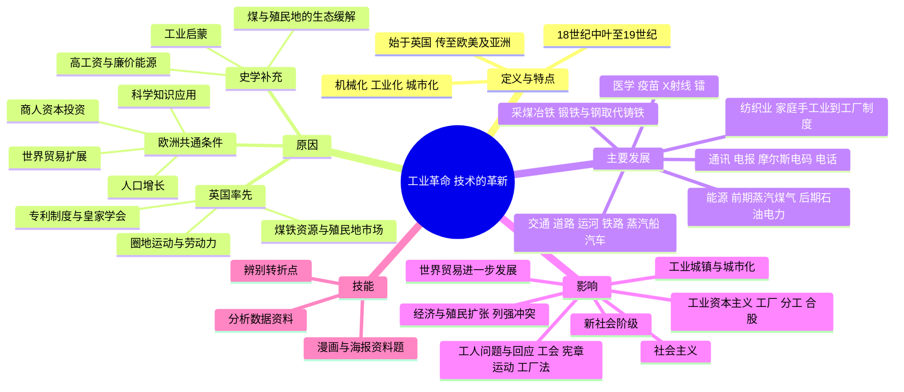
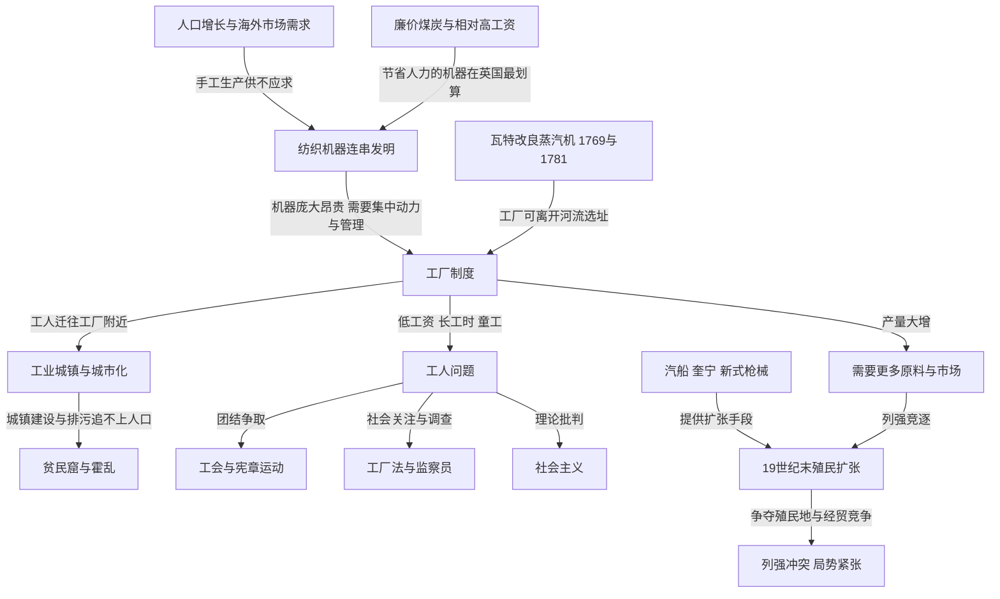

# 🔵 工业革命（技术的革新）｜深析知识包

> 材料：课本《近代欧洲的兴起》C「技术的革新：工业革命」第40—63页（图片1—12，资料5.32—5.59，脚注⑩⑪⑫）
> 模式：深析（默认）｜对象：中二校内考试 + 2030年起DSE历史科「两次工业革命的影响」的预备
> 制作日期：2026-11-13｜语言：简体中文，人名地名用香港课本译名（必要时附内地译名）

---

## 🔵 〇、怎样使用这份知识包

**标记**

| 标记 | 含义 |
|---|---|
| 🔵 | 结构、标题、逻辑框架 |
| ⚫ | 核心史实、概念、课本信息 |
| 🟢 | 课外研究、史学解释、迁移、反事实（拓展，非必背） |
| 🔴 | 必须掌握的考点、关键词、答题关键 |
| 🟡 | 易混易错、作答陷阱、课本表述需修正之处 |

**证据标签**：【所给材料】＝课本截图（未见书名与出版社，不称"官方课本"）；【课本知识】＝课本正文的一般性陈述；【官方评核资料】＝教育局／考评局文件；【学者观点】；【原始史料】。
**证据状态**：【已核实】（本次检索到可靠来源，[R#]对应文末参考资料）｜【推断】｜【待查证】｜【假设性讨论】｜【通用史实】（广泛记载的常识性史实，本次未逐项检索）。

**时间不够时的读法**
1. 只有20分钟：读第七章「核心总结」+ 第六章「易错辨析表」。
2. 有1小时：再读第三章3.3「详细时间线」和第四章「因果链」。
3. 准备论述题：第五章「争议检验」+ 第六章题5示范答案。
4. 做手写笔记：🔴 和 ⚫ 内容抄入笔记；🟢 只记结论一句；🟡 单独做"改错页"。

---

## 🔵 一、本次范围、适用届别与学习路线

### 1.1 范围与届别核对

| 项目 | 核查结果 | 依据 |
|---|---|---|
| 本次材料 | 第40—63页全部正文、资料5.32—5.59、历史冷知识×2、历史深度游×2、历史漫谈×1、历史技能×2、思考点×2、资料分析×1、历史资料题3、脚注⑩⑪⑫ | 【所给材料】 |
| 书籍性质 | 截图未显示书名、出版社；脚注⑫提到「课题6《欧洲国家的殖民扩张》」，与初中课程编排吻合 | 【推断】 |
| 校内课程定位 | 《历史科课程指引（中一至中三）》(2019)：中二「近代世界（15至19世纪）：西力的形成与外延」，课题5「近代欧洲的兴起」的学习重点包括「技术的革新：工业革命」；课题5建议22节（含延伸部分），课题6「欧洲国家的殖民扩张」建议10节；指引提到工业革命又称机器时代、能源转变及童工等社会问题 | 【官方评核资料】【已核实】[R1] |
| 现行DSE（2028届适用） | 卷一历史资料题60%，2小时，全部作答；卷二论述题40%，1小时30分钟，七题选二；评核目标以20世纪为范围——19世纪工业革命不是现行DSE的独立考核范围 | 【已核实】[R2][R5] |
| 你的应届（推算） | 以你目前中二、按正常升班计，约于2031年应考DSE → 适用「高中历史科优化课程框架」：2027/28学年中四全面实施，2030年起文凭试适用 | 【已核实】[R3]；届别为【推断】 |
| 新框架中与本课直接相关部分 | 必修单元1「现代世界的形成」（建议10课时）：1.1「西方的崛起」（5课时）学习重点包括 d)「两次工业革命的影响」——认识两次工业革命对欧洲和北美洲的影响，包括科技与生产力进步、建立近代资本主义体系，以及社会、经济、政治、文化的巨变；1.2「帝国主义的扩张与拉丁美洲和亚洲的反抗」（5课时） | 【官方评核资料】【已核实】[R4] |
| 新框架的公开评核 | 通函只说会更新评核（更灵活、题型更多元客观、兼顾广度与深度），细节由考评局另行公布；截至本次检索，未找到2030年起历史科评核大纲 | 【已核实】[R3]；卷别细节【待查证】 |
| 题目频率 | 新框架尚无任何真题；现行DSE不考19世纪工业革命 → 本包一律标「频率未核实」，不称高频 | — |

**🔴 结论（服务你的两个目标）**
- 校内（中二）：本课是课题5的核心部分，课本所有正文、资料、技能框都可能考，尤其「原因—发展—影响」三大块与两个历史技能（分析数据、辨别转折点）。
- DSE（约2031届）：本课属新框架单元1的背景课题。按课时推算，单元1只占必修190课时中的10课时（约5%）——课时不等于分数，这只是【推断】。真正可直接迁移的是：①「两次工业革命的影响」②卷一常见的数据、漫画、海报资料题技能 ③论述题的「转折点」「影响利弊」写法。
- 🟡 新框架用「两次工业革命」一词；课本用「革命前期／后期」。本包把两者对应起来：前期≈第一次工业革命，后期≈第二次工业革命（时间分界在史学界并不统一，见2.3）。

### 1.2 导图式学习大纲（Mermaid，可在Obsidian直接渲染）



**文字版层级导图（渲染失败时用）**

```
工业革命（18世纪中叶—19世纪；始于英国）
├─ A 定义与特点：机械化｜工业化｜城市化
├─ B 原因
│   ├─ 欧洲共通：人口增长｜世界贸易扩展｜商人投资｜科学知识应用
│   ├─ 英国率先：煤铁＋殖民地（原料、市场）｜圈地运动（劳动力）｜专利与皇家学会（制度、科学）
│   └─ 🟢史学补充：高工资＋廉价煤（艾伦）｜工业启蒙（莫基尔）｜煤＋殖民地（彭慕兰）
├─ C 主要发展
│   ├─ 纺织：家庭手工业制度 → 工厂制度（珍妮纺纱机1764、动力织机1785/1787）
│   ├─ 能源：前期蒸汽、煤气（瓦特1769）｜后期石油、电力（爱迪生1879/1882）
│   ├─ 采煤冶铁：蒸汽抽水；锻铁与钢成本下降
│   ├─ 交通：马克敦式道路｜运河｜蒸汽船1807｜火箭号1829｜汽车1885
│   ├─ 通讯：电报｜摩尔斯电码｜电话
│   └─ 医学：天花疫苗1796｜霍乱、狂犬病疫苗1885｜X射线1895｜镭1898
├─ D 影响
│   ├─ 经济：工业资本主义（工厂制度、分工、合股）｜世界贸易｜殖民扩张
│   ├─ 社会：工业城镇、城市化｜三个新阶级｜工人问题（工资、工时、居住、霍乱、童工）
│   └─ 政治思想：工会｜宪章运动｜工厂法｜社会主义
└─ E 技能：分析数据（趋势、比较、解释）｜辨别转折点（前—中—后）｜漫画资料题
```

**关系说明表（导图分支之间怎样连接）**

| 起点 | 关系性质 | 终点 | 说明（机制） |
|---|---|---|---|
| 人口增长、海外市场 | 因果（需求） | 纺织机器发明 | 手工生产供不应求，节省人力的机器有利可图 |
| 煤炭 | 因果（能源） | 蒸汽机普及 | 煤价低使耗煤的蒸汽机在英国划算 |
| 蒸汽机（尤其1781年后的旋转运动） | 因果（选址） | 工厂制度扩散 | 工厂不必再依河而建，可设于城镇与煤田附近 |
| 工厂制度 | 因果（人口流动） | 城市化 | 工人迁往工厂附近 → 工业城镇 |
| 城市化 | 因果（卫生） | 贫民窟、霍乱 | 城镇建设与排污追不上人口增长 |
| 工人问题 | 因果（回应） | 工会、宪章运动、工厂法、社会主义 | 工人组织争取、国会立法、学者批判 |
| 机器大规模生产 | 因果（原料与市场） | 19世纪末殖民扩张 | 课本资料5.58的解释模型；史学上另有政治、战略、技术解释（见5.4） |

### 1.3 学习路线

1. 先读第二章：建立定义、5W1H、核心概念。
2. 看第三章3.3时间线：把年份串成"前期—后期"两段。
3. 读第三章课本精讲：按课本顺序，每节先看⚫课本要点，再看🟡核查。
4. 读第四章：把"原因→发展→影响"连成因果链；做比较表。
5. 读第五章：学会评价资料、认识史学争议。
6. 做第六章五道题，再看示范答案与"中层 vs 顶层"对照。
7. 用第七章总结背诵，做巩固题。

---

## 🔵 二、主题概览、核心概念与5W1H

### 2.1 一句话抓住本课

⚫ **课本定义**：「工业革命」是指十八世纪中叶至十九世纪，欧洲与美国出现的一场科技变革；始于英国；使欧洲科技水平飞跃发展，为全球经济及社会发展带来深远影响，是近代欧洲兴起的重要阶段。【所给材料】

🔴 **答题版定义（更完整）**：工业革命是约18世纪中叶起首先在英国出现、19世纪扩散至欧美及其他地区的生产方式大转变——以机器和新能源（先是煤炭产生的蒸汽，后有电力、石油）取代人力、畜力，以工厂制度取代家庭手工业，并由此引发城市化、新社会阶级、劳资问题、世界贸易与殖民扩张等连锁变化。

🟡 定义陷阱：工业革命不只是"发明了很多机器"（那只是技术层面），也不是一夜之间的事件；学者对它的起止年份和"革命"一词是否恰当仍有争论（见5.3）。

### 2.2 5W1H 简表

| 要素 | 内容 | 证据与说明 |
|---|---|---|
| **Who 谁** | 发明家与工程师（瓦特、卡特莱特、斯提芬逊父子、爱迪生等）；资本家与投资者；工人（包括妇女与儿童）；英国国会与政府（专利法、圈地法案、工厂法）；工会与宪章派；社会主义者（欧文、圣西蒙、马克思与恩格斯）；殖民地人民 | 【所给材料】；人物细节见4.3 |
| **When 何时** | 课本：18世纪中叶至19世纪；前期（18世纪中叶—19世纪中叶）蒸汽与煤气，后期（19世纪中叶—19世纪末）石油与电力；19世纪初起向外传播 | 【所给材料】。🟢史学常用"约1760—1820/1840年为（第一次）工业革命、1870年后为第二次工业革命"的分法，但分界有争议【已核实（概括性来源）】[R57] |
| **Where 何地** | 始于英国（煤铁产区、棉纺织中心，如曼彻斯特、利物浦、伯明翰、利兹）；19世纪传至欧洲大陆、美国，后至亚洲（如日本） | 【所给材料】；地图资料5.48 |
| **What 发生什么** | 机械化、工业化、城市化；纺织、能源、采煤冶铁、交通、通讯、医学的转变 | 【所给材料】资料5.44 |
| **Why 为什么** | 欧洲层面：人口增长、世界贸易扩展、商人投资、科学知识应用；英国层面：煤铁与殖民地、圈地运动、专利与皇家学会 | 【所给材料】；🟢史学补充见5.3 |
| **How 如何发展** | 纺织业先行机械化 → 瓦特改良蒸汽机使蒸汽成为可靠动力 → 煤铁、交通、通讯相继变革 → 19世纪中叶英国成为领先工业强国 → 技术传播；19世纪后期出现钢、电力、石油等新一波技术 | 【所给材料】；补充见3.3时间线 |

### 2.3 核心概念卡

| 概念（英文） | 含义 | 例子 | 考试怎样用 | 🟡 易混 |
|---|---|---|---|---|
| 🔴 机械化 Mechanisation | 机器逐步取代人力与畜力，成为生产主要动力；此时期亦称「机器时代」 | 珍妮纺纱机、动力织机、蒸汽机 | 描述生产方式转变；转折点题的"中间关键时刻" | ≠工业化（机械化讲生产工具；工业化讲经济结构） |
| 🔴 工业化 Industrialisation | 工业迅速发展，逐渐取代传统农业成为国家经济支柱 | 英国至19世纪中叶成为领先工业强国 | 解释经济结构转变 | ≠城市化（工业化讲产业；城市化讲人口居住） |
| 🔴 城市化 Urbanisation | 大量农村人口迁入工业城镇，城镇人口与面积持续增加 | 资料5.48：1801→1891年英国城镇人口急增；英格兰及威尔斯城市人口比例1801年约34.8%、1851年约50.2%、1901年约77.0% [R41] | 地图资料题、影响题 | 城市化在英国最早，其他欧美国家随工业革命扩展而陆续出现 |
| 🔴 家庭手工业制度 Domestic system | 工人在家中以人手和简单工具小规模生产 | 资料5.37：17世纪家庭纺织场景 | 与工厂制度比较 | 🟢英文史学也常讨论"外发加工制"（商人把原料发给家庭加工），与家庭手工业相关但不完全相同 |
| 🔴 工厂制度 Factory system | 资本家兴建工厂、安置昂贵庞大的机器，雇用大量工人集中操作，进行大规模生产 | 资料5.45、5.47；阿克莱特1771年克朗福德水力纺纱厂【已核实】[R27] | 转折点题、资本主义题 | 早期工厂多靠水力，不是一开始就用蒸汽 |
| 🔴 分工生产 Division of labour | 把生产过程划分为多个专门工序，每名工人只负责一项 | 资料5.46：梳理棉花→纺纱→织布→添加图案 | 解释效率提升 | 🟢亚当·斯密《国富论》(1776)以制针厂说明分工【通用史实】 |
| 🔴 合股制度 Joint-stock company | 发行股票或债券筹集资金，集合资源扩大生产 | 资料5.47流程图 | 解释工业资本主义扩张 | 🟡英国1720—1825年《泡沫法》限制合股公司，早期企业多为家族或合伙经营；1844年起放宽注册、1855/1856年确立有限责任，棉纺业的合股公司热潮要到1870年代才出现（如奥尔德姆）【已核实】[R58] |
| 🔴 资本家 / 工业资本主义 | 拥有机器、矿场等生产资本的商人；他们投入私有财产、通过工厂与合股扩大规模获利 | 资料5.47 | 影响题 | 资本家≠中产阶级（课本分法） |
| 🔴 资产阶级 / 中产阶级 / 工人阶级（无产阶级） | 资产阶级：工业家、商人、矿场经营者，拥有大量生产资源，能影响政府决策；中产阶级：律师、医生、工程师等专业人士；工人阶级：受雇工人，不拥有生产资源 | 资料5.49、5.50、资料题3 | 漫画辨认阶级 | 🟡英语史学的"middle class"常把工厂主、商人也包括在内；考试按课本三分法作答，论述时可注明用语差异 |
| 🔴 工会 Trade union | 工人团结组成的组织，向雇主表达诉求 | 1824年英国废除禁止工人结社的法例 | 工人运动题 | 🟡1825年新法又限制工会活动，1871年《工会法》才确立合法地位【已核实】[R12] |
| 🔴 宪章运动 Chartism | 1838年起以《人民宪章》争取选举改革的运动；三次请愿（1839、1842、1848）均被国会否决 | 资料5.53 | 评价成效 | 🟡《人民宪章》六点全是政治改革（见3.2⑥(d)） |
| 🔴 工厂法 Factory Acts | 国会限制童工、妇女及青年工时的法例；1833年起设工厂监察员 | 资料5.54 | 政府回应、成效 | 🟡1850年法案的对象是妇女与青年，不是成年男工（见3.2⑥(d)） |
| 🔴 社会主义 Socialism | 主张生产资源由社会公有、财富公平分配 | 资料5.55、5.56 | 解释兴起原因 | 🟡「乌托邦派社会主义」是恩格斯等后人加的标签，不是欧文、圣西蒙自称（见3.2⑥(e)） |
| 🔴 能源（课本用法） | 课本把人力、风力、蒸汽、电力等"动力"和水、煤炭、石油等"资源"统称为能源（脚注⑪） | 资料5.44"能源"一行 | 能源转变题 | 🟢科学科：煤、石油是一次能源；蒸汽、电力是由一次能源转换而来的能量载体／动力形式——所以"石油是继蒸汽之后的第二大能源"在概念上不对等 |
| 🔴 转折点 Turning point | 历史不再沿原有趋势，而在某一时刻转向新方向；之后往往出现根本性改变 | 课本例子：纺织业（是）、世界贸易（未必） | 论述题、资料题 | 🟡必须比较前后；只写之后的发展＝只写"影响" |
| 🟢 第二次工业革命 | 约1870年后以炼钢、电力系统、化学、内燃机等新技术为特征的新一波工业化 | 1856年贝塞麦炼钢法、1882年发电站、1885年汽车 | 新框架「两次工业革命的影响」 | 课本称"革命后期"，起点定在19世纪中叶；各书分界不一【已核实（概括性来源）】[R57] |

### 2.4 必须分清的六组概念

| 组别 | A | B | 一句话分清 |
|---|---|---|---|
| 1 | 机械化 | 工业化 | 机械化＝用什么生产；工业化＝靠什么产业养活国家 |
| 2 | 工业化 | 城市化 | 工业化讲经济结构；城市化讲人住在哪里（两者密切相关，但不是同一件事） |
| 3 | 百分比（%） | 百分点 | 煤炭比重由33.5%升至92%＝上升58.5个百分点，相对增幅约175% |
| 4 | 比重下降 | 绝对量下降 | 人力畜力占比由46%降至约6.5%，但绝对能量反而增至约2.2倍（见3.2⑤） |
| 5 | 影响 | 转折点 | 影响只看"之后"；转折点必须比较"之前—期间—之后"，并证明方向根本改变 |
| 6 | 背景／条件 | 直接原因／触发点 | 煤铁资源是长期条件；某项发明是否成为"触发点"须说明它怎样改变发展速度或方向 |

---

## 🔵 三、基础知识、发展脉络与关键转折

### 3.1 资料索引（图片—页码—内容对照）

| 图片 | 页码 | 主要内容 | 资料编号／方框 |
|---|---|---|---|
| 图1 | 40—41 | 导入问题；①技术革新的时代；②工业革命出现的原因(a)—(d) | 资料5.32、5.33、5.34 |
| 图2 | 42—43 | ③英国率先展开工业革命的原因；历史冷知识《垄断法案》；脚注⑩；④主要发展概述 | 资料5.35、5.36 |
| 图3 | 44—45 | (a)纺织业；(b)新能源 (i)革命前期：蒸汽与煤气；脚注⑪ | 资料5.37、5.38、5.39 |
| 图4 | 46—47 | (ii)革命后期：石油与电力；历史深度游「爱迪生」；(c)采煤冶铁；(d)交通(i)陆路 | 资料5.40、5.41 |
| 图5 | 48—49 | (d)(ii)海路；(e)通讯；(f)医学；工业革命前后对照总表 | 资料5.42、5.43、5.44 |
| 图6 | 50—51 | 历史技能：分析数据资料（能源比重表与A、B、C三题） | 能源数据表 |
| 图7 | 52—53 | ⑤影响(a)工业资本主义：(i)工厂制度、分工生产；(ii)合股制度；思考点 | 资料5.45、5.46、5.47 |
| 图8 | 54—55 | 历史技能：辨别转折点（例子1、2）；(b)工业城镇 | 资料5.48 |
| 图9 | 56—57 | (c)新社会阶级；资料分析；(d)(i)工人问题；历史冷知识「霍乱」 | 资料5.49、5.50、5.51、5.52 |
| 图10 | 58—59 | 历史漫谈「童工问题」；(d)(ii)工人运动与其成效 | 资料5.53、5.54 |
| 图11 | 60—61 | (e)社会主义；历史资料题3 | 资料5.55、5.56、资料题漫画 |
| 图12 | 62—63 | (f)世界贸易；历史深度游「世界博览会」；(g)经济与殖民扩张；脚注⑫ | 资料5.57、5.58、5.59 |

### 3.2 课本精讲（按课本顺序；先⚫课本要点，再🟡核查、🟢拓展）

---

#### ① 技术革新的时代（第40页）

⚫ **课本要点**【所给材料】
- 导入问题：甚么是工业革命？工业革命又如何改变欧洲以至世界的面貌？
- 定义：见2.1。
- 三大特点：
  - **机械化**：人们发明并广泛使用新型机器，机械逐步取代人力与畜力成为生产的主要动力；此时期亦因而称为「机器时代」。
  - **工业化**：工业迅速发展，逐渐取代传统农业，成为国家的经济支柱。
  - **城市化**：大量农村人口迁入工业城镇工作，令城镇人口与面积持续增加。
- 资料5.32：工业革命期间发明的动力织机（上）与描绘当时工业城镇的画作（下）；民居与工厂毗邻而建是当时工业城镇的典型景观。

🔴 必背：三个"化"＋各自一个例子。
🟡 照片里的动力织机与画作都是"示意"，资料题若问"从资料可见什么"，只能写画面可见内容（如民居与工厂相邻、烟囱林立、空气污浊），不能补写画面没有的数字。

---

#### ② 工业革命出现的原因（第41页）

⚫ **课本要点**【所给材料】

| 因素 | 课本内容 | 机制（因素→怎样起作用→结果） |
|---|---|---|
| (a) 人口增长 | 18—19世纪欧洲人口大幅上升 | 既提供大量劳动力，也带动对工业制品的需求 → 推动大规模生产与技术改进 |
| (b) 世界贸易的扩展 | 自15世纪起，以欧洲为中心的世界贸易迅速扩展 | 为提升效率以应对全球市场需求 → 积极研发先进技术 |
| (c) 欧洲商人的投资 | 15—18世纪欧洲人从对外贸易赚取大量财富 | 累积资本与潜在可观利润 → 大力投资新发明、改良生产科技 |
| (d) 科学知识的应用 | 科学革命期间出现不少崭新科学理论 | 知识逐渐应用于实际生产（改良机器与技术）→ 奠定基础 |

- 资料5.33「1700至1900年间欧洲人口的增长」：1700年86,300,000；1750年101,800,000；1800年132,000,000；1850年213,000,000；1900年284,000,000。
- 资料5.34「十八世纪初的世界贸易」（地图）：北美洲→欧洲：烟草、酒；西印度群岛→欧洲：糖、棉花；南美洲→欧洲：糖、咖啡、矿产；非洲→欧洲：象牙、矿产；印度→欧洲：香料、棉花；非洲→美洲：黑奴。文字框：欧洲掠夺海外殖民地资源，并发展对外贸易以获取巨额利润；以欧洲为中心的世界经济体系迅速形成。

**资料5.33计算（我据课本数字计算）**

| 时段 | 增幅 | 年均增长率 | 绝对增加 |
|---|---|---|---|
| 1700—1750 | +18.0% | 约0.33% | +1,550万 |
| 1750—1800 | +29.7% | 约0.52% | +3,020万 |
| 1800—1850 | +61.4% | 约0.96% | +8,100万 |
| 1850—1900 | +33.3% | 约0.58% | +7,100万 |
| 1700—1900 | 约3.29倍（+229%） | — | — |

🟡 **核查与易错**
- 资料5.33没有出处，也没说明"欧洲"是否包括俄罗斯；不同学者的估计差别很大。资料题只宜写"趋势"（持续上升、1750年后加速、1800—1850年增长最快），不宜把数字当精确事实背诵。【推断】
- 表中人口在1750年后才明显加速，与工业革命展开同期。**同期≠因果**：人口增长可能推动工业化，工业化带来的就业与粮食供应也可能反过来促进人口增长——两者可能互为因果。单凭此表不能证明"人口增长导致工业革命"。【推断】
- 资料5.34只画了"流向欧洲"的商品和黑奴贸易，省略了经典"三角贸易"的第一程：欧洲船只把纺织品、枪械、酒等制成品运往西非，换取被掳的非洲人。【已核实】[R59] 所以这张图适合说明"欧洲是收益中心"，但不是贸易的完整图像。
- (a)—(d)是"欧洲共通"的条件，不能直接拿来回答"为何英国率先"——那要用③的英国因素，或说明英国在这些条件上比别国更突出。

🟢 **拓展**：彭慕兰（Kenneth Pomeranz）《大分流》(2000) 认为英国得益于"煤"和"美洲殖民地的土地密集产品（如棉花、糖、木材）"，缓解了土地资源的限制——这与资料5.34的商品流向可以互相印证。【学者观点】【已核实】[R52]

---

#### ③ 英国率先展开工业革命的原因（第42页）

⚫ **课本要点**【所给材料】
- **(a) 原料供应与海外市场庞大**：英国本土蕴藏大量煤与铁（重要工业原料）；至18世纪初，英国已拥有多个殖民地，为英国工业提供廉价原料及庞大海外市场。
- **(b) 圈地运动合法化⑩**：自18世纪中叶起，英国通过多项法案使圈地运动合法化 → 很多农民失去耕地，纷纷迁往城市工厂就业 → 为工业发展提供大量劳动力。
  - 脚注⑩：英国早于12世纪已出现圈地；当时不少领主将多块分配给农民耕作的小块土地围封起来，合并成大农场以提高生产效率；此举被批评为剥削农民的土地使用权。
- **(c) 政府支持科技创新**：英国于1623年设立专利制度，保障发明者权益；赋予特许状支持皇家学会进行研究，推动国内科学发展 → 为科技水平奠下良好基础。
- **历史冷知识「一石二鸟的《垄断法案》？」**：1623年英国通过《垄断法案》，创立近代专利制度的雏形；发明者可拥有专利权长达14年，期间他人使用该发明须向原发明者付费。以今日用语说，法案保障了发明者的知识产权与经济回报，鼓励持续创新；又因获取专利需对外公开发明，有助避免其他科学家浪费资源作重复研究；这项近代专利制度的先驱成为英国科技发展领先其他欧洲国家的关键。
- 资料5.35：颁布《垄断法案》的英国君主詹姆士一世。

🟡 **核查与易错**

| 课本说法 | 核查结果 | 校内作答建议 |
|---|---|---|
| 1623年通过《垄断法案》 | 法案在1624年5月29日获御准；因当时法令按会期起始日计算，简称常作"1623"，学者引用1623或1624都有【已核实】[R20] | 按课本写1623年；知道"1624年获御准"即可 |
| 法案目的：设立专利、保障发明者 | 法案主要目的是废除王室滥发的垄断特许（王室借此增加收入）；新发明的专利只是被保留下来的**例外条款**（第6条：授予"真正而首先的发明者"，14年或以下）【已核实】[R20][R21] | 可写"限制王室垄断，同时保留发明专利"——这正好解释课本标题"一石二鸟" |
| 获取专利需对外公开发明 | 书面说明书（公开技术内容）的要求是在18世纪初才逐渐确立；1785年阿克莱特的专利更因说明书不足被判无效【已核实】[R22] → 课本把后来的制度特征套到1623年，属时代错置 | 校内照课本写不会扣分；论述时宜写"专利制度后来发展出公开说明书的要求" |
| 专利制度是英国科技领先的"关键" | 史学上有争议：瓦特把专利延长至1800年，被指在期满前阻碍其他发明者改良蒸汽机【已核实】[R25]；卡特莱特的动力织机专利也因侵权与推广缓慢而少有获利【已核实】[R26] | 宜写"重要的制度条件之一"，避免"关键""唯一" |
| 赋予特许状支持皇家学会 | 皇家学会于1662年获查理二世颁授特许状（第二份特许状1663年），取得出版、通信、拥有财产等法律地位；学会运作主要靠会员会费等自筹，没有国家的经常拨款——据澳洲国家博物馆的介绍，政府在1850年才拨款1,000英镑资助学会的研究【已核实】[R23] | "政府支持"应理解为"王室认可与法律地位"，不是经常资助；颁特许状的是1660年复辟后的查理二世，不要与资料5.35颁布《垄断法案》的詹姆士一世混淆 |
| 圈地运动"合法化" | 12世纪已有圈地；1235年《默顿法令》已准许领主在保留足够牧地的前提下圈占公地；都铎时期为养羊圈地引起争议；18世纪中叶起是以国会法案大规模推行的"议会圈地"，1801年又通过《一般圈地法》【已核实】[R49]。转引资料指圈地法案由1720—1730年的33项增至1790—1800年的506项、1800—1810年的906项【已核实（转引自Mantoux）】[R48] | 更准确的写法："18世纪中叶起，国会通过大量圈地法案，推动大规模圈地" |
| 圈地→农民失地→进城→劳动力 | 有争议：钱伯斯（J. D. Chambers）1953年的经典研究认为议会圈地并未造成大规模离村，劳动力主要来自人口自然增长；其后有学者修正或批评（见5.4争议①）【已核实】[R48] | 校内照课本写；论述题要加"但其作用可能被夸大"的限定 |

---

#### ④ 工业革命的主要发展（第43—49页）

**④-0 概述（第43页）**

⚫【所给材料】
- 18世纪中叶，工业革命率先在英国纺织业展开，并在蒸汽机出现后扩展至冶铁、采矿、造船等重工业。
- 自19世纪初以后，工业革命开始传播至其他欧洲国家、美国，甚至亚洲；至19世纪中叶，英国已成为全球领先的工业与经济强国。
- **资料5.36「工业革命的演进概览」**：英国（①原料供应与海外市场庞大：英国拥有大量工业原料；海外市场为英国工业带来庞大需求。②圈地运动合法化：很多农民失去耕地，为英国提供大量劳动力。③政府支持科技创新：设立专利制度；支持科学研究机构）→ 率先展开工业革命 → **技术革命**（约1750年代展开）：发明珍妮纺纱机 → **动力革命**（约1770年代展开）：瓦特于1769年改良蒸汽机，蒸汽逐渐成为推动机器及交通工具的主要能源 → **交通革命**（约1800年代展开）：新式蒸汽船与蒸汽火车相继问世，铁路建设迅速扩展 → 扩展 → **传播至欧洲及其他地区**（约1800年代展开）：其他欧洲国家仿效英国；英国在海外殖民地建设工厂，把工业革命带到欧洲以外的地区。

🟡 **核查与易错**
- **课本内部张力**：概述说"在蒸汽机出现后扩展至……采矿"，但资料5.39自己写"1712年纽克门发明蒸汽机，主要应用于采矿"。准确的说法：蒸汽机最早就是用于矿井抽水；要到瓦特改良（1769年专利）及1781年发明把往复运动变为旋转运动的装置后，蒸汽动力才能大规模驱动工厂机器。【已核实】[R24]
- 冶铁的突破也比纺织机械化更早开始：1709年达比（Abraham Darby）用焦炭炼铁。【已核实】[R30]
- 资料5.36"技术革命（约1750年代）：发明珍妮纺纱机"——珍妮纺纱机的年份是1764年（资料5.44亦写1764年；1770年取得专利）；"1750年代"只是阶段的大约起点。更早的飞梭（凯伊，1733年）也属纺织技术革新。【已核实】[R27]
- "英国在海外殖民地建设工厂，把工业革命带到欧洲以外"是片面说法：印度在1750年约占世界工业产出的四分之一，至1900年跌至约2%，出现"去工业化"；其原因有争议（莫卧儿帝国衰落带来的内部问题，与英国机制品冲击、世界价格变化等外部因素，两者可能互补）。【已核实】[R39] 论述时应写"工业技术传到部分殖民地，但不少殖民地同时沦为原料产地和英国制品的市场"。
- "至19世纪中叶英国已是领先工业强国"有数据支持：按贝罗克（Paul Bairoch）的人均工业化指数，1860年英国为64，比利时28、美国21、法国20、德国15；有学者估计英国在19世纪中叶约占全球工业产出23%。【已核实】[R39][R40]

**④(a) 革命的起点：纺织业（第44页）**

⚫【所给材料】工业革命前，欧洲人主要在家中以人手与简单工具生产，称为「家庭手工业制度」；18世纪中叶英国人发明并改良纺织机器，纺织业率先变革；许多工人开始在工厂操作机器生产，「家庭手工业制度」逐渐被「工厂制度」（见第52页）取代。资料5.37：17世纪欧洲家庭的模拟场景；工业革命前大部分纺织工序在家中完成。

🟢 课外补充（纺织技术链，均【已核实】[R27]）：飞梭（凯伊，1733年）令织布加快 → 纱线供不应求 → 珍妮纺纱机（哈格里夫斯，1764年发明、1770年专利）、水力纺纱机（阿克莱特，1769年专利；1771年开设克朗福德水力纺纱厂）、走锭纺纱机（克朗普顿，1779年）→ 纱线过剩 → 动力织机（卡特莱特，1785年）。这条"织—纺—织"的追赶链，是解释"一项发明引发另一项发明"的好例子。

**④(b) 新能源的应用（第44—46页）**

⚫【所给材料】工业革命前，人力、畜力、风力、水力与煤炭是欧洲的主要能源⑪，但供应有限或效能不稳定，难以驱动机器长时间运作。脚注⑪：为方便理解，本课文将人力、风力、蒸汽、电力等动力，以及水、煤炭、石油等资源，一律统称为「能源」。

**(i) 革命前期（18世纪中叶至19世纪中叶）：蒸汽与煤气**
- 18世纪瓦特改良蒸汽机，使蒸汽成为稳定可靠的新能源；随后广泛应用于纺织、采矿与运输，生产效率大幅提升。
- 蒸汽被视为推动工业革命发展的重要动力，故工业革命前期又称「蒸汽时代」。
- 欧洲人不仅大量燃烧煤炭产生蒸汽，亦开始利用煤炭制造煤气，用于工业、生火烹饪及照明。
- 资料5.38：瓦特蒸汽机的模型（上），以及18世纪末英国伯明翰的制造厂（右）；因各行各业对蒸汽机需求殷切，瓦特与合伙人在此大量生产蒸汽机。
- **资料5.39「工业革命期间蒸汽机的主要发展」**：
  - 1712：纽克门发明蒸汽机，主要应用于采矿，但尚未广泛普及。
  - 1769：瓦特改良蒸汽机，提升产生蒸汽的速度，并令煤炭耗用量大减；蒸汽机开始应用于多个行业。
  - 1787：卡特莱特发明动力织机，初期以畜力驱动，其后改良为蒸汽动力织机。
  - 1807：富尔敦成功试航蒸汽船「克莱蒙特号」，开启轮船时代。
  - 1829：斯提芬逊研制出蒸汽铁路机车「火箭号」，欧洲由此进入「铁路时代」。

🟡 **核查与易错（资料5.39逐条）**

| 年份 | 课本 | 核查 | 怎样写最安全 |
|---|---|---|---|
| 1712 | 纽克门（内地译纽科门）发明蒸汽机，用于采矿 | 与一般记载一致【通用史实】 | 照写 |
| 1769 | 瓦特"提升产生蒸汽的速度"并大减耗煤 | 瓦特专利名称是"减少火力机蒸汽与燃料消耗的新方法"；关键是**分离冷凝器**，免去汽缸反复冷却与加热，耗煤约为纽克门机的四分之一；1776年首批商用；1781年"太阳与行星齿轮"把往复运动变为旋转运动，才能驱动工厂机器【已核实】[R24][R25]。"提升产生蒸汽的速度"不准确 | 写"改良蒸汽机，大幅减少耗煤；其后加上旋转运动装置，可驱动工厂机器" |
| — | "瓦特与合伙人"（资料5.38） | 合伙人是博尔顿（Matthew Boulton），1775年起合作；专利期满（1800年）前约造近500台【已核实】[R25] | 补充人名 |
| 1787 | 卡特莱特（内地译卡特赖特）发明动力织机 | 1785年4月取得首项专利；1787年完成改良并取得最后一项织布专利，同年在唐卡斯特设厂，先以公牛驱动，1789年改用蒸汽机【已核实】[R26] | 写"1780年代中期（1785年取得专利）"；校内按课本写1787亦可 |
| 1807 | 富尔敦（内地译富尔顿）试航"克莱蒙特号"，开启轮船时代 | 船当时叫"北河蒸汽船"，"克莱蒙特号"是后人借用利文斯顿庄园名的误称；1807年8月在美国哈德逊河由纽约驶往奥尔巴尼；之前已有1783年法国茹弗鲁瓦、1787年美国菲奇等试验船——富尔敦的意义是**首艘商业成功的蒸汽船**【已核实】[R28] | 写"首艘商业上成功的蒸汽船"；注意地点在美国 |
| 1829 | 斯提芬逊（内地译斯蒂芬森）研制"火箭号"，欧洲进入铁路时代 | 1829年10月雷恩希尔竞赛中胜出，主要由罗伯特·斯提芬逊（儿子）制造；它**不是**第一台蒸汽机车（1804年特里维西克已造出）；1825年斯托克顿—达灵顿铁路是首条使用蒸汽机车的公共铁路；1830年利物浦—曼彻斯特铁路成为首条全由蒸汽机车牵引、定时开行的城际铁路【已核实】[R29] | 写"火箭号在竞赛中胜出，标志蒸汽机车可靠，推动铁路时代来临" |

🟡 **"效能不稳定"要限定**：早期工厂多用水力，阿克莱特的克朗福德纺纱厂靠水车可以长时间平稳运转；即使有了瓦特机，一些水力工厂也只把它当作水位低时的后备。【已核实】[R25][R27] 水力的真正限制是"必须依河选址、受季节水量影响"。英国的煤炭也早已大量使用（见⑤能源数据），"供应有限"并不适用于英国煤炭。

**(ii) 革命后期（19世纪中叶至19世纪末）：石油与电力**

⚫【所给材料】
- 19世纪上半叶，石油被发现为高效能燃料；1865年美国铺设全球首条输油管，加快石油运输、提高供应量；其后欧洲亦相继发展石油业；至19世纪末，石油成为继蒸汽之后推动工业革命的第二大能源。
- 美国发明家爱迪生于1879年研制出可长时间发光的电灯泡；至1882年成功启动全球首个电力传输系统，为家庭与工厂提供稳定供电，标志人类正式进入「电力时代」；工厂自此可延长运作时间，产量大幅提升。
- **历史深度游「发明专家爱迪生」**：屡败屡战——早在爱迪生之前已有不少科学家发明电灯泡，但都无法长时间发光；爱迪生购买多项前人电灯泡专利，从中学习并实验，1879年研制出可持久发光的电灯泡并随即量产。只有努力成就天才——1882年在美国纽约设立全球首座中央发电站；电灯泡与电力传输系统带领人类生活进入新时代，对工商业作出重大贡献；他还发明留声机、电影放映机等，一生拥有一千多项专利；名言："所谓天才，就是百分之一的灵感，加上百分之九十九的血汗。"
- 资料5.40：爱迪生与电灯泡（上），以及1882年他启动的中央发电站画作（下）。

🟡 **核查与易错**
- **"第二大能源"不成立**：1900年全球一次能源中，传统生物质（柴薪等）仍略多于一半，煤约占47%，石油所占甚小；石油要到1950年代末才占化石燃料逾四分之一。【已核实】[R36][R37] 19世纪末石油主要用作照明的煤油；石油成为主力是20世纪内燃机普及后的事。另外"继蒸汽之后"把蒸汽（由燃煤产生的动力）和石油（燃料）并列，概念不对等（见2.3"能源"）。
- 现代石油工业一般以1859年德雷克在美国宾夕法尼亚州开凿的商业油井为起点。【已核实】[R36] "1865年全球首条输油管"本次未另行核实【所给材料】。
- **"全球首座／首个"不准确**：爱迪生公司在伦敦霍尔本高架桥的电站于1882年1月已为公众供电，早于同年9月4日启用的纽约珍珠街电站；珍珠街电站是美国首座永久性商业中央电站。【已核实】[R31] 写"爱迪生于1882年建立最早期的中央发电站之一"最稳妥。
- **"电力时代"来得比课本说的慢**：1899年美国工厂装机的机械动力中，只有约5%来自电动机，约30年后才升至80%。【已核实】[R38] 所以"1882年标志正式进入电力时代、工厂自此延长运作"是把起点当成普及。
- 名言常归于爱迪生，本次未核实原始出处，引用时写"相传"。【待查证】

**④(c) 采煤及冶铁工业的发展（第47页）**

⚫【所给材料】工业革命前主要依靠人力采煤，煤井抽水设备不完善；工业材料以铸铁为主，质素更高的锻铁与钢因冶炼成本昂贵尚未普及。工业革命期间利用蒸汽机采煤与抽水，大大提升开采效率；采用新冶炼技术，锻铁与钢的生产成本大幅降低，逐渐取代铸铁成为常用工业材料。

🟢 课外补充（均【已核实】[R30]）：1709年达比以焦炭代替木炭炼铁；1783—1784年科特（Henry Cort）发明轧制与"搅炼法"，以煤炼出锻铁；1856年贝塞麦（Henry Bessemer）转炉炼钢，1870年代后钢才大量普及。🟡 铸铁在工业革命期间本身也被大量使用（如1770年代末建成的铁桥）。

**④(d) 交通运输的改良（第47—48页）**

⚫【所给材料】工业革命前道路质素参差，主要交通工具为牛车、马车与帆船，运输效率十分低下；工业革命期间交通基建改善、新式交通工具面世，运输效率显著提升。
- **(i) 陆路**：开发「马克敦式道路」（内地译麦克亚当式），有效解决路面不平与排水不良；研发蒸汽铁路机车，引领欧美进入建设铁路网络的「铁路时代」；至1885年全球首辆汽车诞生，逐步与铁路机车并列为陆上两大主要交通工具。资料5.41：蒸汽铁路机车（左）及马克敦式道路构想图（右）：①以大碎石筑成碎石层；②以小碎石铺设路面；③在道路两侧挖掘沟渠排水。
- **(ii) 海路**：欧洲各国在工业城镇附近开凿运河，使煤炭、铁等物资运输更高效且成本更低；发明并改良蒸汽船，能运载更多乘客与货物，航程与速度均有所提升。

🟡 "全球首辆汽车"应写"首辆实用的内燃机汽车"：本茨（Karl Benz）的汽车1885年造成，1886年1月29日申请专利；更早在1769年，法国人居纽（Cugnot）已造出蒸汽车。【已核实】[R34] 19世纪末汽车仍极少，"与铁路机车并列为两大交通工具"是20世纪的事。【推断】

**④(e) 通讯的进步（第48页）**

⚫【所给材料】工业革命前主要以邮递书信传递信息，耗时甚久；工业革命期间「摩尔斯电码」及使用电力的电报机与电话装置相继面世，电报与电话通讯日渐普及，信息传递更迅速。资料5.42：发明「摩尔斯电码」的摩尔斯（上）及发明电话的穆齐（下）。

🟡 **核查**
- 电报：英国人库克与惠斯通于1837年取得电报专利，1838年建成首条商业电报线；美国人摩尔斯1832年构思电报，1837年取得专利并示范，1844年5月24日以华盛顿—巴尔的摩线发出"What hath God wrought"。【已核实】[R33] 课本表中"电报机的发明（1832年）"大概对应摩尔斯构思之年。【推断】
- **电话发明人有争议**：课本归功穆齐（Antonio Meucci，内地译梅乌奇），依据是他1871年12月28日提交的专利预告（caveat）；传统上多归功贝尔（Alexander Graham Bell），他在1876年获得电话专利。2002年美国众议院第269号决议表彰穆齐的贡献，但没有撤销贝尔的专利；加拿大国会随即通过动议认定贝尔为发明人；也有学者指穆齐的专利预告没有描述电磁传声。【已核实】[R32] 考试写"1870年代电话面世"最稳妥；若要写人名，按课本写穆齐，并知道有争议。

**④(f) 医学的突破（第48页）**

⚫【所给材料】工业革命前，欧洲人预防疾病的知识有限；工业革命期间城镇贫民窟（见第57页）卫生恶劣，疫症频繁爆发；为此，欧洲人积极研究预防疾病的方法并取得多项突破：
- **免疫疫苗**：针对天花、霍乱与狂犬病的疫苗相继面世，增强人类对相关疾病的免疫力。
- **放射医学**：发现X射线（俗称X光），用来检查人体内部，助医生准确诊断；发现放射性元素「镭」并应用于癌症治疗。
- 资料5.43：发现X射线的伦琴（左）与发现镭的居礼夫妇（右；内地译居里夫妇）。

🟡 **"为此"的因果要收窄**：城市疫症确实推动了公共卫生改革——1848年霍乱流行期间英国通过首部《公共卫生法》【已核实】[R43]，1854年斯诺（John Snow）研究伦敦霍乱与水源的关系【已核实】[R42]；但天花疫苗（1796年）源于詹纳在乡村的观察，伦琴与居礼夫妇的发现属物理、化学研究，都不宜说成"为解决贫民窟疫症而来"。【通用史实】【推断】写法建议："工业革命时期的科学进步和城市卫生危机，共同推动了医学与公共卫生的发展。"

**④(g) 资料5.44「工业革命带来的重要转变」（第49页，全表转录）**

| 范畴 | 工业革命前 | 工业革命后 | 重要发展（课本所列年份） |
|---|---|---|---|
| 纺织业 | 家庭手工业制度：在家中以人手及简单工具生产；小规模生产 | 工厂制度：工人在工厂内操作机器生产；大规模生产 | 珍妮纺纱机（1764）；动力织机（1787） |
| 能源 | 人力、畜力、风力、水力与煤炭为主要能源 | 大量燃烧煤炭，并广泛使用效能更高的新能源，包括蒸汽、煤气、电力及石油 | 瓦特改良蒸汽机（1769） |
| 采煤及冶铁工业 | 采煤高度依赖人力，抽水设备欠完善；工业材料以质量较差但成本较低的铸铁为主 | 运用蒸汽机采煤及抽水，开采效率提升；新冶炼技术大幅降低锻铁与钢的生产成本，两者逐渐成为主要工业材料 | — |
| 交通运输 | 道路质素参差；牛车、马车与帆船为主要交通工具，运输效率甚低 | 交通建设改善；新式交通工具问世，运输效率提升 | 马克敦式道路的采用（1800年代初）；蒸汽船的发明（1807）；铁路机车「火箭号」的发明（1829）；单缸内燃机汽车的发明（1885） |
| 通讯 | 主要以邮递书信传讯息，耗时甚久 | 发明「摩尔斯电码」及使用电力装置，使讯息传递更迅速 | 电报机的发明（1832）；「摩尔斯电码」的发明（1837）；电话的发明（1871） |
| 医学 | 预防疾病的知识有限 | 在免疫疫苗与放射医学领域取得突破性发展 | 天花疫苗的发明（1796）；霍乱与狂犬病疫苗的发明（1885）；X射线的发现（1895）；放射性元素「镭」的发现（1898） |

🟡 表内"发明"一词要小心：蒸汽船（1807）是"首艘商业成功"，火箭号（1829）不是首台机车，电话（1871）有争议，马克敦式道路"1800年代初"是笼统年代。

---

#### ⑤ 历史技能：分析数据资料（第50—51页）

⚫ **课本要点**【所给材料】
- 分析数据时必须留意**标题、时间、单位**等要素。
- 资料：「1659—1859年间英国＊不同能源占总能源耗用量的百分比」（＊资料只涵盖英格兰与威尔斯的数据）

| 年份 | 人力与畜力 | 木炭 | 煤炭 | 水力 | 风力 |
|---|---|---|---|---|---|
| 1659年 | 46% | 19% | 33.5% | 0.8% | 0.7% |
| 1759年 | 27.4% | 9.8% | 61% | 0.6% | 1.2% |
| 1859年 | 6.5% | 0.1% | 92% | 0.1% | 1.3% |

- 课本标注框：标题（1659—1859年间英国不同能源的耗用量）；时间（1659年、1759年及1859年）；单位（不同能源占总能源耗用量的百分比）。
- 三种常见题型：①指出数据的发展趋势（上升／下降／维持不变，并引用数据作证）；②比较不同的数据组合（避免只作个别分析）；③运用个人知识回应（解释数据背后的历史事件或变化原因）。
- A、B、C三题（填充与圈选）的参考答案和完整版答案见第六章题1。

🟡 **数据核查（重要，考试可拉开差距）**
1. **数据来源**：表中数字与经济史学家里格利（E. A. Wrigley）《能源与英国工业革命》(2010) 中英格兰及威尔斯的能源消耗数据完全吻合（我据其绝对值逐项计算比重，误差在四舍五入范围内）。【已核实】[R35]
2. **"1659年"其实是十年平均**：原始数据是1650—1659年、1750—1759年、1850—1859年三个十年的年均值，课本把它简化成单一年份。【已核实】[R35]
3. **"木炭"应为"薪柴"**：原始类别是Firewood（柴薪，包括木柴与木炭），不只木炭。【已核实】[R35]
4. **标注框把标题简化了**：真正标题是"……占总能源耗用量的**百分比**"，标注框写成"……的耗用量"——漏了"百分比"，容易令人误把比重当成用量。【所给材料】这正是第2点技巧"留意单位"的反面教材。
5. **比重≠绝对量**（据里格利原始数据计算，单位：太焦耳TJ）

| 十年 | 人力＋畜力 | 薪柴 | 煤炭 | 总量 | 煤炭比重 |
|---|---|---|---|---|---|
| 1650—59 | 53,780 | 22,200 | 39,060 | 116,820 | 33.4% |
| 1750—59 | 63,370 | 22,560 | 140,810 | 230,850 | 61.0% |
| 1850—59 | 117,890 | 2,240 | 1,689,100 | 1,835,300 | 92.0% |

   - 人力畜力的**比重**由46%跌至约6.4%，但**绝对量**由53,780 TJ增至117,890 TJ（约2.2倍）——它们没有"减少"，只是煤炭增长得更快。
   - 总能源消耗增加约15.7倍；煤炭增加约43倍。
6. **蒸汽机解释不了前半段**：1650年代至1750年代，煤炭比重已由约33%升至61%，绝对量增加约3.6倍——这发生在瓦特1769年改良蒸汽机之前。研究指出，18世纪初以前煤炭主要用于供热（家居取暖、制盐、酿酒、制砖等），早期煤炭增长主要来自家用，例如泰恩河一带的煤运往伦敦。【已核实】[R35] 所以课本C题"因为蒸汽机需要煤炭"主要只能解释1759—1859年的变化；完整答案应把两段分开。
7. **百分点**：煤炭比重1659→1859年上升58.5个百分点（33.5%→92%），相对增幅约175%；人力畜力下降39.5个百分点，相对跌幅约86%。

---

#### ⑥ 工业革命的影响（第52—63页）

⚫ 总述【所给材料】：工业革命彻底改变欧美各国的生产模式，对两地经济与社会发展，甚至全球局势，均产生深远影响。

**⑥(a) 工业资本主义的兴起（第52—53页）**

⚫【所给材料】
- 机器、矿场等成为生产所需的重要资本；拥有这些资本的商人称为「资本家」；他们把私有财产投入生产，并通过工厂制度与合股制度扩大规模以赚取更多利润 → 工业资本主义兴起；资本家与工人之间的贫富差距日益扩大。
- **(i) 工厂制度的形成**：资本家兴建工厂、安置昂贵庞大的机器，雇用大量工人操作机器进行大规模生产；工厂制度逐渐取代家庭手工业制度，成为主要生产模式。资料5.45：画家笔下的19世纪英国纺织厂。
  - 为大规模生产，工厂把生产过程划分为多个专门工序，每名工人只负责一项＝「分工生产」；工人长期重复相同工序，熟能生巧 → 提升效率与产品质素。资料5.46：19世纪棉花工厂的主要专门工序：①梳理棉花 ②纺纱 ③织布 ④添加图案。
- **(ii) 合股制度的发展**：设置大型机器与厂房成本高昂，不少资本家组织合股公司，发行股票或债券筹集资金；合股制度有助集合更多生产资源、扩大规模、赚取更多利润 → 进一步推动工业资本主义发展。
- **资料5.47「工厂制度及合股制度的运作」**（流程）：资本家（"投资机器与厂房成本不低，我们需要筹集资金，组成合股公司。"）→ 投资 → ❶兴建工厂 ❷聘请管理人员与工人 ❸购置机器 → 大规模生产 → 棉织品 → 在市场出售 → 利润 → 吸引投资者（"这间公司有潜质，值得投资！"）→ 投资于资本家发行的股票或债券 → 提供更多资本 → 再投入工厂。
- **思考点**：在工业革命期间，大部分在纺织厂工作的工人都是女性。你知道个中原因吗？

🔴 **思考点参考答案**（课本没有给答案；以下为教学答案）
1. **工资较低**：当时女工工资普遍低于男工，雇用女工可压低成本；有研究指出，当时反对妇女外出做工的观念，也被用来合理化女性的低工资。【已核实】[R19]
2. **机器降低体力要求**：新式纺织机器令工序变得简单重复，不再需要原先熟练纺纱工的技术与体力，于是由妇女和儿童取代。【已核实】[R26]（Fordham史料集导言）
3. **便于管理**：雇主普遍认为女工较顺从、较少组织工会对抗。【推断】（属当时雇主的看法，不是事实判断）
4. **家庭生计**：男工工资微薄，妇女与儿童亦须到工厂或矿场工作帮补家计（课本第57页）。【所给材料】
🟡 "大部分都是女性"是课本说法，本次没有找到可直接核对的全国比例；可核实的是妇女与儿童合计占纺织厂劳动力很大比例，例如1835年一项涵盖英格兰和苏格兰982间棉纺厂的调查显示，约43%工人未满18岁。【已核实】[R17]

🟡 **合股制度的时间要分清**：英国1720—1825年的《泡沫法》限制自由成立合股公司，企业家多以家族企业或合伙方式经营（如著名棉纺厂主格雷格家族）；1825年废除该法，1844年开放公司注册，1855/1856年确立有限责任；棉纺业的合股公司热潮要到1873—1875年才在奥尔德姆出现。【已核实】[R58] 所以资料5.47更适合描述19世纪中后期，而不是工业革命初期的典型做法；运河、铁路等需要巨额资本的行业较早依赖合股集资。【推断】

**⑥(b) 工业城镇的出现（第55页）**

⚫【所给材料】工业革命前大多数欧洲人住在农村；工业革命期间许多农民连同家人迁往工厂附近，以便寻找工作 → 工业城镇兴起；城镇人口不断增加、范围扩大 → 「城市化」。城市化与工业化密切相关；英国是发源地，城市化最早在当地展开；随工业革命向外扩展，其他欧美国家亦陆续出现城市化。

**资料5.48「1801年与1891年英国工业城镇的人口变化」（地图转录）**

图例：● 蓝圆＝人口超过100万；■ 红方＝50—100万；▲ 绿三角＝20—50万；★ 紫星＝10—20万；• 黑点＝少于10万。

| 城镇 | 1801年 | 1891年 |
|---|---|---|
| 伦敦 | ■ 50—100万 | ● 超过100万 |
| 格拉斯哥 | • 少于10万 | ■ 50—100万 |
| 曼彻斯特 | • | ■ |
| 利物浦 | • | ■ |
| 伯明翰 | • | ■ |
| 都柏林 | ★ 10—20万 | ▲ 20—50万 |
| 爱丁堡 | • | ▲ |
| 利兹 | • | ▲ |
| 布里斯托 | • | ▲ |
| 贝尔法斯特 | （未标示） | ▲ |
| 谢菲尔德 | （未标示） | ▲ |
| 诺定咸 | （未标示） | ▲ |
| 亚伯丁 | （未标示） | ★ |
| 莱斯特 | （未标示） | ★ |
| 诺里奇 | （未标示） | ★ |
| 加的夫 | （未标示） | ★ |
| 布莱顿 | （未标示） | ★ |

**读图结论（可直接用于资料题）**
- 1801年图上只有伦敦和都柏林人口超过10万；1891年已有17个城镇超过10万，其中伦敦超过100万，格拉斯哥、曼彻斯特、利物浦、伯明翰达50—100万。
- 增长最急的多是工业或港口城镇（曼彻斯特＝棉纺，利物浦＝港口，伯明翰＝金属制造，谢菲尔德＝钢铁，格拉斯哥＝造船与纺织）。🟢 城镇的产业特征属课外补充【通用史实】。
- 爱尔兰只有贝尔法斯特（亚麻纺织、造船）明显冒起，说明工业化在英国内部也不平均。【推断】

🟡 **口径提醒**
- 这张地图的"英国"包括爱尔兰（1801年起为大不列颠及爱尔兰联合王国）；第50页能源表的"英国"只包括英格兰与威尔斯——同一课两份资料的"英国"范围不同，比较时要注明。
- 地图没有注明数据来源和城市边界（市区还是都会区），不同口径会令城镇落入不同组别。【推断】
- 课外数据：英格兰及威尔斯的城市人口比例1801年约34.8%，1851年约50.2%，1901年约77.0%；英国是首个城市人口过半的社会（1851年）。【已核实】[R41]

**🔵 历史技能：辨别转折点（第54页）**

⚫【所给材料】
- 定义：当历史不再沿原有趋势，而在某一时刻转变并朝新方向发展，该时刻称为「转折点」，可以是年份、事件或思想；转折点之后历史往往出现根本性改变，甚至被视为进入新时代。
- 方法：必须比较其**前后**的历史情况；切忌只关注该时刻之后的发展，否则只是说明其「影响」，未能证实其转折性质。
- **例子1（世界贸易）**：前——欧洲人开辟新航路，促使以欧洲为中心的世界贸易迅速发展；期间——欧洲国家工业产品产量大幅上升，新式交通工具相继出现；后——生产技术与交通运输进步，世界贸易更趋频繁，进一步巩固欧洲在全球贸易的主导地位。结论：世界贸易在工业革命后更频繁，但未出现根本性转变，仍沿原有趋势（以欧洲为中心）→ 工业革命**未必**可视为世界贸易发展的转折点。
- **例子2（纺织业）**：前——纺织工人多在家中以简单工具进行小规模手工生产；期间——欧洲人发明以蒸汽推动的纺织机并应用于纺织业；后——纺织工人在工厂内操作大型机器大规模生产。结论：出现根本性变化，进入「机器时代」——以机器大规模生产取代人手小规模生产 → **可视为**欧洲纺织业发展的转折点。

🟡🟢 **例子1的结论取决于你选的"维度"**（见5.4争议②）
- 若以"贸易中心是否改变"为标准：课本结论成立（中心仍是欧洲）。
- 若以"贸易的规模、商品结构、制成品流向、市场整合程度"为标准：可以论证是转折点——经济史学者奥鲁克与威廉姆森（O'Rourke & Williamson, 2002）以商品价格趋同衡量全球化，认为真正的"全球化大爆发"始于1820年代，由运输成本下降推动；【已核实】[R53] 而印度由世界主要棉布出口地变成英国棉布的市场（见④-0），制成品的流向出现逆转。【已核实】[R39]
- 所以考试时：先界定标准，再判断；**不要**以为课本例子是唯一"标准答案"。课本例子是示范"方法"，结论可以因标准不同而不同。

**⑥(c) 新社会阶级的形成（第56页）**

⚫【所给材料】工业革命前，贵族与农民是西方社会的两大主要阶级；工业革命期间三个新兴社会阶级逐渐形成：
- **资产阶级**：工业家、商人、矿场经营者等从事工业与贸易的人士，私人拥有大量生产资源；因工业发展而致富，甚至能影响政府决策。
- **中产阶级**：律师、医生、工程师等专业人士，依靠学识或专业累积财富，但资产与政治影响力不及资产阶级。
- **工人阶级**：在工厂受雇的工人，工资微薄，不拥有任何生产资源，又称「无产阶级」。
- 资料5.49：画家笔下的一名18世纪法国律师。
- **资料5.50**：一幅19世纪末美国的讽刺漫画，标题为《我们的工业保护者》；漫画中多名周薪不超过11美元的劳工，艰辛地撑起一艘载有四〔名〕百万富翁的船只，在名为「困难时刻」的海洋中航行。（"四"字后一字被装订线遮住，据画面有四名富翁推断为"名"）
- **资料分析**：细阅资料5.50，你认为这幅漫画想传达甚么讯息？

🔴 **资料分析参考答案**：漫画讽刺所谓"工业保护者"——坐在钱袋上的百万富翁——其实并没有保护工业，反而是周薪只有6至11美元的工人在"困难时刻"中用血汗撑起他们的财富；漫画家批评财富集中于少数富豪、工人付出最多却得益最少，反映工业资本主义下严重的贫富不均。
🟢 **出处**：此画为吉勒姆（Bernhard Gillam）所作，刊于美国《Puck》杂志1883年2月7日；四名富翁是菲尔德、古尔德、范德比尔特与塞奇，船身由木材、亚麻、布料等产品堆成，工人身上标明各行业周薪。【已核实】[R44] 有资料把这幅画解读为嘲讽"富豪自称是美国工业保护者"的说法。【已核实】[R44] 由于当时美国正就"保护性关税"激烈辩论，标题中的"保护"可能语带双关。【推断】
🟡 资料5.50反映的是**美国**镀金时代，不是英国；用它解释英国工业革命的阶级问题时，要说明是"同类现象"。资料5.49是18世纪**法国**律师，只能说明"专业人士"的形象，时间地点都不是工业革命中的英国。
🟡 "工业革命前只有贵族与农民两大阶级"是简化说法：城市商人、工匠、教士等早已存在；工业革命带来的变化是"工业资本家"与"大批工厂工人"迅速壮大。【推断】

**⑥(d) 工人问题与政府的回应（第57—59页）**

**(i) 工人问题的出现**

⚫【所给材料】工业革命期间，工人阶级长期受资产阶级剥削，生活困苦：
- **工资微薄**：工资低微，甚至常遭无理扣减；妇女与儿童也要到工厂或矿场工作以协助家庭生计。
- **工时过长与工业意外频繁**：工人每日需工作14至15小时，长期过劳；工厂与矿场缺乏安全设备，导致意外频生。
- **居住环境恶劣**：工业城镇发展追不上人口增长速度，多数工人仅能居住在拥挤及卫生恶劣的贫民窟，疾病因此容易传播。
- 资料5.51：工业革命期间的工厂童工。
- **历史冷知识「犹如黑死病的霍乱？」**：城市化发展迅速，贫民窟大幅增加；排污及垃圾处理设施极度不足，工厂与民居常随意排放污水与排泄物，严重污染饮用水源；恶劣卫生环境成为病菌滋生与传播的温床。19世纪期间欧洲共爆发五次霍乱疫症，死亡率极高，令人联想起中古时代的黑死病；其中1850年代情况最为严重，单是1854年便已在英国造成逾两万人死亡。资料5.52：一幅于1866年发表的英国漫画，以死神比喻受污染的水源是致命霍乱的源头。

🟡 **霍乱数据核查**

| 疫潮（英格兰及威尔斯） | 死亡人数（约） |
|---|---|
| 1831—32 | 约2.2万（另有估计以全英计约3.2万） |
| **1848—49** | **约5.3万（最严重）** |
| 1853—54 | 约2万（大不列颠约2.3万） |
| 1865—66 | 约1.4万 |

来源：【已核实】[R42]（多个二手概括来源一致，数字为近似值）
- 结论：1848—49年疫潮才是英国19世纪最严重的一次；课本"1850年代最为严重"与数据不符；"1854年逾两万人死亡"大致对应1853—54年疫潮。
- "欧洲共爆发五次"取决于怎样划分全球大流行；英国本土通常记为四次主要疫潮（1831—32、1848—49、1853—54、1865—66）。【已核实】[R42]
- 🟡 "剥削"属马克思主义用语，带价值判断；作答时可写"受雇于资本家，工资低、工时长、待遇恶劣"，更客观。

**历史漫谈「童工问题」（第58页，六格漫画转录）**

⚫【所给材料】①随着工厂大量兴建，工业城镇逐渐兴起；由于地主实行圈地运动，华迪的父母被迫迁往城镇，在工厂寻找工作。②然而工人工资微薄，华迪的父母只好让年仅九岁的他到煤矿工作，以帮补家计（"为甚么我们这么穷"）。③童工深受雇主欢迎，因为工资远低于成年人，又能完成一些成人无法应付的工作，例如体型瘦小的华迪可在狭窄坑道中搬运煤炭。④华迪每天工作长达十四小时，失去接受教育的机会；矿坑中更常发生爆炸、坍塌等意外。⑤为加快工作进度，监工经常随意鞭打华迪，令他遍体鳞伤（"偷懒吗？这是你应得的'奖励'！"）。⑥最终一次矿坑事故令华迪重伤（"我还可以工作吗？"）；华迪的处境只是冰山一角，童工问题在工业革命时期的欧洲极为普遍。
**思考点**：工业革命期间童工出现的原因是甚么？

🔴 **思考点参考答案**
1. **家庭贫困**：成年工人工资微薄，家庭需要儿童收入帮补生计（漫画②）。
2. **雇主需求**：童工工资远低于成年人，又能做成人做不到的工作，如在狭窄坑道搬煤、钻到机器下清理（漫画③）。
3. **机械化与分工**：机器把工序拆细，简单重复的工作儿童也能做；经济史学者汉弗莱斯（Jane Humphries, 2010）利用600多部工人自传指出，1790—1850年童工明显增加，机械化与分工是重要原因，失去父亲、子女众多的家庭尤其依赖儿童收入。【学者观点】【已核实】[R18]
4. **缺乏保障**：1833年以前没有有效的法律与监察，亦没有普及义务教育。【推断】
🟡 儿童劳动在工业革命前已存在——家庭手工业中，儿童常负责洗毛、梳理羊毛等工序【已核实】[R27]；工业革命改变的是其规模、地点（工厂、矿场）和强度。

**(ii) 工人运动与其成效**

⚫【所给材料】
- 为改善待遇及生活，工人开始团结组织工会，向雇主表达诉求；1824年英国政府首次承认工会的合法地位；此后英国工人组织积极争取更多权益，例如于1838至1848年间发起「宪章运动」，要求缩短工时、提高工资，并提出改革选举制度，包括赋予年满21岁男子投票权、允许工人代表参政等，以保障工人权益。
- 自1830年代起，英国政府陆续制定法例改善工人劳动条件，回应工人诉求，包括设立标准工时、禁止童工在矿场工作等（见资料5.54）。至于其他国家的工人，直至20世纪初，其处境仍未有明显改善。
- 资料5.53：1840年代宪章运动的宣传海报及集会。

**资料5.53海报转录（主要字句）**：GRAND Demonstration! TO THE MEN & WOMEN of GLOUCESTERSHIRE. TAKE NOTICE! THAT A COUNTY MEETING of the Inhabitants of GLOUCESTERSHIRE will be holden on SELLSLEY HILL, in the Borough of Stroud, on **Whit-Tuesday, May 21st**, to take into consideration the best means to be adopted in order to secure the passing of the PEOPLE'S CHARTER … The Chair will be taken at 12 o'Clock. … Peace, Law, and Order …（小字部分模糊，未转录）

**资料5.54「1833—1850年英国政府通过有关工人年龄及工时限制的法案」（课本图表转录＋核查）**

| 法案 | 课本：不准在工厂／矿场工作 | 课本：每日最长工作时间 | 核查结果 |
|---|---|---|---|
| 1833年工厂法案 | 9岁以下（儿童） | 9—13岁：8小时；13—18岁：12小时 | ✅大致正确：适用于纺织厂；9—13岁每周不超过48小时、每日8小时（亦有资料写每日上限9小时）；13—18岁每日12小时；童工每日须上学2小时；设4名工厂监察员【已核实】[R6][R7] |
| 1842年矿务法案 | 10岁以下儿童；妇女 | — | ✅正确：禁止妇女与10岁以下男童在井下工作【已核实】[R7][R8] |
| 1844年工厂法案 | — | 9—13岁：6.5小时；妇女：12小时 | ⚠️年龄有误：该法把童工年龄下限由9岁**降至8岁**，规定8—13岁儿童每日工作6.5小时（"半工半读"）；妇女与青年同样每日最多12小时【已核实】[R8][R9] |
| 1847年工厂法案 | — | 妇女、青年：10小时 | ✅正确（俗称"十小时法案"）【已核实】[R8] |
| 1850年工厂法案 | — | **男子图标**：10.5小时 | ❌对象有误：1850年法案规定的是**妇女与青年**每日（周一至周五）10.5小时、周六7.5小时，并把工作时间限定在日间（夏季早上6时至晚上6时，冬季可为早上7时至晚上7时），以堵塞"接力制"漏洞；它并没有直接限制成年男工——有历史学者指出，男工仍可在童工接力协助下工作15小时【已核实】[R9][R10][R11] |

🟡 **由此看出三个可以写进答案的观点**
1. 工厂法主要保护儿童、青年和妇女；成年男工长期没有法定工时保障。
2. 法律≠执行：1833年全国只有4名监察员；1844年后雇主用"接力制"规避，1850年法案甚至以把妇女青年工时由10小时**增至**10.5小时作交换，换取取消接力制——改善是曲折的。【已核实】[R6][R11]
3. 1833年并非第一部工厂法：1802年和1819年已有法例，但1833年首次设监察员，才较有效。【已核实】[R7]

🟡 **工会与宪章运动核查**
- **工会**：1824年废除禁止工人结社的法例后罢工频生，1825年新法又把工会活动限于商议工资与工时，纠察等行为仍可被检控；1871年《工会法》才确立工会的合法地位。【已核实】[R12] → 课本"1824年首次承认合法地位"只是起点。
- **宪章运动**：1838年由伦敦工人协会的洛维特等人起草《人民宪章》，六点要求是：①21岁以上男子普选权 ②秘密投票 ③取消议员财产资格限制 ④议员支薪 ⑤平均选区 ⑥每年改选国会。【已核实】[R13][R14][R15] **六点全是政治改革，没有"缩短工时、提高工资"**——课本把运动支持者的经济诉求与宪章的正式内容混在一起。宪章运动的背景之一是1832年改革法案几乎没有扩大工人阶级的政治权利。【已核实】[R13]
- **成效**：1839、1842、1848年三次请愿均被国会否决，短期失败；但至1918年，六点中有五点已实现（只有每年改选国会未实现）。【已核实】[R13]

🟡 **资料5.53的日期**：海报写"Whit-Tuesday, May 21st"（圣灵降临节后的星期二，5月21日）。按复活节推算，1830—1865年间只有1839、1850、1861年的圣灵降临节星期二落在5月21日（我以复活节算法计算）；而地方史资料记载，1839年5月21日星期二，约5,000人在塞尔斯利公地（Selsley Common，海报拼作Sellsley）举行宪章派集会。【已核实】[R16] → 海报应属**1839年**，不是课本标题所说的"1840年代"；下方集会照片课本未注明年份。【推断】这是用"史料内证"判断年代的好例子。
- 海报用"Peace, Law, and Order（和平、法律与秩序）"，显示这次集会采取守法、和平请愿的路线。【推断】

🟡 "其他国家的工人直至20世纪初仍未有明显改善"过于笼统；欧洲各国在19世纪后期陆续出现劳工与社会立法（例如德国1880年代的社会保险）。【通用史实】

**⑥(e) 社会主义的提出（第60页）**

⚫【所给材料】
- **(i) 由来**：工业革命期间资本主义盛行，贫富悬殊日益严重；部分学者批评资本主义容许少数资本家私人拥有大量生产资源，并借此剥削工人阶级以积累巨额财富；因此主张生产资源应由社会公有，财富应公平分配——这些新思想统称「社会主义」。
- **(ii) 发展**：社会主义分不同派别，较具代表性的有英国学者欧文与法国学者圣西蒙提出的「乌托邦派社会主义」，以及德国学者马克思与恩格斯倡导的「共产主义」（又称马克思主义）；随工业革命向外扩展，社会主义传播至多个工业国家，其中以共产主义理论最受关注，其理念及相关运动对西方乃至全球发展产生深远影响。
- 资料5.55：马克思（下）与恩格斯（上）于1848年共同撰写《共产党宣言》，主张工人阶级推翻资产阶级，建立社会主义社会。
- **资料5.56「社会主义学者眼中的资本主义弊病与解决方法」**：弊病——①生产资源由少数资本家私人拥有 ②资本家要求工人长时间工作，却只支付微薄工资 ③贫富悬殊日益严重；解决方法——①生产资源由全民共同拥有 ②工人的付出与报酬成正比，实现财富公平分配 ③社会阶级界线逐渐消除。

🟡 **标签与人物要准确**
- 「乌托邦社会主义」（内地多译"空想社会主义"）这个名称，是恩格斯在1880年《社会主义从空想到科学的发展》中推广的，用来区别于他和马克思的"科学社会主义"；它是后人的批评性标签，不是欧文、圣西蒙的自称。三位代表通常是圣西蒙、傅立叶与欧文。【已核实】[R56]
- 欧文是出身威尔士的**工厂主**与社会改革家（经营苏格兰新拉纳克纺织厂），不是一般意义的"学者"。【已核实】[R56]
- 圣西蒙设想由实业家与科学家等"最有能力者"领导的工业社会，并不主张生产资源公有——把他放进"生产资源公有"的定义里并不贴切。【已核实】[R56]
- 🟢 恩格斯1845年出版《英国工人阶级状况》，记录曼彻斯特等地工人的处境，是他与马克思理论的重要经验来源之一。【已核实（概括性来源）】[R57]

**思想传承关系表**（区分直接影响、相近观点与后世追认）

| 关系 | 内容 | 性质 |
|---|---|---|
| 欧文、圣西蒙、傅立叶 → 马克思、恩格斯 | 恩格斯在著作中评述并吸收三人对资本主义的批判，同时批评他们缺乏阶级斗争分析 | 直接影响＋批判继承 |
| "乌托邦社会主义"一词 | 恩格斯1880年推广的分类 | 后世追认（标签） |
| 圣西蒙 ↔ 欧文 | 同属早期社会改革思想，但一重实业家与科学家领导，一重合作社区与工人福利 | 相近观点，非师承 |

**⑥ 历史资料题3（第61页）**

⚫【所给材料】目标：认识工业革命对欧洲社会的影响；程度：3（阐释资料，并运用个人的历史知识与理解）。
- 资料：一幅有关19世纪英国的漫画，标题为《壮大的牺牲！》。画面标注：阶级A（站在台上操纵机器者）、阶级B（从楼梯被倒进机器的人群）、绞肉机、成衣产品、利润（台下钱袋，台座刻有PROFITS）、顾客（右方商店内，招牌可辨"CHEAP … HOUSE"）。
- 问题：1. 辨别漫画中的两个阶级（阶级A是____，阶级B是____）。2. 漫画家认为19世纪的成衣生产存在甚么问题？（填充：牺牲阶级____的性命才得以持续；阶级____掉进「____」，令机器不断制造成衣产品及利润。）3.「工业革命导致严重的社会不平等。」试根据资料，并就你所知，解释此说法。（个人所知提示：工业革命造成两个阶级之间的贫富与地位差距持续扩大）
- 参考答案与"中层 vs 顶层"对照见第六章题2。

🟢 **出处考证**：英国威廉森美术馆的藏品著录显示，克鲁克香克（George Cruikshank）有一幅蚀刻画题为"Tremendous Sacrifice!"，内容是"面目狰狞的牟利者把穷人赶进绞肉机，前方是富有女士光顾的布料店"，与本漫画吻合；另有作品目录把它注为"the sweating system（血汗制度）"。【已核实】[R45] 课本的《壮大的牺牲！》应是这个标题的译名；作品年份本次未能核实。【待查证】
🟢 **背景**：1850年金斯莱（Charles Kingsley）发表《廉价而恶劣的衣服》，揭露伦敦成衣业层层转包的"血汗制度"：中间人（sweater）把工作分包，工人挤在阁楼里同吃同住同工作。【已核实】[R46] 因此漫画中的"绞肉机"是比喻——当时廉价成衣很大程度依赖外发的手工缝制，而不全是机器生产。【推断】

**⑥(f) 世界贸易的进一步发展（第62页）**

⚫【所给材料】工业革命期间的技术革新促使西方国家不断扩大生产规模；以英、法、德、美为首的工业强国从世界各地（包括殖民地）大量进口原材料投入生产，再将工业制品大规模出口至全球市场；随交通运输与通讯工具改良，国际贸易与科技交流日益频繁。
- **历史深度游「世界博览会」**：先进生产技术是各国的商业机密，也是引以为傲的「硬实力」；已有170多年历史的世界博览会（简称「世博」）是展示硬实力的重要舞台之一。**第一届世博**：1851年5月于伦敦揭幕，约有30个国家参展；主办国英国展示多项创新成果，包括新式织布机、印刷机与蒸汽铁路机车等，技术领先，令其他参展国相形见绌。**水晶宫**：首届世博展馆，设计师运用超过30万块玻璃铺设外墙与门窗，打造晶莹通透的建筑，展现英国在科技、工艺与艺术上的成就；场馆造价高昂，但吸引约600万人参观，带来可观收益，使英国实现「名利双收」。资料5.57：1851年参展国在水晶宫设置展览的情形。

🟡 **核查**：水晶宫用了293,655块玻璃，"近30万块"比"超过30万块"准确；参观人次约600万；盈利约18.6万英镑，用于在伦敦南肯辛顿购地兴建博物馆区（今维多利亚与艾伯特博物馆、科学博物馆等）。【已核实】[R47] 参展国家数目各来源说法不一，本次未能核实。【待查证】

**⑥(g) 西方国家的经济与殖民扩张（第63页）**

⚫【所给材料】经历工业革命后，西方国家的经济与科技实力大幅提升，希望获取更多生产原料并拓展海外市场；西方列强凭借国力优势，加紧在亚、非、拉丁美洲进行经济与殖民地扩张，掀起19世纪末新一轮殖民浪潮⑫。至20世纪初，西方国家已在亚、非两洲建立众多殖民地，一个以西方为中心的全球经济体系逐渐形成；然而抢夺殖民地与经贸竞争也引发西方国家之间的冲突，令全球局势日渐紧张。脚注⑫：有关这一轮殖民浪潮的更多资料，可参阅课题6《欧洲国家的殖民扩张》。
- **资料5.58「工业革命后西方国家与殖民地的关系」**（循环图）：工业上应用机器，令产量大大提高 → 导致 → 西方工业国家需要更多资源生产（图示煤、石油）／需要寻找更多海外市场来消费商品 → 导致 → 西方工业国家在亚、非、拉丁美洲进行经济与殖民地扩张 → 再导致机器生产扩大。
- **资料5.59「十九世纪末欧洲国家的殖民地及其控制的资源」**（地图）：图例——比利时、英国、丹麦、法国、德国、意大利、荷兰、葡萄牙、西班牙殖民地；资源框——亚洲（印度、东南亚一带）：矿产、石油、香料、茶叶；大洋洲（澳洲）：羊毛；北美洲（加拿大）：木材；非洲及南美洲：可可豆、咖啡豆、水果、矿产、木材。

🟡🟢 **解释模型要有边界**
- 资料5.58是编者画的**解释模型**，不是史料；它只呈现经济动机。经济解释可追溯至霍布森《帝国主义》(1902) 及列宁的理论；加拉格尔与罗宾逊《自由贸易帝国主义》(1953) 则强调英国早已通过"非正式帝国"扩张，19世纪末的瓜分是长期政策的延续，并引起许多后续辩论。【学者观点】【已核实】[R54]
- 工业革命还提供了扩张的**手段**：赫德里克《帝国的工具》(1981) 指出，汽船、奎宁（预防疟疾）与后膛枪等技术，使欧洲人能深入非洲与亚洲内陆。【学者观点】【已核实】[R55]
- 这部分直接连到新DSE框架1.2「帝国主义的扩张与拉丁美洲和亚洲的反抗」[R4]，值得多花时间。
- 地图细节：19世纪末的"比利时殖民地"（刚果）当时其实是比利时国王利奥波德二世的私人领地，1908年才由比利时政府接管。【通用史实】

---

### 3.3 详细时间线（★＝关键转折；「课」＝课本有载；「补」＝课外补充）

| 时间 | 关键事件／文件／人物 | 阶段特点 | 意义 | 来源 |
|---|---|---|---|---|
| 15世纪起 | 以欧洲为中心的世界贸易扩展；海外贸易累积资本 | 长期背景 | 市场与资本 | 课 |
| 1623/1624 | 《垄断法案》：保留发明专利（14年或以下） | 制度条件 | 发明可获法定回报 | 课；补[R20] |
| 1662 | 皇家学会获查理二世颁特许状 | 科学革命 | 科学交流制度化（无经常性国家拨款） | 课；补[R23] |
| 1709 | 达比以焦炭炼铁 | 煤铁结合 | 摆脱木炭限制 | 补[R30] |
| 1712 | 纽克门蒸汽机，用于矿井抽水 | 早期蒸汽 | 蒸汽首先服务采矿 | 课 |
| 1733 | 凯伊发明飞梭 | 纺织革新起步 | 织布加快、纱线供不应求 | 补[R27] |
| 18世纪中叶起 | 议会圈地法案大增 | 农业与土地制度变化 | 劳动力来源之一（有争议） | 课；补[R48] |
| 1764 | 哈格里夫斯珍妮纺纱机（1770年专利） | 纺纱机械化 | 一人可同时纺多根纱 | 课 |
| ★1769 | 瓦特分离冷凝器专利；阿克莱特水力纺纱机专利 | 动力革命开端 | 蒸汽机大幅省煤；工厂生产成形 | 课；补[R24][R27] |
| 1771 | 阿克莱特克朗福德水力纺纱厂 | 工厂制度 | 集中生产的样板 | 补[R27] |
| 1776 | 博尔顿—瓦特首批蒸汽机投入使用 | 商业化 | 发明变成产品 | 补[R24] |
| 1779 | 克朗普顿走锭纺纱机 | 纺纱精细化 | 高质棉纱 | 补[R27] |
| ★1781 | 瓦特"太阳与行星齿轮"旋转运动 | 蒸汽进入工厂 | 工厂可脱离河流选址 | 补[R24] |
| 1783—84 | 科特轧制与搅炼法 | 锻铁量产 | 铁材更便宜 | 补[R30] |
| 1785/1787 | 卡特莱特动力织机（1785专利；1787完成改良、设厂） | 织布机械化 | 推广缓慢，后经多人改良 | 课；补[R26] |
| 1796 | 天花疫苗 | 医学 | 预防医学突破 | 课 |
| 1801 | 《一般圈地法》 | 圈地 | 简化圈地程序 | 补[R49] |
| 1802、1819 | 早期工厂法 | 劳工立法起步 | 缺乏监察，成效有限 | 补[R7] |
| 1804 | 特里维西克首台蒸汽铁路机车 | 交通 | 机车技术起步 | 补[R29] |
| 1807 | 富尔敦"北河蒸汽船"（后称克莱蒙特号） | 交通（美国） | 首艘商业成功的蒸汽船 | 课；补[R28] |
| 19世纪初 | 工业革命传至欧洲大陆、美国 | 扩散 | 英国优势开始被追赶 | 课 |
| 1824/1825 | 废除禁止结社法／新法限制工会 | 工人组织 | 工会合法化的起点 | 课；补[R12] |
| 1825 | 斯托克顿—达灵顿铁路 | 铁路 | 首条用蒸汽机车的公共铁路 | 补[R29] |
| ★1829—30 | 火箭号赢得雷恩希尔竞赛；利物浦—曼彻斯特铁路通车 | 铁路时代 | 城际铁路网络兴起 | 课；补[R29] |
| 1832 | 改革法案；摩尔斯构思电报 | 政治／通讯 | 工人仍无投票权 → 宪章运动背景 | 课；补[R13][R33] |
| 1831—32 | 英国首次霍乱疫潮 | 城市卫生 | 城市问题暴露 | 补[R42] |
| ★1833 | 工厂法：设4名监察员 | 政府介入 | 首部较有效的劳工法例 | 课；补[R6] |
| 1837—38 | 库克与惠斯通电报专利（1837）、首条商业电报线（1838）；摩尔斯电码 | 通讯革命 | 信息与运输分离 | 课；补[R33] |
| 1838 | 《人民宪章》六点 | 宪章运动 | 工人争取政治权利 | 课；补[R13] |
| 1839 | 宪章运动首次请愿被否决；5月21日塞尔斯利集会（资料5.53海报） | 宪章运动高峰 | 短期失败 | 补[R13][R16] |
| 1842 | 矿务法；宪章运动第二次请愿 | 劳工立法 | 禁止妇女及10岁以下男童下井 | 课；补[R7] |
| 1844 | 工厂法：8—13岁童工每日6.5小时；妇女每日12小时 | 劳工立法 | 首次规管妇女工时 | 课（年龄有误）；补[R8] |
| 1844 | 华盛顿—巴尔的摩电报线 | 通讯（美国） | 电报实用化 | 补[R33] |
| 1845 | 恩格斯《英国工人阶级状况》 | 批判思想 | 记录工人处境 | 补[R57] |
| 1847 | "十小时法案" | 劳工立法 | 妇女、青年每日10小时 | 课 |
| 1848 | 《共产党宣言》；宪章运动第三次请愿；《公共卫生法》 | 思想与改革 | 社会主义理论成形 | 课；补[R43] |
| 1848—49 | 英格兰及威尔斯霍乱约5.3万人死亡 | 城市卫生 | 19世纪最严重疫潮 | 补[R42] |
| 1850 | 工厂法：妇女、青年10.5小时，限于日间（夏季早6至晚6） | 劳工立法 | 以延长工时换取取消接力制 | 课（对象有误）；补[R10] |
| ★1851 | 伦敦世博（水晶宫）；英格兰及威尔斯城市人口过半 | 英国领先 | "世界工厂"形象；首个城市化社会 | 课；补[R41][R47] |
| 1853—54 | 英国霍乱约2万人死亡；1854年斯诺研究伦敦霍乱 | 公共卫生 | 水源传播证据 | 课；补[R42] |
| ★1856 | 贝塞麦转炉炼钢 | 第二次工业革命先声 | 廉价钢材（1870年代后普及） | 补[R30] |
| 1859 | 德雷克在宾夕法尼亚开凿商业油井 | 石油工业 | 现代石油业开端 | 补[R36] |
| 1865 | 美国首条输油管 | 石油运输 | — | 课 |
| 1871 | 英国《工会法》；穆齐提交电话专利预告 | 工会合法化／通讯 | 工会获确立的合法地位 | 课；补[R12][R32] |
| 1876 | 贝尔获电话专利 | 通讯 | 电话发明权争议 | 补[R32] |
| 1879 | 爱迪生长寿命电灯泡 | 电力 | 电灯实用化 | 课 |
| ★1882 | 爱迪生伦敦霍尔本高架桥电站（1月）、纽约珍珠街电站（9月） | 电力时代起点 | 集中发电供电 | 课；补[R31] |
| 1883 | 《Puck》漫画《我们的工业保护者》（资料5.50） | 美国镀金时代 | 贫富悬殊的舆论批评 | 课；补[R44] |
| 1885 | 本茨汽车（1886年1月专利）；霍乱与狂犬病疫苗 | 内燃机 | 汽车起步 | 课；补[R34] |
| 1895、1898 | X射线、镭 | 放射医学 | 诊断与治疗突破 | 课 |
| 19世纪末 | 新一轮殖民浪潮（新帝国主义） | 帝国扩张 | 列强冲突加剧 | 课 |
| 1900 | 全球能源：传统生物质仍逾一半，煤约47% | 能源 | 石油尚未成为主力 | 补[R36] |
| 1918 | 宪章六点中五点已实现 | 长期成效 | 宪章运动的长远影响 | 补[R13] |

### 3.4 阶段划分与关键转折判断

| 阶段 | 时间（约） | 特点 | 主导部门 | 领先地区 |
|---|---|---|---|---|
| 酝酿期 | 17世纪—18世纪中叶 | 煤炭已广泛用于供热；贸易与殖民扩张；科学革命；焦炭炼铁、纽克门蒸汽机 | 煤炭、羊毛与棉布贸易 | 英国、荷兰 |
| 前期／第一次工业革命 | 18世纪中叶—19世纪中叶 | 纺织机械化、工厂制度、蒸汽动力、铁路 | 棉纺织、煤铁、铁路 | 英国一枝独秀 |
| 后期／第二次工业革命 | 19世纪中叶（课本）或1870年代（常见分法）—19世纪末／1914 | 廉价钢、电力、化学、内燃机、石油起步 | 钢铁、电力、化学 | 美国、德国追上并超越 |

**真正的转折点（附判断标准）**
- **1769—1781年瓦特蒸汽机改良**：标准＝"动力来源是否改变"。之前蒸汽机耗煤大、只宜抽水；之后蒸汽机省煤、能产生旋转运动，工厂可脱离河流选址——动力格局根本改变。
- **1829—1830年火箭号与利物浦—曼彻斯特铁路**：标准＝"陆上运输方式是否改变"。之前陆运靠马车、运河；之后有定时开行、全由蒸汽机车牵引的城际铁路。
- **1833年工厂法**：标准＝"国家是否介入劳资关系"。之前法例缺乏执行机制；之后设监察员，政府开始系统规管工厂（但只保护部分工人，见3.2⑥(d)）。
- **1856年贝塞麦炼钢法、1882年发电站**：标准＝"关键材料与能源是否换代"——第二次工业革命的起点（普及要到1870年代至20世纪初）。

### 3.5 时期趋势总结及其例外

**主要趋势**：①生产由家庭走向工厂；②能源由人力畜力、柴薪转向煤炭，后期再添电力与石油；③人口由农村流向城市；④社会由"贵族—农民"格局转向"资本家—中产—工人"格局；⑤国家由放任逐步走向立法规管；⑥世界经济由欧洲商业主导转向西方工业主导，并伴随新一轮殖民扩张。

**限制这一总结的阶段与例外**
- 煤炭转型在英国早于工业革命开始（1650年代煤已占约三分之一能源），不是工业革命一开始才发生。
- 水力在早期工厂长期重要，蒸汽并非一开始就取代一切。
- 1780—1840年工人实际工资几乎停滞（"恩格斯停顿"），1840年后才明显上升（见5.4争议③）——"工业革命改善生活"在时间上要分段。
- 欧洲各地差距极大：19世纪中叶英国已高度工业化与城市化，俄国等地仍以农业为主（贝罗克指数1860年英国64、俄国8）。【已核实】[R39]
- 殖民地的工业化方向往往相反（如印度去工业化）。

---

## 🔵 四、因果链、人物／制度、影响及相关比较

### 4.1 原因分析：六个方面的检查

| 方面 | 课本因素 | 机制（因素→怎样起作用→造成甚么变化→怎样影响结果） | 证据边界 |
|---|---|---|---|
| 经济 | 人口增长；世界贸易扩展；商人投资；英国煤铁与殖民地市场 | 需求上升＋资本积累 → 投资节省人力的机器 → 产量上升 → 工厂制度扩展 | 人口与工业化可能互为因果；早期工厂多靠合伙、家族资金与利润再投资[R58] |
| 社会 | 圈地运动 → 劳动力 | 部分农民失去公地使用权 → 成为工资劳动者 → 供应工厂 | 规模有争议，人口自然增长可能更重要[R48] |
| 政治／制度 | 专利制度；皇家学会特许状；国会圈地法案 | 产权保障 → 发明者预期获利 → 投资研发 | 专利亦可能阻碍改良（瓦特）[R25] |
| 思想文化 | 科学革命、科学知识应用 | 实验方法与知识 → 改良机器 | 🟢莫基尔"工业启蒙"强调实用知识与熟练技工[R40]；但不少早期发明出自工匠而非科学家【推断】 |
| 国际 | 以欧洲为中心的贸易；殖民地 | 原料（棉花）与市场 → 扩大生产 | 🟢彭慕兰：美洲殖民地的土地密集产品缓解资源限制[R52] |
| 技术／资源 | 煤铁资源 | 廉价煤 → 蒸汽机划算；焦炭炼铁 | 🟢艾伦：高工资＋廉价能源令"以资本和能源代替人力"的技术在英国最有利可图[R50] |

**原因的层次（不要把它们混为一谈）**

| 层次 | 内容 | 说明 |
|---|---|---|
| 长期背景 | 15世纪以来的海外贸易与殖民扩张；科学革命 | 提供市场、资本、知识，但欧洲多国都有 |
| 结构性条件 | 英国的煤铁、相对高的工资、产权制度、国内统一市场 | 解释"为何在英国" |
| 短期因素 | 18世纪中叶棉纺织品需求上升、纱线供不应求 | 推动一连串纺织发明 |
| 触发点 | 工业革命**没有**单一"导火线"；若硬要举，瓦特改良蒸汽机（1769/1781）是动力上的关键一步 | 🟡不要把某一发明写成"唯一导火线" |
| 人物选择 | 瓦特与博尔顿合伙、阿克莱特建立工厂模式 | 个人作用须放回市场与资源条件中看 |

**根本原因怎样判断**：先定标准——
- 若标准是"为何发生在英国而非法国、荷兰或中国"：艾伦与彭慕兰都把"相对价格与资源"（廉价煤、高工资、殖民地资源）放在核心，因为这些条件是英国独有或最突出的。
- 若标准是"为何技术能持续改进而不是一次性发明"：莫基尔强调知识传播与技工群体。
- 结论：本包**不设唯一根本原因**；答题时可以说"以'为何在英国'为标准，廉价能源与高工资构成的相对价格条件最具解释力"，并承认这是学者解释。

### 4.2 因果链



**文字版（每个箭头都写机制）**
1. 需求链：人口增长＋海外市场 →（手工生产供不应求）→ 纺织发明 →（机器需集中动力与管理）→ 工厂制度。
2. 能源链：廉价煤 →（耗煤机器在英国划算）→ 蒸汽机普及 →（工厂可设于城镇）→ 工厂集中于城市。
3. 社会链：工厂制度 →（工人迁居）→ 城市化 →（建设追不上人口）→ 贫民窟、疫症 →（社会压力）→ 公共卫生改革。
4. 劳资链：工厂制度 →（工资低、工时长、童工）→ 工人问题 →（组织、请愿、调查、理论）→ 工会、宪章运动、工厂法、社会主义。
5. 国际链：大规模生产 →（原料与市场需求）＋ 新技术提供手段 → 殖民扩张 →（竞逐）→ 列强冲突。
🟡 第5条的"需求"一环是课本资料5.58的解释模型；史学上还有战略、民族主义等解释（见5.3）。

### 4.3 人物与群体（把人放回时代）

| 人物／群体 | 目标与处境 | 资源与选择 | 实际结果 | 个人作用 vs 结构条件 |
|---|---|---|---|---|
| 瓦特 | 修理纽克门机时发现其浪费蒸汽 | 发明分离冷凝器；与博尔顿合伙，专利延长至1800年 | 至1800年约造近500台；蒸汽机进入工厂[R25] | 依赖伯明翰的制造能力与资金；专利亦被指阻碍他人改良 |
| 卡特莱特 | 牧师，非纺织行内人 | 1785年取得动力织机专利，自设工厂 | 工厂失败，专利少有获利；动力织机经他人改良才普及[R26] | 发明≠普及；市场与配套技术决定扩散速度 |
| 斯提芬逊父子 | 为铁路公司提供机车 | 火箭号赢得雷恩希尔竞赛 | 推动城际铁路[R29] | 建基于特里维西克等前人与铁路公司的投资 |
| 爱迪生 | 把电灯变成可出售的系统 | 购买前人专利、系统化实验、建电站 | 1882年伦敦、纽约电站[R31] | 电灯泡有众多前人；电力普及到工厂要到20世纪初[R38] |
| 工人（含妇女、儿童） | 养家糊口 | 进厂、组织工会、参与宪章运动 | 早期工资停滞、工时长；1840年后实际工资上升[R51] | 处境受技术、法律、议价能力共同影响 |
| 欧文 | 工厂主，希望改善工人生活 | 在新拉纳克推行改革 | 成为早期社会主义代表之一[R56] | 被恩格斯归入"乌托邦社会主义" |
| 马克思与恩格斯 | 批判资本主义 | 1848年《共产党宣言》 | 共产主义理论影响深远 | 建立在工业城市工人处境的观察之上 |

🟡 避免"英雄决定论"：没有任何一项工业革命技术是由一个人"凭空发明"的；也避免"事后全知"：当时的人并不知道蒸汽或电力最终会如何改变世界。

### 4.4 制度之间的支持与制约

| 制度 | 怎样支持工业化 | 怎样制约或出现落差 |
|---|---|---|
| 专利制度 | 给发明者回报预期 | 垄断期内可能阻碍改良（瓦特）；书面说明书要求到18世纪才确立 |
| 工厂制度＋分工 | 提高效率、统一管理 | 工时长、纪律严、童工问题 |
| 合股制度 | 集合资本 | 《泡沫法》（1720—1825）长期限制；有限责任到1855/1856年才确立[R58] |
| 工厂法＋监察员 | 限制童工与工时 | 1833年只有4名监察员；1844年后"接力制"规避；只保护儿童、青年与妇女[R6][R11] |
| 工会法律地位 | 工人可集体议价 | 1825年法例限制；1871年才确立[R12] |
| 选举制度 | — | 1832年改革法后工人仍无投票权 → 宪章运动[R13] |

### 4.5 影响评估

| 范畴 | 短期（约1760—1850） | 长期（约1850—1914及以后） | 得益者 | 受损者 | 预期／非预期 |
|---|---|---|---|---|---|
| 经济 | 产量与生产率上升，但早期整体增长比想像慢（有学者估计至1830年代全要素生产率年增约0.4%）[R40] | 持续经济增长；英国成"世界工厂"；美、德后来居上 | 资本家、投资者、消费者 | 被机器取代的手工业者 | 预期：获利；非预期：周期性经济危机【推断】 |
| 社会 | 城市化、贫民窟、霍乱；新阶级形成 | 城市卫生改善；城市人口比例达约77%（1901，英格兰及威尔斯）[R41] | 中产阶级、专业人士 | 早期工人、童工 | 非预期：城市疫症 |
| 生活水平 | 1780—1840年人均产出升约46%，实际工资只升约12%[R51] | 1840—1900年人均产出升约90%，实际工资升约123%[R51] | 早期主要是资本家；后期工人亦受惠 | 早期工人 | 非预期：分配不均 |
| 政治 | 工会解禁但受限；宪章运动请愿失败 | 工会合法（1871）；宪章五点于1918年前实现 | 工人（长期） | — | — |
| 思想 | 社会主义出现 | 共产主义理论与运动影响全球 | — | — | 非预期：对资本主义的根本挑战 |
| 国际 | 英国制成品出口、殖民地成原料地与市场 | 新帝国主义、列强冲突；印度去工业化；"大分流" | 西方工业国 | 殖民地人民、亚洲手工业 | 非预期：列强冲突加剧 |

**评价标准提示**：①覆盖范围（多少人受影响）②持续性（短期还是长期）③对不同群体的分配④是否改变制度。不能只列正面与负面便结束，要说明在同一标准下哪一面更重。

### 4.6 比较

**(a) 工业革命前 vs 后**：见3.2④(g)资料5.44全表（课本已整理）；补充三行——

| 维度 | 前 | 后 |
|---|---|---|
| 居住 | 大多数人住农村 | 英格兰及威尔斯1851年城市人口过半[R41] |
| 社会阶级 | 贵族、农民为主（课本简化） | 资产阶级、中产阶级、工人阶级 |
| 国家角色 | 放任为主 | 立法规管工厂、公共卫生 |

**(b) 前期（第一次工业革命） vs 后期（第二次工业革命）**

| 维度 | 前期／第一次（约18世纪中叶—19世纪中叶） | 后期／第二次（约19世纪中叶或1870年代—19世纪末／1914） | 异同判断与解释 |
|---|---|---|---|
| 主要能源 | 煤炭→蒸汽；煤气照明 | 电力、石油（内燃机）起步；煤仍最重要 | **同**：煤炭贯穿两期（1900年全球煤约占47%）[R36]；**异**：新增电力与石油 |
| 主导产业 | 棉纺织、煤铁、铁路 | 钢铁、电力、化学、汽车起步 | **异**：由轻工业与铁转向钢、电等重化工业 |
| 关键技术来源 | 多为工匠、技师的经验改良 | 更依赖有组织的研究与实验（如爱迪生的研究室） | **异**【推断】 |
| 领先国家 | 英国一枝独秀 | 美国、德国迎头赶上：贝罗克人均工业化指数1913年美国126、英国115、德国85[R39] | **异**：领导地位转移 |
| 生产组织 | 工厂制度、合伙企业为主 | 合股与有限责任公司普及、大企业 | **同**：工厂制度延续；**异**：企业规模扩大 |
| 社会影响 | 城市化、工人问题、工会与宪章运动 | 工人运动壮大、社会主义传播、殖民扩张加剧 | **同**：劳资矛盾持续；**异**：规模更大、更国际化 |

至少两点相似：①都以机器与新能源取代人力；②煤炭都是最主要的能源；③都伴随城市化与劳资矛盾。至少两点差异：①主导产业不同；②领先国家不同；③新能源不同。

**(c) 两幅漫画比较：资料5.50 vs 资料题3漫画**

| 维度 | 资料5.50《我们的工业保护者》 | 资料题3《壮大的牺牲！》 | 异同与可能原因 |
|---|---|---|---|
| 地点与时间 | 美国，1883年（《Puck》）[R44] | 英国，19世纪（克鲁克香克，年份待查证）[R45] | 不同国家，反映工业资本主义的不平等并非英国独有 |
| 资本家形象 | 四名富豪坐在钱袋上 | 狰狞的牟利者操纵机器 | 同：都把资本家画成坐享其成者 |
| 工人形象 | 低周薪工人在海中撑起船 | 穷人被倒进绞肉机 | 同：工人付出最多；异：资料题3更强调"牺牲性命" |
| 批评焦点 | 工资低、财富集中、"保护者"名不副实 | 廉价成衣以工人性命为代价；顾客亦是受益者 | 异：资料题3把消费者也纳入批评【推断】 |
| 表现手法 | 讽刺性标题＋数字标签（周薪） | 象征（绞肉机）＋讽刺性标题（"牺牲"原是商店减价用语？【推断，待查证】） | 两者都有夸张，都不能当作精确统计 |
| 作为史料的用处 | 反映1880年代美国舆论对富豪的批评 | 反映19世纪英国对血汗制度的批评 | 可互证"当时有人批评不平等"，不能单独证明全体工人的实际生活水平 |

---

## 🔵 五、史料与学术解释、主要争议及据证判断

### 5.1 课本资料逐项评价（先问"它能回答甚么问题"）

| 资料 | 性质 | 能帮助回答的问题 | 用处 | 限制／可信性 |
|---|---|---|---|---|
| 5.33 人口表 | 编者整理的统计（无出处） | 18—19世纪欧洲人口怎样变化 | 显示增长趋势与1750年后加速 | 无出处；未说明是否含俄罗斯；不能单独证明因果 |
| 5.34 贸易地图 | 编者绘制的示意图（二手） | 18世纪初欧洲从世界各地获取甚么 | 显示商品流向与奴隶贸易、欧洲为收益中心 | 省略欧洲→非洲的制成品输出[R59]；箭头不代表贸易量 |
| 能源比重表（第50页） | 学术数据（里格利2010）的简化 | 英格兰及威尔斯能源结构怎样变化 | 来源可靠，可量化转变 | 十年平均被写成单年；"木炭"实为薪柴；只有比重，没有绝对量[R35] |
| 5.36 演进概览 | 编者制作的示意图 | 工业革命大致怎样推进 | 帮助记忆阶段 | 年代笼统（如"1750年代"）；"把工业革命带到殖民地"片面 |
| 5.39 蒸汽机时间线 | 编者整理 | 蒸汽技术怎样演进 | 串连五个关键年份 | 部分措辞不准（瓦特、火箭号、克莱蒙特号）[R24][R28][R29] |
| 5.44 前后对照表 | 编者整理 | 各范畴前后有何不同 | 比较题、转折点题的骨架 | "发明"一词过宽；电话年份有争议[R32] |
| 5.48 地图 | 编者据人口资料绘制（推断） | 英国城镇人口1801—1891年怎样变化 | 直观显示城市化 | 无出处；城市边界口径不明；"英国"包括爱尔兰 |
| 5.50 美国漫画 | 原始史料（1883年《Puck》讽刺漫画）[R44] | 1880年代美国人怎样看待富豪与工人 | 反映舆论与批评者立场；周薪标签可作线索 | 讽刺夸张；有立场；美国而非英国 |
| 5.52 英国漫画（1866） | 原始史料（漫画） | 1866年时人怎样理解霍乱 | 反映"受污染水源导致霍乱"的观念已进入大众媒体【推断】 | 象征手法，不能证明死亡人数 |
| 5.53 宪章海报 | 原始史料（1839年集会海报）[R16] | 宪章派怎样动员群众 | 显示郡集会、请愿、"和平、法律与秩序"的守法路线 | 只反映格洛斯特郡一次集会；课本标注年代有误 |
| 5.54 工厂法图表 | 编者整理（二手） | 1833—1850年政府怎样规管工时与童工 | 便于比较 | 1844年年龄、1850年对象有误[R8][R10] |
| 资料题3漫画 | 原始史料（克鲁克香克蚀刻画）[R45] | 19世纪英国人怎样批评廉价成衣业 | 反映对血汗制度的批评 | 象征、夸张；作者立场鲜明；年份待查证 |
| 5.58 循环图 | 编者的解释模型 | 课本怎样解释殖民扩张 | 帮助理解经济动机 | 只有经济解释；不是史料 |
| 5.59 殖民地图 | 编者绘制 | 19世纪末欧洲列强控制哪些地区与资源 | 显示殖民帝国范围 | 刚果当时属利奥波德二世私人领地；未包括俄、美、日的扩张【通用史实】 |

🟡 **"用处"与"可信性"分开判断**：资料5.50有明显立场、不可信作为精确数据，但正因为它有立场，所以对"了解当时批评者怎样看资本家"非常有用。

### 5.2 课本内部表述对照（同一件事，课本不同位置怎样写）

| 事项 | 位置A | 位置B | 差异 | 怎样处理 |
|---|---|---|---|---|
| 纺织机械化起点 | 资料5.36："技术革命约1750年代展开：发明珍妮纺纱机" | 资料5.44："珍妮纺纱机的发明（1764年）" | 年代笼统 vs 具体年份 | 写1764年；"1750年代"指阶段 |
| 蒸汽机与采矿的先后 | 第43页："蒸汽机出现后扩展至……采矿" | 资料5.39："1712年纽克门蒸汽机主要应用于采矿" | 先后矛盾 | 蒸汽最先用于采矿；瓦特改良后才普及到工厂 |
| 瓦特的贡献 | 第44页："使蒸汽成为稳定可靠的新能源" | 资料5.39："提升产生蒸汽的速度，并令煤炭耗用量大减" | 措辞不同 | 核心是分离冷凝器省煤＋旋转运动[R24] |
| 动力织机 | 资料5.39、5.44：1787年 | （课外）1785年首项专利[R26] | 年份 | 两者都有依据，标明含义 |
| 能源表标题 | 正文标题："……占总能源耗用量的百分比" | 标注框："……的耗用量" | 漏"百分比" | 以正文标题为准 |
| 宪章运动 | 第59页："1838至1848年" | 资料5.53海报（内证为1839年） | 标注"1840年代"不准 | 海报属1839年 |

### 5.3 多元史学解释（只选与本课直接相关、可核实的）

| 议题 | 学者与著作 | 主张 | 依据 | 解释了甚么 | 忽略／受质疑之处 | 怎样帮助扣题 |
|---|---|---|---|---|---|---|
| 为何英国率先 | 艾伦（Robert C. Allen）《全球视野下的英国工业革命》(2009) [R50] | 英国在国际贸易中的成功造就"高工资、廉价能源"经济，使以资本和能源代替人力的发明在英国最有利可图；技术后来改良至在别国也划算才扩散 | 各国工资、能源价格比较 | "为何在英国、为何在18世纪" | 有评论指法国即使工资较低，采用珍妮机仍有利可图；美国工资更高却未率先工业化[R40] | 原因题的"根本原因"讨论 |
| 同上 | 莫基尔（Joel Mokyr）《启蒙经济》(2009) [R40] | "工业启蒙"：英国拥有大量能把知识化为技术、并可自由创业的熟练技工 | 知识传播与技工群体 | 技术为何能持续改进 | 被批评证据较少[R40] | 补充"科学知识应用" |
| 同上 | 彭慕兰（Kenneth Pomeranz）《大分流》(2000) [R52] | 1800年前英国与中国长江三角洲发展相近；英国靠"煤＋美洲殖民地"两项生态缓解突破土地限制 | 中英区域比较 | 东西方为何分途 | 后续研究认为英中差距在1800年前已出现[R52] | 补充"原料与殖民地" |
| "革命"还是"演进" | 汤因比（Arnold Toynbee，1852—1883）讲稿，1884年出版，使"工业革命"一词流行 [R57]；克拉潘、克拉夫茨等认为变化渐进，"革命"一词并不恰当 [R57] | 前者强调剧变；后者指早期增长缓慢、集中于少数部门（如纺织）[R40] | 经济增长统计 | 变化的速度 | — | 转折点题可讨论"渐变还是突变" |
| 生活水平 | 艾伦《恩格斯停顿》(2009) [R51]；克拉夫茨(2020) 重估 [R51] | 艾伦：1780—1840年人均产出升46%而实际工资只升12%，利润份额上升；1840年后工资追上；克拉夫茨用新数据指差距没有那么大 | 实际工资与产出数据 | 早期工人为何困苦 | 数据口径争议 | 影响题、利弊题 |
| 圈地与劳动力 | 钱伯斯（J. D. Chambers）(1953) [R48]；多布（Maurice Dobb）(1946)；斯内尔（K. D. M. Snell）(1985) [R48] | 多布（马克思主义）：圈地造成可供工业的流动劳动力；钱伯斯：圈地未造成大规模离村，人口自然增长更重要；斯内尔重新检讨圈地对乡村就业的社会后果，挑战钱伯斯已成"正统"的看法 | 村落人口统计 | 劳动力从何而来 | 各方数据与地区代表性 | 评价课本因素(b) |
| 童工 | 汉弗莱斯（Jane Humphries）(2010) [R18] | 1790—1850年童工增加，与机械化、分工及家庭困境有关 | 600多部工人自传 | 童工的成因与规模 | 自传作者以男性为主 | 思考点、影响题 |
| 新帝国主义 | 霍布森(1902)、列宁 [R54]；加拉格尔与罗宾逊(1953) [R54]；赫德里克(1981) [R55] | 霍布森与列宁：经济需要（投资、市场）推动扩张；加拉格尔与罗宾逊：英国一直通过"非正式帝国"扩张，19世纪末是延续而非突变；赫德里克：工业技术提供了扩张的手段 | 投资贸易数据、政策档案、技术史 | 殖民扩张的动机与手段 | 经济论被批评忽略战略、政治因素；"非正式帝国"概念受普拉特等质疑[R54] | 资料5.58的边界；DSE单元1.2 |
| 全球化何时开始 | 奥鲁克与威廉姆森(2002) [R53]；弗林与吉拉尔德斯 [R53] | 前者：以商品价格趋同衡量，全球化大爆发在1820年代；后者：全球化诞生于16世纪，19世纪只是后来的阶段 | 价格数据 vs 白银贸易 | 工业革命对世界贸易的意义 | 定义之争 | 转折点例子1 |
| 印度去工业化 | 克林辛史密斯与威廉姆森（NBER 2004）；贝罗克(1982) [R39] | 印度占世界工业产出由1750年约25%降至1900年约2%；原因包括内部（莫卧儿衰落）与外部（世界价格冲击） | 价格与产出估计 | 工业革命对殖民地的影响 | 估计数字的准确度 | 反驳"把工业革命带到殖民地" |

🟡 引用学者名字本身不是得分点；要说明"这个观点怎样帮你回答题目"。中二校内考试一般不要求学者名字，可写"有历史学家认为……"。

### 5.4 争议检验（三个核心维度）

**争议①：「圈地运动为工业革命提供了大量劳动力」**

| 待评估结论 | 主要支持证据 | 重要反对证据／适用限制 | 据证判断 |
|---|---|---|---|
| 圈地运动是工业劳动力的主要来源 | ①18世纪中叶起议会圈地法案激增（1790—1800年506项、1800—1810年906项）[R48]；②圈地终结了在公地上放牧、割草等传统权利，部分农民被迫依靠工资维生[R49]；漫画亦以华迪一家为例（课本第58页）；③马克思主义学者（如多布）持此论[R48] | ①钱伯斯(1953)研究诺定咸郡，认为圈地村落人口并未大量外流，劳动力主要来自人口自然增长[R48]；②克拉夫茨(1978)只找到圈地与外迁之间"微小但正面"的关联，不支持"大规模驱逐"[R48] | **部分同意**：圈地是劳动力来源之一，也改变了乡村劳工的生计；但"主要来源"之说被夸大，人口增长更关键。课本写法可用，论述时须加限定 |

**争议②：「工业革命是世界贸易发展的转折点」（课本例子1认为"未必"）**

| 待评估结论 | 主要支持证据 | 重要反对证据／适用限制 | 据证判断 |
|---|---|---|---|
| 工业革命是世界贸易的转折点 | ①以价格趋同衡量，全球市场整合在1820年代才大爆发，由运输成本下降推动[R53]；②商品结构由香料、糖等奢侈品转向棉纱棉布、煤、钢铁、粮食等大宗货品（课本第62页"大量进口原材料、大规模出口工业制品"）；③制成品流向逆转：印度由棉布出口地变成英国棉布市场，占世界工业产出由约25%跌至约2%[R39] | ①贸易中心仍是欧洲，课本例子1成立；②有学者主张全球化在16世纪已诞生[R53]；③价格趋同在18世纪的部分市场已开始（如欧洲谷物市场）[R53] | **视乎标准，部分同意**：以"中心"为标准→不是转折点；以"规模、结构、流向、整合"为标准→可视为转折点。答题时先定标准，再下判断 |

**争议③：「工业革命改善了工人的生活」**

| 待评估结论 | 主要支持证据 | 重要反对证据／适用限制 | 据证判断 |
|---|---|---|---|
| 工业革命改善工人生活 | ①1840—1900年实际工资升约123%，高于人均产出的90%[R51]；②工会合法（1871）、宪章五点于1918年前实现[R12][R13]；③城市卫生在19世纪后期改善（公共卫生法、排污）[R43] | ①1780—1840年实际工资只升约12%，人均产出却升46%，利润份额上升（"恩格斯停顿"）[R51]；②每日工作14—15小时、童工增加（1790—1850）[R18]；③1848—49年霍乱约5.3万人死亡[R42] | **分时段判断**：约1780—1840年改善有限甚至恶化；1840年后明显改善。说"改善"必须注明时期和群体；克拉夫茨(2020)认为早期差距没有艾伦估计的那么大[R51]，故"停顿"的程度仍有争论 |

### 5.5 核心结论的三轮核验摘要

| 核心结论（本包采用） | ①证据核对 | ②解释检验（反证与替代解释） | ③最终表述 |
|---|---|---|---|
| 工业革命始于英国纺织业，蒸汽动力使其扩展 | 纺织发明年份、瓦特专利与旋转运动[R24][R27] | 反证：蒸汽最早用于采矿；焦炭炼铁更早（1709） | "纺织业是机械化的领头部门；蒸汽在瓦特改良后才普及到工厂" |
| 煤炭是能源转变的核心 | 里格利数据：煤比重33%→61%→92%[R35] | 替代解释：前半段转变主要是供热，与蒸汽机无关 | "煤炭转型早于工业革命开始，而蒸汽机令其在1750年后加速" |
| 工业革命带来严重社会不平等 | 工时、童工、霍乱、"恩格斯停顿"数据[R18][R42][R51] | 反证：1840年后实际工资明显上升 | "在约1780—1850年尤为严重，其后逐步改善" |
| 政府回应有成效但有限 | 1833年设监察员；1847年十小时法[R6][R8] | 反证：监察员少、接力制规避、男工无保障[R11] | "保护儿童、青年与妇女的成效逐步显现，但执行有限、范围不全" |
| 工业革命推动19世纪末殖民扩张 | 资料5.58、5.59；技术提供手段[R55] | 替代解释：战略、民族主义、"非正式帝国"的延续[R54] | "工业革命提供了扩张的经济动机与技术手段，但不是唯一原因" |

### 5.6 🟢 知识迁移与反事实

**现实联系（经济学讨论）**："恩格斯停顿"常被今天的经济学家拿来讨论自动化与人工智能：新技术提高生产力，但工资是否同步上升，要看资本积累、工人议价能力和制度。克拉夫茨(2020)重估这段历史时，正是针对这类讨论。【已核实】[R51]
- 相似机制：节省人力的技术 → 生产力上升 → 收益先流向资本拥有者。
- 边界：今天有最低工资、社会保障、工会法、普选等制度，19世纪初英国大多没有；历史类比不能当作对未来的预测。

**跨学科联系（科学／地理）**：课本把蒸汽、电力和煤炭、石油统称"能源"，但科学上前者是能量载体，后者是一次能源；工业革命的本质之一，是人类开始大规模使用"储存了亿万年阳光"的化石燃料，摆脱了柴薪与土地面积的限制（里格利的核心论点）。【已核实】[R35] 这也连结到今天地理科讨论的化石燃料与能源转型——正如煤炭用了一百年才取代柴薪成为全球最大能源（1900年前后），能源转型通常需时很长。【已核实】[R36][R37]

**反事实【假设性讨论】：如果英国没有便宜易采的煤？**
- 改变的假设：英国煤价与欧洲大陆相若。
- 保持不变：相对高的工资、殖民地、专利制度、科学文化。
- 可能路径一：按艾伦的逻辑，耗煤的蒸汽机在英国不再特别划算，工厂较长时间依赖水力，工业化速度放慢、分布更受河流限制。
- 可能路径二：英国仍凭高工资推动节省人力的纺织机器（这些机器可用水力），工业化照样开始，但城市化与重工业发展较慢。
- 不确定性：无法知道替代能源（如更多水力、进口燃料）能走多远；反事实只能帮助我们看清"煤"在因果链中的位置，不能证明它是唯一必要条件。

---

## 🔵 六、知识—题型对应表、考点、易错辨析、练习与示范答案

> 本课在新DSE框架下尚无真题，以下题目一律标【课本练习】或【仿真题】；"频率未核实"。分值与时间属教学建议，题目另有规定时以题目为准。

### 6.1 核心知识—题型对应表

| 核心知识 | 相关设问 | 应调用的史实及解释 | 易失分处 |
|---|---|---|---|
| 定义与三特点 | 指出／描述工业革命的特点 | 机械化（珍妮纺纱机、蒸汽机）、工业化、城市化（资料5.48） | 只写名词，没有例子 |
| 欧洲出现工业革命的原因 | 解释欧洲出现工业革命的原因 | 人口、贸易、资本、科学＋各自机制 | 罗列因素，不写"怎样起作用" |
| 英国率先的原因 | 解释／评价英国率先的最重要原因 | 煤铁与殖民地、圈地、专利；🟢高工资＋廉价能源 | 把欧洲共通因素当英国独有；不说明比较标准 |
| 纺织业转变 | 比较前后；是否转折点 | 家庭手工业→工厂；1764、1769、1771、1785 | 只写之后，不写之前 |
| 能源转变 | 数据题：趋势、比较、解释 | 煤比重33.5%→61%→92%；蒸汽机；比重≠绝对量 | 把比重当用量；忽略1659—1759年已大升 |
| 交通与通讯 | 描述／解释影响 | 铁路1825/1830、火箭号1829、蒸汽船1807、电报1837/1844 | 误称"发明了第一台"火车／轮船 |
| 工业资本主义 | 解释工业资本主义怎样兴起 | 工厂制度、分工、合股；贫富差距 | 混淆资本家与中产阶级 |
| 城市化 | 地图资料题 | 1801年2个城镇过10万→1891年17个；1851年城市人口过半 | 忽略图例与"英国"范围 |
| 新社会阶级 | 漫画辨认阶级 | 资产阶级、中产阶级、工人阶级（无产阶级） | 只写"富人／穷人" |
| 工人问题与回应 | 解释问题；评价政府回应成效 | 工时14—15小时、童工、霍乱；1833监察员、1847十小时；工会1824/1825/1871；宪章六点 | 把宪章运动写成"加薪运动"；把1850法案当成保护男工 |
| 社会主义 | 解释社会主义出现的原因 | 贫富悬殊→公有与公平分配；欧文、马克思与恩格斯 | 说"乌托邦"是欧文自称 |
| 世界贸易与殖民扩张 | 解释工业革命与殖民扩张的关系 | 资料5.58循环；技术手段；列强冲突 | 只写经济动机 |
| 转折点技能 | 是否转折点？ | 前—中—后＋维度＋程度 | 只写影响；不定标准 |

### 6.2 🔴 核心考点表（重要性判断；频率未核实）

| 考点 | 必须能说出的内容 |
|---|---|
| 工业革命的定义、时间、地点、三特点 | 18世纪中叶—19世纪；始于英国；机械化、工业化、城市化 |
| 欧洲四因素、英国三因素 | 各附一个机制 |
| 六大发展领域 | 纺织、能源、采煤冶铁、交通、通讯、医学，各附一个年份 |
| 前期 vs 后期 | 蒸汽与煤气 vs 石油与电力；可对应第一次／第二次工业革命 |
| 工厂制度、分工、合股 | 定义＋资料5.46、5.47 |
| 三个新阶级 | 定义＋分别 |
| 三大工人问题 | 工资、工时与意外、居住 |
| 工人运动与政府回应 | 工会、宪章运动、工厂法（含资料5.54） |
| 社会主义 | 主张＋两派 |
| 世界贸易、殖民扩张 | 资料5.58循环 |
| 两个历史技能 | 数据分析三步；转折点前中后 |

### 6.3 🟡 易错辨析表（典型误答 → 正确改写）

| # | 典型误答 | 为何错 | 正确改写 |
|---|---|---|---|
| 1 | 瓦特发明了蒸汽机 | 1712年纽克门已有蒸汽机 | 瓦特于1769年**改良**蒸汽机（分离冷凝器），大减耗煤；1781年加上旋转运动装置，可驱动工厂机器 |
| 2 | 火箭号是世界第一台火车 | 1804年特里维西克已造出蒸汽机车 | 火箭号在1829年雷恩希尔竞赛胜出，证明蒸汽机车可靠，推动铁路时代 |
| 3 | 富尔敦发明了蒸汽船 | 1783年、1787年已有蒸汽船试验 | 富尔敦1807年的船是首艘商业成功的蒸汽船（在美国） |
| 4 | 爱迪生建立了全球第一座发电站 | 他在伦敦的电站1882年1月已运作，早于纽约 | 爱迪生于1882年建立最早期的中央发电站之一（伦敦、纽约） |
| 5 | 19世纪末石油已是第二大能源 | 1900年煤与柴薪仍占绝大部分 | 19世纪末石油业兴起（主要作照明），20世纪才成为主要能源 |
| 6 | 人力畜力的使用在工业革命后减少了 | 表中只是比重下降，绝对量其实上升 | 人力畜力**所占比重**由46%降至6.5% |
| 7 | 煤炭使用上升了58.5% | 混淆百分点与百分比 | 煤炭比重上升58.5个**百分点**（相对增幅约175%） |
| 8 | 煤炭比重上升完全因为蒸汽机 | 1659—1759年已大升，早于瓦特 | 前段主要因煤用于供热；1759年后蒸汽机、炼铁、铁路使需求加速 |
| 9 | 1850年工厂法把男工工时限为10.5小时 | 该法对象是妇女与青年 | 1850年工厂法规定妇女与青年（周一至周五）每日工作10.5小时，并限于日间（夏季早6时至晚6时） |
| 10 | 1844年工厂法规定9—13岁儿童工作6.5小时 | 该法把下限降至8岁 | 1844年工厂法规定8—13岁儿童每日工作6.5小时 |
| 11 | 宪章运动要求加薪和缩短工时 | 《人民宪章》六点全是政治要求 | 宪章运动要求21岁以上男子普选、秘密投票、议员支薪等选举改革 |
| 12 | 1824年后工会完全合法 | 1825年新法又加限制 | 1824年废除禁止结社法；1871年《工会法》才确立工会合法地位 |
| 13 | 1850年代是英国霍乱最严重的时期 | 1848—49年死亡约5.3万，远多于1853—54年约2万 | 1848—49年霍乱疫潮最为严重 |
| 14 | 圈地运动是工业劳动力的唯一来源 | 人口自然增长同样重要，学界有争议 | 圈地运动是劳动力来源之一 |
| 15 | 工业革命是转折点，因为之后有很多发明 | 只写影响，没有比较前后 | 先写之前的情况，再写关键时刻，最后写之后的根本改变 |
| 16 | 欧文和圣西蒙自称乌托邦社会主义者 | 名称是恩格斯等后来所加 | 欧文、圣西蒙等被后人（尤其恩格斯）称为"乌托邦社会主义者" |
| 17 | 工业革命只发生在英国 | 19世纪传到欧美及日本等地 | 工业革命始于英国，19世纪扩散至欧洲大陆、美国等地 |
| 18 | 资料5.50说明英国工人周薪不足11美元 | 资料是美国漫画 | 资料5.50反映19世纪末美国的贫富悬殊 |
| 19 | 皇家学会由政府出资 | 特许状给予的是正式地位，学会主要靠会员会费自筹 | 皇家学会于1662年获王室颁授特许状，取得正式地位与出版等权利 |

### 6.4 题型与答题框架

**资料题**

| 题型（指令） | 要做到甚么 | 框架 |
|---|---|---|
| 辨认／描述 | 直接回答，引用资料线索 | 答案 → 线索（标明资料编号） |
| 推断讯息（漫画） | 由画面推到作者想法 | 画面线索 → 象征意义 → 讯息 → 作者立场／态度 |
| 指出趋势（数据） | 方向＋首尾数据（必要时加中间点） | 趋势 → "由某年的X%上升至某年的Y%" → 补充转折点 |
| 比较数据 | 同一维度对照两组数据 | "A的比重持续上升，B则持续下降" → 引用两组首尾数据 → 小结 |
| 解释说法（资料＋个人所知） | 两者都要落实 | 资料线索（含引述）→ 解释 → 个人所知（具体史实）→ 解释 → 回扣说法 |
| 用处／可信性 | 分开判断 | 资料能回答甚么问题 → 作者、时间、目的、语气 → 与其他资料互证 → 限制 |

**论述题**

| 题型 | 结构 |
|---|---|
| 原因题 | 引言（界定、总体判断）→ 每段一个因素：因素→机制→结果→回扣 → 因素间互动 → 结论（按标准选最重要因素） |
| 影响题／利弊题 | 引言（标准）→ 按范畴或群体分段 → 短期与长期 → 权衡 → 结论 |
| 转折点题 | 引言（界定"转折点"与范围、判断）→ 每段一个维度：之前→关键时刻→之后→是否根本改变 → 限制段（延续、地区差异）→ 结论（程度） |
| 比较题 | 按共同维度逐项对照，不写成两篇小传 → 结论（相同多还是不同多、原因） |

---

### 6.5 五道代表题

#### 题1【课本练习·资料技能：数据】（第50—51页 A、B、C 题）

**课本填充／圈选答案**
- A. 指出趋势：1659—1859年间，煤炭占英国能源耗用比重呈现**上升**的趋势。援引数据：煤炭由1659年占能源总耗用量的**33.5**%**上升**至1859年的**92**%。
- B. 进行比较：1659年后，人力及畜力所占比重持续**下降**，煤炭所占比重则持续**上升**。援引数据：1659年人力及畜力占比重最高，达到**46**%；此后持续**下降**。煤炭比重由1659年的**33.5**%持续**上升**；至1859年，煤炭比重超过**90**%，人力及畜力则只占**6.5**%。
- C. 根据资料：1659年后，人力及畜力比重持续**下降**，煤炭比重持续**上升**。就个人所知：18世纪，**工业革命**于英国展开，更庞大、更重型的生产机器相继被发明并应用于各个范畴，但**人力及畜力**不足以推动新式机器；蒸汽是当时最重要的能源，而它是由**煤炭**产生，因此英国对后者（煤炭）的需求亦大幅增加，从而出现上述变化。

**考场可完成版（完整句子；B题约3分、C题约4分属教学暂定）**
- 建议时间：A题1分钟、B题2—3分钟、C题4—5分钟；建议字数：A约40字，B约90字，C约120—150字。
- **B**：根据资料，1659—1859年间，人力及畜力占英国（英格兰及威尔斯）能源耗用的比重持续下降，由1659年的46%降至1759年的27.4%，再降至1859年的6.5%；煤炭的比重则持续上升，由33.5%升至61%，再升至92%。可见两者走势相反，煤炭取代人力及畜力，成为最主要的能源。
- **C**：资料显示，1659年后煤炭比重持续上升，人力及畜力比重持续下降。就我所知，18世纪中叶起英国展开工业革命，纺织、采矿等行业出现大型机器，人力和畜力不足以长时间推动；瓦特于1769年改良蒸汽机，大幅减少耗煤，其后蒸汽机广泛用于工厂、矿场及铁路，而蒸汽须燃烧煤炭产生，加上新式炼铁亦大量用煤，英国对煤炭需求大增，于是煤炭比重上升、人力畜力比重下降。

**完整深化版（拉分点）**
- 把变化分成两段：1659—1759年煤炭比重已由33.5%升至61%（早于瓦特1769年的改良），主要因为煤炭广泛用于家居取暖与制盐、酿酒、制砖等供热用途；1759—1859年的再上升（61%→92%），才主要来自蒸汽机、焦炭炼铁、铁路与煤气。【已核实】[R35]
- 注明口径：数据是十年平均、只涵盖英格兰及威尔斯；"人力及畜力比重下降"不等于用量减少——按原始数据，人力畜力的能量绝对值约增至2.2倍，只是煤炭增长快得多（约43倍）。【已核实】[R35]

**表现层次【教学估评】**：考场版B、C属校内高分水平（数据准确、首尾与中间点齐全、个人所知有具体史实）；深化版加入分段与口径分析，达到DSE卷一数据题的较高表现要求（无官方评分指引可对照，故为教学估评）。

---

#### 题2【课本练习·漫画资料题】（第61页 历史资料题3）

**第1题：辨别两个阶级**（教学暂定2分；建议1分钟；约20字）
- 考场版：阶级A是**资产阶级（资本家）**，阶级B是**工人阶级（无产阶级）**。
- 深化版（补线索）：阶级A站在台上操纵绞肉机，台座刻有"PROFITS（利润）"、台下堆满钱袋，表示他拥有生产工具并获得利润；阶级B衣衫褴褛，从楼梯被成群倒进机器，表示他们只能出卖劳动力。
- 表现层次【教学估评】：考场版即满分答案；写"富人／穷人"属基础表现，概念不精确。

**第2题：填充**（教学暂定3分；建议1分钟）
- 答案：漫画家认为，19世纪的成衣生产是牺牲阶级**B**的性命才得以持续。漫画中，阶级**B**掉进「**绞肉机**」，令机器不断制造出成衣产品及利润。
- 深化版：标题"牺牲"语带讽刺——英国商店常以"大牺牲（减价）"招徕顾客【推断，待查证】；漫画指出真正被"牺牲"的不是商家利润，而是工人的性命。此画出自克鲁克香克，主题是成衣业的"血汗制度"。【已核实】[R45][R46]

**第3题：解释说法「工业革命导致严重的社会不平等」**（教学暂定4分）

**考场可完成版**（建议6—8分钟；建议字数150—200字）
> **资料线索**：漫画中，工人（阶级B）被成群倒进绞肉机，象征工人被压榨至牺牲健康甚至性命；机器另一端产出的成衣与一袋袋利润，却全归站在台上的资本家（阶级A），顾客则在华丽的商店里选购廉价成衣。这反映工人付出最多却所得最少，财富集中在资本家手中。
> **个人所知**：工业革命期间，资本家拥有机器、工厂等生产资源，透过工厂制度与合股制度扩大生产，累积巨额财富，甚至能影响政府决策；工人阶级不拥有生产资源，工资微薄，每日工作14至15小时，妇女与儿童也要做工，并多住在拥挤肮脏的贫民窟，霍乱屡次爆发。政治上，工人在1832年改革后仍没有投票权。可见两个阶级的贫富与地位差距持续扩大，社会不平等十分严重。

**完整深化版**（拉分点；不必全写）
- 量化证据：1780—1840年英国人均产出上升约46%，但实际工资只升约12%，利润占国民收入的份额上升——经济增长的成果主要流向资本家。【已核实】[R51]
- 政治不平等：宪章运动1839、1842、1848年三次请愿要求21岁以上男子普选，均被国会否决。【已核实】[R13]
- 限度（展示史识）：漫画是讽刺作品，以夸张手法表达作者立场；1840年后英国实际工资明显上升，工会亦在1871年获确立合法地位——"严重不平等"在工业革命前期最为明显。【已核实】[R12][R51]

**表现层次【教学估评】**（无官方评分指引可对照）：考场版属**顶层表现**——资料线索用"工人被倒进机器"与"利润归资本家"的对比证明"不平等"，并解释象征意义；个人所知同时写出两个阶级在财富、工作、居住和政治权利上的差距，最后回扣说法。若只写资料或只写个人所知其中一边，属中层表现。深化版加入量化证据与时期限度，属拓展。

**中层表现 vs 顶层表现（同题对照）**

| 维度 | 中层表现示例 | 顶层表现示例 | 差距说明 |
|---|---|---|---|
| 扣题 | "漫画显示工人很惨。" | "漫画显示工人付出最多却所得最少，财富集中于资本家，说明社会不平等。" | 顶层把线索扣回"不平等"这个关键词 |
| 资料证据 | 只说"工人掉进机器" | 指出"工人被倒进绞肉机"与"利润钱袋归资本家"两组对比线索 | 顶层用"对比"证明"不平等" |
| 解释 | 没有说明象征意义 | 解释绞肉机象征压榨、钱袋象征利润分配 | 漫画题必须解释象征 |
| 个人所知 | "工人工资低。" | 工资微薄＋工时14—15小时＋童工＋贫民窟＋无投票权，并与资本家的财富和政治影响对照 | 顶层用具体史实，且同时写两个阶级 |
| 评价 | 无 | （深化）指出漫画立场与时期限制 | 解释题不必反驳，但适度限定可显示史识 |

🟡 提醒：本题指令是"解释此说法"，不是"是否同意"，主体应是支持说法的论证；限度只宜一两句，不要喧宾夺主。

---

#### 题3【仿真题·解释】试解释为何英国率先展开工业革命。（答题框架）

> 标为"答题框架"，非完整示范答案。建议：校内约15分钟、350—450字；若作DSE式论述题须延长。

| 部分 | 论点 | 应调用史实 | 解释方向 |
|---|---|---|---|
| 引言 | 英国率先，是资源、市场、劳动力与制度互相配合的结果，其中廉价煤炭与海外市场最具英国特色 | — | 先界定"率先"＝比欧洲其他国家早；表明判断 |
| 段1 资源与能源 | 煤铁丰富 | 煤占英格兰及威尔斯能源比重1650年代已约33%、1750年代约61%；1709年焦炭炼铁 | 廉价煤令蒸汽机、炼铁在英国划算（🟢艾伦） |
| 段2 原料与市场 | 殖民地与海外贸易 | 18世纪初已有多个殖民地；资料5.34商品流向；海外市场需求 | 需求刺激纺织机械化；贸易利润提供资本 |
| 段3 劳动力 | 人口增长与圈地 | 欧洲人口1750—1850年增约一倍（资料5.33）；18世纪中叶起议会圈地法案大增 | 提供工资劳动者；🟡圈地作用有争议 |
| 段4 制度与知识 | 专利与科学 | 1623/1624年《垄断法案》；1662年皇家学会；科学革命 | 发明有回报、知识交流；🟡专利亦可能阻碍改良 |
| 结论 | 因素互动；以"为何在英国"为标准，廉价能源与市场条件最关键 | — | 不强设唯一原因，说明标准 |

**易失分处**：①只写"欧洲人口增长"而不说明英国的特点；②每段只列事实不写机制；③结论只重复各段。

---

#### 题4【仿真题·比较】比较工业革命前期（18世纪中叶至19世纪中叶）与后期（19世纪中叶至19世纪末）的发展。（答题框架）

> 答题框架。建议：校内约12—15分钟、300—400字。

- **引言**：界定两期（课本分法；亦常称第一次与第二次工业革命）；判断：两期一脉相承，但能源、主导产业与领先国家明显不同。
- **维度一 能源**：前期煤炭→蒸汽、煤气（瓦特1769）；后期电力（1882年发电站）、石油（1859年油井、1865年输油管）。异中有同：煤在两期都是最重要能源。
- **维度二 主导产业与技术**：前期纺织、煤铁、铁路（1830年利物浦—曼彻斯特铁路）；后期钢铁（1856年贝塞麦炼钢）、电力、汽车（1885）。
- **维度三 领先国家**：前期英国独领风骚（1851年世博）；后期美、德追上（1913年人均工业化指数美126、英115、德85）。
- **维度四 社会影响**：两期都有城市化与劳资矛盾；后期社会主义思想传播更广、殖民扩张加剧。
- **结论**：相同之处在于以机器与化石能源推动生产、带来城市化与社会矛盾；不同之处在于新能源、新产业与领导国家——后期是前期的延续与升级。
- 对照表可直接用4.6(b)。

---

#### 题5【仿真题·论述（转折点）】「工业革命是十八至十九世纪欧洲社会发展的转折点。」你在多大程度上同意此说？试参考相关史实，解释你的答案。

**答题框架**

| 部分 | 论点 | 具体史实 | 解释方向 |
|---|---|---|---|
| 引言 | 界定"转折点"与"欧洲社会"；标准＝生产方式、居住形态、社会结构是否根本改变；判断：很大程度同意，但有限度 | — | 先定标准，才能判断程度 |
| 主体一 | 生产与工作方式根本改变 | 家庭手工业 → 1764、1769、1781 → 工厂与分工；煤比重约61%→92% | 前—中—后对比，证明"方向改变" |
| 主体二 | 居住与社会结构根本改变 | 资料5.48城镇数目；1851年城市人口过半；三个阶级；工时、霍乱 | 人住在哪里、靠甚么生活、属于哪个阶级都变了 |
| 主体三 | 限度：政治权利落后、地区不均、部分延续 | 1832改革法、宪章三次请愿失败、工会1871才合法；贝罗克指数；童工早已存在 | 转折由英国开始、逐步扩散 |
| 结论 | 很大程度同意 | — | 回扣标准与程度 |

**考场可完成版**
- 建议时间：DSE式论述题约45分钟（构思5分钟＋书写40分钟）；建议字数约1,100—1,400字（本示范约1,140个汉字，连标点和数字约1,380字）。
- 中二校内若限时约30分钟：保留引言、主体一、主体二、主体三的第一点及结论，约800字。

> **引言**　所谓"转折点"，是指历史发展不再沿原有趋势，而在某一时期出现根本性的方向转变；要证明工业革命是转折点，必须比较它发生前后的情况。本文以"生产方式、居住形态和社会结构是否出现根本改变"为标准，并以最早工业化的英国为主要例子。笔者在很大程度上同意此说：工业革命使英国以至西北欧的社会，由以农村和家庭手工业为本，转向以城市、工厂和工资劳动为本；但政治权利的调整较慢，欧洲各地的变化亦先后不一，因此它是一个由英国开始、逐步扩散的转折点。
>
> **主体一**　工业革命前，欧洲人主要在家中以人手和简单工具进行小规模生产，即"家庭手工业制度"，全家分担洗毛、纺纱、织布等工序，工作节奏由家庭自行安排。18世纪中叶起，英国出现一连串纺织发明，如1764年的珍妮纺纱机和1769年阿克莱特的水力纺纱机；瓦特于1769年改良蒸汽机，1781年再加上旋转运动装置，令蒸汽能够驱动工厂机器。此后，资本家兴建工厂，集中机器和工人，以分工方式大规模生产，例如棉花工厂把生产拆成梳棉、纺纱、织布、添加图案等专门工序。能源结构亦随之转变：英格兰及威尔斯的煤炭占能源耗用比重由1750年代约61%升至1850年代约92%。生产地点由家庭移到工厂，生产工具由工人自有变为资本家所有，工作时间由机器和工厂规章决定——这些都是方向性的根本改变，而非原有趋势的延续，所以在生产方式上，工业革命是欧洲社会的转折点。
>
> **主体二**　工业革命前，大多数欧洲人住在农村，社会以贵族、地主和农民为主。工业革命期间，大批农民迁往工厂附近，工业城镇迅速兴起：1801年英国只有伦敦和都柏林的人口超过10万，到1891年已有17个城镇超过10万，曼彻斯特、利物浦、伯明翰和格拉斯哥更达50万至100万；1851年英格兰及威尔斯的城市人口首次过半。社会结构亦同时改变：拥有生产资源的资产阶级致富，甚至能影响政府决策；律师、医生、工程师等中产阶级壮大；不拥有生产资源的工人阶级则每日工作14至15小时，妇女和儿童也要做工，许多人住在拥挤肮脏的贫民窟，1848至49年的霍乱便在英格兰及威尔斯造成约5.3万人死亡。新的阶级关系更催生了工会、宪章运动和社会主义思想。人们住在哪里、靠甚么谋生、属于哪个阶级都出现根本变化，可见工业革命在社会结构上同样是转折点。
>
> **主体三**　不过，这个转折并非全面而即时。第一，政治权利的改变明显落后：1832年改革法案后，工人仍然没有投票权；宪章运动要求21岁以上男子普选，但1839、1842和1848年三次请愿都被国会否决；工会虽在1824年解禁，1825年又受限制，直至1871年才确立合法地位。第二，欧洲各地差距很大：按贝罗克的人均工业化指数，1860年英国为64，法国只有20、德国15、俄国8，可见19世纪中叶欧洲大陆多数地区仍以农业为主。第三，部分现象早已存在：儿童在家庭手工业中本已参与劳动，工业革命改变的是童工的规模和工作环境。因此，"转折点"之说在英国最为成立，在欧洲其他地区要到19世纪后期才逐步显现。
>
> **结论**　总括而言，以生产方式、居住形态和社会结构为标准，工业革命使英国以至西北欧由农村和家庭手工业社会转向城市、工厂和工资劳动社会，变化之深足以视为欧洲社会发展的转折点；然而政治平等的实现和欧洲各地的普及都较为迟缓，转折是一个由英国开始、在19世纪逐步扩散的过程。故此，笔者在很大程度上同意题目的说法。

**完整深化版**（＝考场版全文＋以下插入；合计约2,000字；属拓展选读，考场不必写同样长度）

- **[基础必备·插入引言末]** 本文所指"欧洲社会"，包括人们的生产方式、居住地点、阶级关系和生活水平。
- **[拓展选读·插入主体一末]** 值得注意的是，有经济史学者认为英国早期的整体增长比"革命"一词所暗示的缓慢，变化集中在纺织等少数部门【已核实】[R40][R57]；但就纺织业和工厂制度本身而言，生产组织的改变仍是根本性的——渐进的总体增长与局部的根本转变并不矛盾。
- **[拓展选读·插入主体二末]** 城市化是持续的方向性转变：英格兰及威尔斯城市人口比例由1801年约34.8%升至1851年约50.2%，再升至1901年约77.0%。【已核实】[R41] 国家角色亦转向：1833年工厂法首次设立监察员，政府开始系统地介入工厂劳动，这在放任为主的18世纪是罕见的。【已核实】[R6]
- **[拓展选读·新增一段，置于主体三之后]** 生活水平的变化进一步说明"转折"有先后：经济史学者艾伦指出，1780至1840年英国人均产出上升约46%，实际工资却只升约12%，成果主要流向资本家；1840至1900年人均产出升约90%，实际工资升约123%，工人才普遍受惠。【已核实】[R51] 汉弗莱斯根据600多部工人自传，指出1790至1850年童工增加。【已核实】[R18] 换言之，工业革命先带来社会结构的剧变与早期工人的困苦，生活水平的普遍改善要到19世纪中叶以后才出现；这正好说明转折点之后的"新方向"包含代价，而判断程度时必须区分时期与群体。
- **[拓展选读·插入结论]** 若改以"生活水平"为标准，结论应收窄为：工业革命在长远上开启了持续增长与生活改善的新方向，但在约1780至1840年间对工人而言并未带来改善。

**表现层次判断【教学估评】**（没有对应的官方评分指引，以下为教学层次，不代表考评局等级）
- 考场版：**顶层表现**。理由：①引言界定"转折点"并提出判断标准；②主体一、二都按"之前—关键时期—之后"比较，并说明为何属"根本改变"；③史实具体准确（年份、城镇数目、比重、霍乱死亡数）；④主体三处理限度（政治、地区、延续），结论交代"很大程度"的理由。可再改进：欧洲大陆的证据较少；未讨论女性处境。
- 深化版：在顶层答案上加入史学讨论与分时段的生活水平证据，展示较高的史识；属拓展，不代表考场必须写同样长度。
- 两档详略不等于"中层／顶层"的评分差异：考场版本身已是顶层表现。

**中层表现 vs 顶层表现（同题对照）**

| 维度 | 中层表现示例 | 顶层表现示例 | 差距说明 |
|---|---|---|---|
| 界定与标准 | 没有界定转折点，直接开始列举 | 界定转折点必须比较前后，并定出三个判断标准 | 没有标准就无法判断"程度" |
| 前后比较 | "工业革命后出现了很多工厂，所以是转折点。" | 先写家庭手工业，再写1764—1781年的发明，最后写工厂与分工 | 中层只写"之后"＝只写影响 |
| 证据 | "城市人口增加了很多。" | "1801年只有两个城镇过10万，1891年有17个；1851年城市人口过半。" | 顶层用可核实的具体数据 |
| 解释 | 没有说明为何算"根本改变" | 指出生产地点、工具所有权、工作节奏三方面都改变 | 必须把史实连到题目关键词 |
| 另一面 | 没有或只写一句"也有坏处" | 写政治权利落后、地区差异、部分延续，并说明它们怎样限制"转折点"之说 | "坏处"≠"限度"；限度要针对"是否转折" |
| 结论 | "所以我同意。" | 说明同意的程度及理由（英国最成立、逐步扩散） | 结论要回扣标准与程度 |

---

## 🔵 七、核心总结、巩固题、学习记录、参考资料、材料覆盖及核查说明

### 7.1 核心总结

**一句话**：工业革命约18世纪中叶始于英国纺织业，靠煤炭与蒸汽动力扩展到各行各业，使生产由家庭走向工厂、人口由农村走向城市、社会形成资本家与工人对立的新格局，并推动工会、工厂法、社会主义以及19世纪末的殖民扩张。

**🔴 必背年份（课本）**

| 年份 | 事件 |
|---|---|
| 1623 | 《垄断法案》（专利制度雏形；1624年获御准） |
| 1712 | 纽克门蒸汽机（采矿） |
| 1764 | 珍妮纺纱机 |
| 1769 | 瓦特改良蒸汽机 |
| 1787 | 动力织机（课本；首项专利1785） |
| 1796 | 天花疫苗 |
| 1807 | 富尔敦蒸汽船（首艘商业成功） |
| 1824 | 工会解禁（1871年才确立合法地位） |
| 1829 | 火箭号 |
| 1833 | 工厂法（9岁以下禁做；设监察员） |
| 1838—1848 | 宪章运动 |
| 1842 | 矿务法（妇女及10岁以下儿童不准下井） |
| 1844 | 工厂法（课本写9—13岁6.5小时；实为8—13岁） |
| 1847 | 十小时法案 |
| 1848 | 《共产党宣言》 |
| 1850 | 工厂法（妇女、青年10.5小时；课本误作男子） |
| 1851 | 伦敦世博（水晶宫） |
| 1865 | 首条输油管 |
| 1871 | 电话（课本：穆齐；贝尔1876年专利） |
| 1879 | 电灯泡 |
| 1882 | 爱迪生中央发电站（伦敦1月、纽约9月） |
| 1885 | 汽车；霍乱与狂犬病疫苗 |
| 1895／1898 | X射线／镭 |

**🟢 加分年份（课外，已核实）**：1709焦炭炼铁｜1733飞梭｜1771克朗福德纺纱厂｜1781旋转运动｜1784搅炼法｜1825斯托克顿—达灵顿铁路｜1830利物浦—曼彻斯特铁路｜1848—49霍乱最严重｜1851城市人口过半｜1856贝塞麦炼钢｜1859德雷克油井｜1918宪章五点实现。

**🔴 十个必会概念**：机械化｜工业化｜城市化｜家庭手工业制度｜工厂制度｜分工生产｜合股制度｜资产阶级／中产阶级／工人阶级｜宪章运动｜社会主义。

**🔴 五个可直接用于答题的判断句**
1. "工业革命是欧洲纺织业的转折点：生产由家庭手工小规模转为工厂机器大规模。"
2. "煤炭比重由1659年的33.5%升至1859年的92%，反映能源结构转向化石燃料；人力畜力比重下降，不代表其用量减少。"
3. "工业革命早期（约1780—1840）工人生活改善有限，社会不平等明显；1840年后实际工资才显著上升。"
4. "英国政府的回应有成效但有限：工厂法逐步保护儿童、青年与妇女，但监察不足，成年男工未受保障。"
5. "工业革命为19世纪末的殖民扩张提供了经济动机与技术手段，但殖民扩张亦有政治与战略因素。"

### 7.2 巩固与延伸题（针对本课易混点；先做再看答案）

1. **改错**：「1850年工厂法把成年男工每日工时限为10.5小时，可见英国政府已全面保障工人。」指出两处错误并改正。
2. **数据推理**：按里格利数据，人力畜力的能量1650年代约53,780太焦耳，1850年代约117,890太焦耳；比重则由约46%降至约6.4%。有同学说："工业革命后，人力畜力的使用减少了。"评论这句话。
3. **转折点小练习**：「工业革命是世界贸易发展的转折点。」分别以"贸易中心"和"贸易结构"为标准，各写两三句说明判断为何不同。

**参考答案**
1. 错处一：1850年法案限制的是**妇女与青年**的工时（周一至周五每日10.5小时，限于日间，夏季为早6时至晚6时），不是成年男工；错处二：不能说"全面保障"——成年男工没有法定工时保障，监察员人数有限，雇主亦曾以接力制规避法例，1850年法案甚至把工时由10小时增至10.5小时作为取消接力制的交换。
2. 不正确：数据显示人力畜力的绝对能量约增至2.2倍，只是煤炭增长得更快（约43倍），所以人力畜力所占**比重**下降。正确说法："人力畜力在能源耗用中所占比重大幅下降。"
3. 以"贸易中心"为标准：工业革命前后世界贸易都以欧洲为中心，方向没有改变，故未必是转折点（课本例子1）。以"贸易结构"为标准：贸易由香料、糖等奢侈品转向棉布、煤、钢铁、粮食等大宗货品，印度由棉布出口地变成英国棉布的市场，制成品流向逆转，故可视为转折点。结论：判断取决于所选标准。

### 7.3 学习记录

- 本轮尚未收到你的作答 → 状态："尚未复测"。
- 你交来答案后，我会按"知识点／题号—原错误—正确辨析—后续情况"建立错题记录，并在下次涉及相关内容时安排1—2道变式题复测。

### 7.4 参考资料（实际使用；按类别）

**官方课程与评核文件**
- [R1] 课程发展议会.《历史科课程指引（中一至中三）》. 教育局, 2019. https://www.edb.gov.hk/attachment/tc/curriculum-development/kla/pshe/Hist_Curr_Guide_S1-3_Chi_final_10072019.pdf
- [R2] 香港考试及评核局.《2028年香港中学文凭考试 历史科》（评核大纲）. https://www.hkeaa.edu.hk/DocLibrary/HKDSE/Subject_Information/hist/2028hkdse-c-hist-m36.pdf
- [R3] 教育局.《教育局通函第170/2025号：优化高中中国历史科及历史科课程框架》. 2025年10月3日. https://www.edb.gov.hk/attachment/tc/curriculum-development/kla/pshe/ssch_h_opt/EDBCM_2025170_C.pdf（英文版：…/EDBCM_2025170_E.pdf）
- [R4] 教育局.《高中历史科优化课程框架》. https://www.edb.gov.hk/attachment/tc/curriculum-development/kla/pshe/ssch_h_opt/SSHist_CF_C.pdf
- [R5] 教育局课程发展处.《历史科［适用于2028年起的香港中学文凭考试］》科目简介. https://amp.edb.edcity.hk/doc/chi/Hist.pdf

**工厂法、工会、宪章运动、童工与女工**
- [R6] UK Parliament. "The 1833 Factory Act." Living Heritage. https://webtest.parliament.uk/about/living-heritage/transformingsociety/livinglearning/19thcentury/overview/factoryact
- [R7] Encyclopaedia Britannica. "Factory Act." https://www.britannica.com/print/article/200060
- [R8] Thornber, Craig. "Summary of Factory Acts in the 19th Century." https://thornber.net/medicine/html/factory.html
- [R9] Brown, Richard. "Factory Reform Legislation of 1840s." 2008. https://richardjohnbr.blogspot.com/2008/05/factory-reform-legislation-of-1840s.html
- [R10] Marx, Karl. *Capital*, Vol. 1, Ch. 10 "The Working-Day"（网上文本）. https://www.bibliomania.com/2/1/261/1294/24745/25.html
- [R11] Hansard. House of Commons, "Factories," 14 March 1850. https://api.parliament.uk/historic-hansard/commons/1850/mar/14/factories
- [R12] Lumen Learning. "Organized Labor"（World History）; Wikipedia, "Combinations of Workmen Act 1825"（线索）. https://courses.lumenlearning.com/suny-worldhistory/chapter/3810/
- [R13] UK Parliament. "The Chartist Movement" / "1838 People's Charter." Living Heritage. https://webtest.parliament.uk/about/living-heritage/transformingsociety/electionsvoting/chartists/overview/chartistmovement
- [R14] The National Archives (UK). "On the Record: The People's Charter." https://www.nationalarchives.gov.uk/explore-the-collection/on-the-record-podcast/on-the-record-the-peoples-charter/
- [R15] Chase, Malcolm. "Chartism." *Campaigning for Change*, White Rose eprints. https://eprints.whiterose.ac.uk/109435/1/campaigning-change-lessons-from-history-chartists-101814.pdf
- [R16] Wikipedia. "Selsley"（1839年5月21日宪章集会；引Selsley Community Group，线索）＋海报内证与复活节推算. https://www.wikipedia.org/wiki/Selsley
- [R17] Galbi, Douglas. "Child Labor and the Division of Labor in the Early English Cotton Mills." https://www.galbithink.org/child.htm
- [R18] Humphries, Jane. *Childhood and Child Labour in the British Industrial Revolution*. Cambridge UP, 2010（摘要见CiNii；书评：Richard Brown, Historical Association, 2010）. https://history.org.uk/historian/resource/3291/childhood-and-child-labour-in-the-british-industri
- [R19] Minoletti, Paul. "The Importance of Ideology." Oxford Discussion Papers in Economic and Social History 87, 2011. https://www.nuff.ox.ac.uk/Economics/History/Paper87/minoletti87.pdf

**专利与科学机构**
- [R20] Wikipedia. "Statute of Monopolies"（线索）; Deazley, Ronan. "Commentary on the Statute of Monopolies 1624." *Primary Sources on Copyright (1450–1900)*, 2008. https://copyrighthistory.org/cam/commentary/uk_1624/uk_1624_com_972007115336.html
- [R21] AJ Park. "The Statute of Monopolies – Still Relevant 400 Years On." 29 May 2024. https://ajpark.com/insights/the-statute-of-monopolies-still-relevant-400-years-on/
- [R22] "Patents." Ipso Jure Pages; "Patents 1." Fiddlebase（说明书要求的历史）. https://sites.google.com/site/ipsojurepages/patents
- [R23] Cartwright, Mark. "The Foundation of the Royal Society." World History Encyclopedia, 2023; National Museum of Australia. "Royal Society London." https://www.worldhistory.org/article/2285/the-foundation-of-the-royal-society

**技术发展**
- [R24] Encyclopaedia Britannica. "Watt Steam Engine"; "Did James Watt Invent the Steam Engine?" https://www.britannica.com/print/article/2126358
- [R25] Cartwright, Mark. "Watt Steam Engine." World History Encyclopedia. https://www.worldhistory.org/Watt_Steam_Engine
- [R26] EBSCO Research Starters. "Patenting of the Steam-Powered Loom"; Fordham Modern History Sourcebook: Richard Guest, *The Steam Loom* (1823). https://sourcebooks.web.fordham.edu/mod/1823cotton.asp
- [R27] Cartwright, Mark. "The Textile Industry in the British Industrial Revolution." World History Encyclopedia; Saylor Academy. https://www.worldhistory.org/article/2183/the-textile-industry-in-the-british-industrial-rev/
- [R28] Encyclopaedia Britannica. "Ship: The Steamboat." https://www.britannica.com/technology/ship/The-steamboat
- [R29] Lumen Learning. "The First Locomotives"; Grace's Guide. "Railways: An Outline." https://gracesguide.co.uk/Railways:_An_Outline
- [R30] Grace's Guide. "Timeline: Iron and Steel"; Herefordshire Through Time. "Iron." https://www.gracesguide.co.uk/Timeline:_Iron_and_Steel
- [R31] Wikipedia. "Holborn Viaduct power station"（线索）; ETHW. "Milestones: Pearl Street Station, 1882." https://ethw.org/Milestones:Pearl_Street_Station,_1882
- [R32] U.S. House of Representatives. H.Res.269, 107th Congress, 11 June 2002. https://www.congress.gov/107/bills/hres269/BILLS-107hres269eh.pdf ; Library of Congress（存档）"Who Is Credited with Inventing the Telephone?"
- [R33] Encyclopaedia Britannica. "Telegraph"; APS News. "This Month in Physics History: Morse." https://aps.org/publications/apsnews/200205/history.cfm
- [R34] EBSCO Research Starters. "First Practical Automobile"; Wikipedia. "Benz Patent-Motorwagen." https://www.ebsco.com/research-starters/history/first-practical-automobile

**能源与经济数据**
- [R35] Wrigley, E. A. *Energy and the English Industrial Revolution*. Cambridge UP, 2010（表1转引自VoxEU/CEPR专栏"Industrial revolution, energy revolution"）; Warde, Paul. *Energy Consumption in England & Wales 1560–2000*. CNR, 2007. https://voxeu.org/article/industrial-revolution-energy-revolution
- [R36] Bhutada, Govind. "The 200-Year History of Mankind's Energy Transitions." World Economic Forum / Visual Capitalist, 2022（数据：Smil、Our World in Data）; The Breakthrough Institute. "Has There Really Never Been an Energy Transition?" https://www.weforum.org/stories/2022/04/visualizing-the-history-of-energy-transitions/
- [R37] Smil, Vaclav. "Halfway between Kyoto and 2050." 2024（节录转引自energyskeptic.com）.
- [R38] EBSCO Research Starters. "History of Energy from 1900 to 1950." https://ebsco.com/research-starters/power-and-energy/history-energy-1900-1950
- [R39] Bairoch, Paul. "International Industrialization Levels from 1750 to 1980." *Journal of European Economic History* 11 (1982)（数据转引自McKay et al. 教科书表20.1）; Clingingsmith, David, and Jeffrey G. Williamson. "India's De-Industrialization under British Rule." NBER Working Paper 10586, 2004. https://www.nber.org/papers/w10586
- [R40] Clarke, Stephen. "The Industrial Revolution: Why Britain Got There First." *History Today*, 9 Dec. 2014. https://www.historytoday.com/industrial-revolution-why-britain-got-there-first

**城市化、霍乱与公共卫生**
- [R41] Cambridge Group for the History of Population and Social Structure. "Urban Society"（blog, 2024）; Taylor & Francis图书章节（英格兰及威尔斯城市人口表）. https://www.campop.geog.cam.ac.uk/blog/2024/10/31/urban-society/
- [R42] Save My Exams. "Cholera in London, 1854"; GCSE History. "Cholera FAQ"; Wikipedia. "1846–1860 cholera pandemic"（多个二手概括来源互证）.
- [R43] SimpleStudy. "Responses to Cholera Epidemics"（1848年《公共卫生法》）.

**资料出处**
- [R44] NEH EDSITEment. "The Protectors of Our Industries"; ExplorePAHistory; Seton Hall University American History blog. https://edsitement.neh.gov/resource/protectors-our-industries
- [R45] Williamson Art Gallery & Museum. Collection item 1577775（George Cruikshank, "Tremendous Sacrifice!"）; fulltable.com Cruikshank作品列表. https://williamsonartgallery.org/item/1577775
- [R46] Kingsley, Charles. "Cheap Clothes and Nasty." 1850（The Peel Web转载）. https://historyhome.co.uk/peel/economic/sweat.htm
- [R47] Victoria and Albert Museum. "The Great Exhibition of 1851"; *The Gazette*. "The Great Exhibition of 1851." https://www.vam.ac.uk/articles/the-great-exhibition-of-1851

**史学研究**
- [R48] Chambers, J. D. "Enclosure and Labour Supply in the Industrial Revolution." *Economic History Review* 5.3 (1953): 319–43（EconPapers书目）; Snell, K. D. M. *Annals of the Labouring Poor*. Cambridge UP（第4章）; Crafts, N. F. R. "Enclosure and Labor Supply Revisited." *Explorations in Economic History* 15 (1978)（转引自"Jane Takes on History"博客，并含Mantoux的圈地法案数目）; libertarianism.org文章（概述多布与钱伯斯之争）.
- [R49] Wikipedia. "Enclosure"; "Statute of Merton"（线索）; Rollins College. "The English Enclosure Movement."
- [R50] Economic History Society. "Why the Industrial Revolution Was British"（Robert Allen 2009年Tawney讲座新闻稿）; Allen, Robert C. *The British Industrial Revolution in Global Perspective*. Cambridge UP, 2009. https://www.ehs.org.uk/press/why-the-industrial-revolution-was-british
- [R51] Allen, Robert C. "Engels' Pause." *Explorations in Economic History* 46.4 (2009): 418–35; Crafts, Nicholas. "The Industrial Revolution: Engels' Pause Revisited"（CEPR DP14762 / Warwick WP, 2020）. https://repec.cepr.org/repec/cpr/ceprdp/DP14762.pdf
- [R52] Pomeranz, Kenneth. *The Great Divergence*. Princeton UP, 2000; Hoffman, Philip T. "Comment on Ken Pomeranz's *The Great Divergence*." Project MUSE; Warwick CAGE podcast notes. https://muse.jhu.edu/article/449544
- [R53] O'Rourke, Kevin H., and Jeffrey G. Williamson. "When Did Globalisation Begin?" *European Review of Economic History* 6.1 (2002): 23–50（NBER WP 7632）; Flynn, Dennis O., and Arturo Giráldez（回应文章，eScholarship）; Crucini, Mario, and Gregor Smith. "Early Globalisation and the Law of One Price." VoxEU, 2016. https://www.nber.org/papers/w7632
- [R54] Gallagher, John, and Ronald Robinson. "The Imperialism of Free Trade." *Economic History Review* 6.1 (1953): 1–15; Stokes, Eric. *Historical Journal* (1969); Hobson, J. A. *Imperialism: A Study* (1902); Lenin, V. I. *Imperialism, the Highest Stage of Capitalism*.
- [R55] Headrick, Daniel R. *The Tools of Empire*. Oxford UP, 1981（Cambridge期刊书评书目；Headrick文章摘要，libertarianism.org）.
- [R56] Encyclopedia.com. "Utopian Socialism"; SAGE Encyclopedia of World Poverty. "Utopian Socialists."
- [R57] Wikipedia. "Industrial Revolution"（名称由来、分期、"革命"一词争议——仅作线索）.
- [R58] Harris, Ron. "Political Economy, Interest Groups, Legal Institutions, and the Repeal of the Bubble Act in 1825." *Economic History Review* 50.4 (1997): 675–96（摘要）; MPRA Paper 51478（格雷格家族合伙）; Wikipedia. "Oldham Limiteds."
- [R59] Understanding Slavery Initiative. "The Workings of the Trade"; McKay et al. "The Atlantic Economy."

### 7.5 材料覆盖核对

| 图片／页码 | 已覆盖内容 | 辨认疑点 |
|---|---|---|
| 图1／40—41 | 导入问题、定义、三特点、资料5.32；四个欧洲因素、资料5.33（全表）、5.34（全部箭头与文字框） | 第40页右侧数字被装订线遮住少量字（"十九[世纪]""这场革[命]"等），按上下文补足，不影响意思 |
| 图2／42—43 | 英国三因素、脚注⑩、冷知识《垄断法案》、资料5.35；主要发展概述、资料5.36全图 | 无 |
| 图3／44—45 | 纺织业、资料5.37、新能源、脚注⑪、前期蒸汽与煤气、资料5.38、5.39五个年份 | 第45页顶部隐约有"(c)"字样，判断为纸背透印，按正文处理 |
| 图4／46—47 | 后期石油与电力、深度游爱迪生全文、资料5.40；采煤冶铁、交通陆路、资料5.41三项说明 | 无 |
| 图5／48—49 | 海路、通讯、医学、资料5.42、5.43；资料5.44全表 | 无 |
| 图6／50—51 | 能源表、标注框、三题型、A、B、C题（填充答案见题1） | 无 |
| 图7／52—53 | 工业资本主义、工厂制度、分工、合股、思考点、资料5.45、5.46、5.47全流程 | 无 |
| 图8／54—55 | 辨别转折点（定义、方法、例子1、2）；工业城镇、资料5.48两图全部城镇符号 | 无 |
| 图9／56—57 | 新社会阶级、资料5.49、5.50、资料分析；工人问题、资料5.51；霍乱冷知识、资料5.52 | 资料5.50"载有四〔名〕"一字被装订线遮住 |
| 图10／58—59 | 童工漫画六格与思考点；工人运动、资料5.53（海报主要字句）、5.54全表 | 海报小字模糊，只转录主要字句 |
| 图11／60—61 | 社会主义由来与发展、资料5.55、5.56；历史资料题3（题目与标注） | 资料题标题前几字略模糊，读作"一幅有关"；商店招牌只辨出"CHEAP … HOUSE" |
| 图12／62—63 | 世界贸易、深度游世博全文、资料5.57；殖民扩张、资料5.58、5.59（图例与资源框）、脚注⑫ | 无 |

覆盖结论：12张图片的正文、资料说明、方框、题目及脚注均已逐项整理；未完成转录的只有海报小字及上述个别被遮字。

### 7.6 核查说明

**三轮检查结果**
- **第一轮（材料与史实）**：已逐页核对转录；对课本的关键年份、数字和说法做定向检索。实质发现的课本问题共14处，按严重程度：①资料5.54把1850年工厂法对象标为成年男子（应为妇女与青年）；②1844年工厂法童工年龄（应为8—13岁）；③宪章运动的要求（六点全为政治改革）；④霍乱"1850年代最严重"（应为1848—49年）；⑤"石油19世纪末成为第二大能源"；⑥爱迪生"全球首座／首个"电站与输电系统；⑦资料5.53海报年份（1839年）；⑧"获取专利需公开发明"属时代错置；⑨瓦特"提升产生蒸汽的速度"；⑩"蒸汽机出现后扩展至采矿"与资料5.39矛盾；⑪能源表"木炭"、单一年份与标注框漏"百分比"；⑫1824年"首次承认工会合法地位"过简；⑬电话发明人争议；⑭"英国把工业革命带到殖民地"片面。另有多处措辞宜收窄（"关键""唯一""全球首辆汽车"等）。
- **第二轮（考纲与答案）**：已核对现行2028年DSE评核大纲与2025年优化框架；确认本课在新框架属单元1背景课题；所有题目已标【课本练习】或【仿真题】；未作任何频率统计。
- **第三轮（教学与可执行性）**：🔴/🟢分层，考场版字数与时间按题型设定；示范答案只使用本包已核实的史实。

**仍存疑或未能完成的项目**
- 2030年起DSE历史科评核大纲尚未找到，卷别、题型只能暂按现行格式练习。
- 资料题3漫画的创作年份、"牺牲"作为商店减价用语的说法，未能核实。
- 1851年世博参展国家数目、1865年首条输油管、马克敦式道路年份，本次未另行核实（照课本）。
- 女工在纺织厂中所占的全国比例未取得可直接核对的数据。
- 霍乱死亡数、工资与产出变化等数字来自二手概括或学术估计，宜视为近似值。

### 7.7 自我检查与自我驳论

| 我可能错在哪里 | 驳论 | 处理 |
|---|---|---|
| 指出课本十多处问题，可能令你在校内考试与老师的标准答案冲突 | 校内评分以课本为准是现实 | 每处都给"校内作答建议"；只有明显事实错误（如1850年法案对象、1844年年龄）建议你向老师求证 |
| 我对"世界贸易转折点"的反驳，依赖经济学者以价格趋同定义的全球化 | 若以"贸易中心"为标准，课本结论同样成立 | 已写成"视乎标准"，不是推翻课本 |
| 不少核查来自二手概括网站（复习网站、百科类） | 它们不是原始档案 | 关键争议另找学术来源互证；百科只作线索，并在参考资料中注明 |
| 把课本"前期／后期"对应为"第一次／第二次工业革命"可能过于整齐 | 史学界分界不一（1840、1850、1870年都有人用） | 已在2.3、3.4注明分界有争议 |
| 篇幅很长，可能超出中二校内需要 | 你要求完整、不想有遗漏 | 已用🔴/🟢分层，并在第〇章提供20分钟和1小时的读法 |
| 新DSE格式未公布，示范答案的"DSE式"时间与字数可能不适用 | 只能以现行卷二（90分钟答两题）推算 | 已标为教学建议 |

### 7.8 本次实质调整说明

- 课本是初中（中二）教材，而你的提示词以DSE为本：我把"校内必背"与"DSE迁移"分开标注，并把DSE届别按你目前中二推算为约2031年（适用2025年优化框架）。
- 把本课视为一个核心主题（工业革命），分"原因、发展、影响"三个模块；每个模块均提供至少5个关键点、2类题型和1项易错辨析，以免把多个主题合并来规避数量要求。
- 课本没有给出答案的思考点、资料分析和资料题，均补上参考答案，并标明属教学答案。
