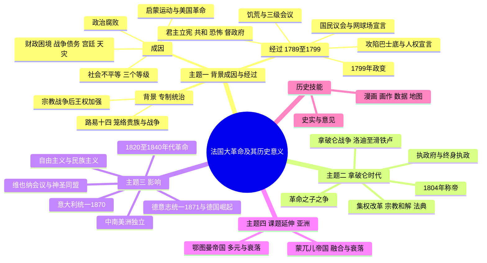

# 法国大革命及其历史意义｜【深析】完整知识包

**课本范围**：课题5“近代欧洲的兴起”D“对自由和民主的追求：法国大革命及其历史意义”＋概念整合＋课题延伸（pp.64–93，照片15张）
**适用**：中二校内考试为主；DSE 技能迁移与背景知识为辅
**制作日期**：2026-11-14｜简体中文讲解，人名地名用香港教科书译名（内地译名见 §2.4）

> **怎样用这份文件**
> - 只为校内测验温习：先读全部 🔴、§3（按课本顺序的完整知识）、§6.4（课本练习全解）、§6.2（考点卡）。
> - 想拿高分或为 DSE 打底：再读 §4（因果与比较）、§5（史料与争议）、§6.6（两份完整示范答案）。
> - 🟢 内容属拓展，可选读，不会挤掉课本正文。
> - 照片里没有看到你的划线标记；如果老师有划线或指定范围，告诉我即可补标。

### 标记与标签说明

| 标记 | 用途 |
|---|---|
| 🔵 | 结构／标题、阶段、框架 |
| ⚫ | 核心史实、概念、材料信息 |
| 🟢 | 课外研究、学者解释、跨学科与反事实（拓展） |
| 🔴 | 必须掌握的考点、关键词、答题关键（本文所有“核心考点”均为**频率未核实**，见 §0.2） |
| 🟡 | 易混易错、年代混淆、作答陷阱、课本表述需修正处、证据限制 |

- **来源类别**：【所给材料】（你拍的课本照片，出版社未见于照片，故不称“官方课本”）【课本知识】【原始史料】【学者观点】【官方评核资料】（教育局／考评局文件）
- **证据状态**：【已核实】（本次联网找到可靠来源核对）【推断】（据证据推论）【待查证】（未能核实，不宜当考场事实背诵）【假设性讨论】
- 来源类别≠可信程度。凡写“【已核实·单一来源】”，表示只找到一个来源，未达交叉互证。

---

## 🔵 §0 本次范围、适用届别与材料编号

### 0.1 材料编号（按页序）

| 编号 | 页码 | 主要内容（含资料编号） |
|---|---|---|
| 图片1 | pp.64–65 | D 导言、导入问题；①革命背景；深度游“太阳下的危机”（资料5.60）；②成因 (a) 政治腐败（资料5.61）；“历史头条”钻石项链事件（漫画） |
| 图片2 | pp.66–67 | (b) 社会不平等（资料5.62 两幅漫画、资料分析题）；(c) 财政困境（资料5.63、注⑬） |
| 图片3 | pp.68–69 | (d) 启蒙运动与美国革命（资料5.64）；③经过 (a) 导火线 (i)(ii)；冷知识“面包引发革命？” |
| 图片4 | pp.70–71 | 历史资料题4（三级会议，Q1–Q3）；(iii)《网球场宣言》；(b) 爆发（资料5.65）；(c) 发展与结束 |
| 图片5 | pp.72–73 | 历史定格“革命下动荡的法国”六事件；罗兰夫人遗言；思考点 |
| 图片6 | pp.74–75 | ④拿破仑时代 (a)(b)；注⑭；冷知识“糖衣包装的革命之子？”（资料5.66）；资料5.67、5.68；资料分析题 |
| 图片7 | pp.76–77 | 历史定格“拿破仑战争”六事件；名言；思考点 |
| 图片8 | pp.78–79 | 历史技能“辨识史实与意见”（陈述四题、大卫画作、英国漫画两题） |
| 图片9 | pp.80–81 | ⑤影响 (a) 自由主义、民族主义 (i)（资料5.69）；历史漫谈《马赛曲》 |
| 图片10 | pp.82–83 | (a)(ii)；(b)(i) 维也纳会议（资料5.70、资料分析题）；资料5.71 两幅地图 |
| 图片11 | pp.84–85 | 维也纳会议（续）；(ii) 19世纪欧洲革命（资料5.72）；(c) 美洲；(d)(i) 意大利统一（资料5.73） |
| 图片12 | pp.86–87 | 资料5.74 意大利地图；(ii) 德意志统一（资料5.75、5.76、5.77） |
| 图片13 | pp.88–89 | 深度游“德意志帝国的崛起”（资料5.78）；概念整合（课题5总图） |
| 图片14 | pp.90–91 | 课题延伸（一）蒙兀儿帝国（资料5.79–5.81） |
| 图片15 | pp.92–93 | 课题延伸（二）鄂图曼帝国（资料5.82–5.84）；两大帝国的衰落 |

### 0.2 学科、届别与课程定位（先说清楚“考不考”）

- ⚫ **这是初中历史科内容。** 页眉“近代欧洲的兴起”与资料编号“5.xx”显示属课题5；教育局2023年的教学资源把“课题5：近代欧洲的兴起”列为**中二级**课题〔R1〕【官方评核资料】【已核实】。课本 pp.90–93 自注为“课程所定的延伸部分，教师可因应学生能力及课时……”（句末被裁切）【所给材料】——延伸部分是否考，以老师公布为准。
- 🔵 **你应考的 DSE 届别（推算）**：按你现读中二、正常升读并在高中选修历史科推算，你会考 **2031 年文凭试**【推断】。教育局通函第170/2025号公布：优化后的高中历史科课程于 2027/28 学年在中四全面实施，**适用于2030年起的文凭试**〔R2〕【官方评核资料】【已核实】。所以对你适用的是“优化课程”，不是现行课程。
- ⚫ **优化课程与本课的关系**：优化框架必修单元1“现代世界的形成”课题1.1“西方的崛起”（建议5课时）的说明写到“概括了解文艺复兴、宗教改革、科学革命与启蒙运动的影响”及“认识欧美主要国家的政治革命和资本主义制度的确立”〔R3〕【官方评核资料】【已核实】。框架原文**没有点名**法国大革命、拿破仑、维也纳会议、意德统一【已核实：本次检索框架文本未见这些词】。
  - 🔴 法国大革命**很可能**属于“欧美主要国家的政治革命”的**概括了解**范围【推断】——即 DSE 只需掌握大纲层面的成因、过程与意义，不必背拿破仑每场战役。
  - 德国统一、德法矛盾、民族主义，是必修单元2.1“第一次世界大战”的背景（框架在该单元提到“极端民族主义”）【推断】。
  - 框架单元1.2提到鄂图曼帝国，但语境是19世纪末至20世纪初对帝国主义的反抗，**不是**课本这里15–18世纪的文化融合【已核实】。
- ⚫ **试卷格式**：2030年起的评核细节当局尚未公布，只说会“引入更多元及客观的题型”〔R2〕【官方评核资料】【已核实】。现行（适用2029年考试）的格式是：卷一资料题，占60%，2小时；卷二论述题，7题选2，占40%，1小时30分〔R4〕【官方评核资料】【已核实】。因此下文示范答案的作答时间和字数**只是教学建议**，不是2031年的规定。
- 🟡 **真题与“高频”**：考评局真题需购买，本次未能取得原文，所以**不作任何“高频／低频”统计**；全文的“核心考点”只表示重要，标为“频率未核实”。也不会套用中国历史科的评分规则。

### 0.3 本次的“核心主题”划分

| 核心主题 | 课本页 | 说明 |
|---|---|---|
| 一、法国大革命的背景、成因与经过 | pp.64–73 | 课本 ①②③ |
| 二、拿破仑时代 | pp.74–79 | 课本 ④＋历史技能 |
| 三、法国大革命及拿破仑时代的影响 | pp.80–88 | 课本 ⑤＋深度游（含意德统一、德国崛起） |
| 四、（课题延伸）15–18世纪亚洲文明：蒙兀儿与鄂图曼 | pp.90–93 | 延伸部分，独立主题 |
| 概念整合 | p.89 | 课题5全课总复习图，不另立主题，见 §3.6 |

每个核心主题都有：≥5个关键点、≥2类题型及框架、≥1项易错辨析、关键结论的证据与适用边界（分布在 §3–§6，§6.1 有总对照表）。

---

## 🔵 §1 导图式学习大纲

### 1.1 Mermaid 导图
（如果你的阅读器不显示 Mermaid 图，请看 1.2 的文字版，内容相同。）



### 1.2 文字层级版（与上图相同）

```
法国大革命及其历史意义（pp.64–93）
├─ 主题一 背景、成因、经过（1789–1799）
│   ├─ 背景：宗教战争后王权加强 → 路易十四专制高峰（笼络贵族、战争耗财）
│   ├─ 成因：政治腐败｜社会不平等｜财政困境｜启蒙思想＋美国革命
│   └─ 经过：饥荒 → 三级会议（1789.5）→ 国民议会、网球场宣言（6月）
│            → 巴士底（7.14）→ 人权宣言（8月）→ 君主立宪（1791）
│            → 对奥宣战（1792.4）→ 共和（1792.9）→ 恐怖（1793–94）
│            → 督政府（1795–99）→ 雾月政变（1799.11）
├─ 主题二 拿破仑时代（1799–1815）
│   ├─ 上台：第一执政（1799）→ 终身执政（1802）→ 皇帝（1804）
│   ├─ 改革：中央集权｜与教会和解｜《拿破仑法典》（1804）
│   ├─ 战争：洛迪（1796）→ 莱茵邦联（1806）→ 半岛（1808）→ 俄罗斯（1812）
│   │        → 莱比锡（1813）→ 滑铁卢（1815）
│   └─ 评价：“革命之子”之争
├─ 主题三 影响
│   ├─ 思想：自由主义、民族主义（法国 → 欧洲 → 美洲）
│   ├─ 反动：维也纳会议（1814–15）、神圣同盟
│   ├─ 冲击：1820–1840年代革命浪潮；中南美洲独立
│   └─ 统一：意大利（1870）、德意志（1871）→ 德国崛起改变欧洲局势
├─ 主题四 课题延伸：蒙兀儿帝国（1526–1857）、鄂图曼帝国（约13世纪末建立）
└─ 历史技能：史实与意见；漫画、画作、数据、地图的读法
```

### 1.3 学习路线：把导入问题拆成六个子问题

课本导入问题（p.64）：“法国大革命如何改变欧洲乃至世界的面貌？”这题太大，先拆开，逐个解决（对应章节在括号里）：

1. 革命前的法国出了什么问题？（政治、社会、财政、思想、国际）→ §3.2、§4.1
2. 1789年，一场为解决财政问题召开的会议，怎样变成了革命？→ §3.3、§4.1
3. 革命为什么越走越激进，又为什么在1799年结束？→ §3.3、§4.3
4. 拿破仑是延续了革命，还是终结了革命？→ §3.4、§5.4 争议二
5. 革命与拿破仑怎样改变了欧洲（思想、版图、政局）和美洲？→ §3.5、§4.6
6. 同一时期，亚洲两大帝国怎样管理多民族、多宗教？（作对照）→ §3.7、§4.7

**综合回答（一句话版）**：法国大革命推翻专制和等级特权，把“自由、平等、人民主权”变成政治纲领；拿破仑把其中的法律平等推行到欧洲各地，同时用战争激起各地的民族主义；维也纳会议想把时钟拨回去却失败，最终引出19世纪的革命浪潮与意德统一，改变了欧洲版图和美洲的殖民格局（详见 §7.1）。

---

## 🔵 §2 主题概览、5W1H、核心概念与译名

### 2.1 5W1H 简表（主题一至三）

| 要素 | 内容 | 依据 |
|---|---|---|
| 谁 | 国王路易十六、王后玛丽·安东妮特；三个等级（教士、贵族、平民）；第三等级代表；巴黎民众；激进派领袖罗伯斯比尔；拿破仑；欧洲各国君主与反法联盟；意、德统一领袖（伊曼纽二世、加富尔、加里波的；威廉一世、俾斯麦） | 【所给材料】 |
| 何时 | 狭义的革命：1789–1799；课本延伸到拿破仑时代（1799–1815）及其影响（至1871年德意志帝国成立，深度游提到1888年后的威廉二世）；背景上溯16世纪宗教战争和路易十四（1643–1715） | 【所给材料】 |
| 何地 | 法国（巴黎、凡尔赛）→ 欧洲各地（意大利、德意志、伊比利亚半岛、俄罗斯等）→ 中南美洲 | 【所给材料】 |
| 发生什么 | 推翻君主专制 → 君主立宪 → 共和 → 恐怖时代 → 督政府 → 拿破仑执政、称帝；自由主义和民族主义传播；维也纳会议后出现革命浪潮和意德统一 | 【所给材料】 |
| 为什么 | 长期：专制、等级特权、启蒙思想；中期：战争债务与财政危机、美国革命的鼓舞；短期：1788年天灾歉收、粮价飙升；直接触发：三级会议的投票方式之争 | 【所给材料】＋本文分析（§4.1） |
| 如何发展 | 1789.5 三级会议 → 6月国民议会、网球场宣言 → 7.14 巴士底 → 8月人权宣言 → 1791 君主立宪 → 1792.4 对奥宣战、9月共和 → 1793–94 恐怖 → 1795–99 督政府 → 1799.11 政变 | 【所给材料】 |

**课题延伸 5W1H**

| 要素 | 内容 |
|---|---|
| 谁 | 蒙兀儿：巴布尔（开国）、阿克巴（第三代，文化融合）、沙贾汗（第五代，泰姬陵）、巴哈杜尔沙二世（末代）；鄂图曼：奥斯曼一世（开国）、历代苏丹、建筑师希南 |
| 何时 | 课本标题为15–18世纪；鄂图曼约13世纪末建国、1453年攻陷君士坦丁堡；蒙兀儿1526年建立、1857年灭亡 |
| 何地 | 印度次大陆（德里、阿格拉）至阿富汗；鄂图曼横跨欧、亚、非三洲，首都伊斯坦堡 |
| 发生什么 | 多民族、多宗教帝国，通过宽容政策促成文化融合（印度伊斯兰文化；吸收东罗马基督宗教文化） |
| 为什么 | 开明君主推动；帝国辽阔、族群多元，需要整合 |
| 如何发展 | 盛世融合 → 蒙兀儿17世纪末改行宗教压迫、分裂、被英国侵略而亡；鄂图曼受民族主义冲击，被讥为“欧洲病夫”（细节与争议见 §5.4） |

### 2.2 主题概览（三句话）
⚫ 18世纪末，法国在专制统治下出现政治腐败、社会不平等和财政危机，又受启蒙思想与美国革命的鼓舞，于1789年爆发大革命【所给材料】。
⚫ 革命十年间政体多次更替，最后由拿破仑夺权；他一方面以《拿破仑法典》巩固法律平等，另一方面称帝并发动连年战争【所给材料】。
⚫ 革命与拿破仑战争把自由主义和民族主义带到欧洲和美洲；维也纳会议想恢复旧秩序，结果19世纪仍爆发革命浪潮，意大利和德意志相继统一【所给材料】。

### 2.3 核心概念（首次出现附英文与通俗解释）

| 概念 | 英文 | 通俗解释 | 考试怎样用／易混 |
|---|---|---|---|
| 君主专制 | absolute monarchy | 国王集中最高权力，不受议会或宪法约束 | 🔴 革命的政治背景；路易十四是高峰 |
| 笼络政策 | （课本用语） | 用凡尔赛宫的奢华宫廷生活吸引、控制大贵族 | 🟡 史学界对“强迫贵族挥霍”的说法有保留，见 §3.1 |
| 三个等级 | Three Estates | 教士（第一）、贵族（第二）、平民（第三，约占人口98%） | 🔴 资料题必考人口与特权对比 |
| 免税特权 | fiscal privileges | 特权等级免交或少交主要直接税 | 🟡 贵族并非“完全免税”，见 §3.2(b) |
| 三级会议 | Estates-General | 由三个等级代表组成的全国性会议，国家财政困难时由君主召开，1614年后长期未开 | 🔴 革命的导火线 |
| 每级一票／一人一票 | vote by order／vote by head | 前者每个等级只算一票；后者每位代表各一票 | 🔴 第三等级要求改制的原因 |
| 国民议会 → 国民立宪议会 | National Assembly → National Constituent Assembly | 第三等级自组的议会（1789.6），7月改称国民立宪议会，负责制宪 | 🟡 不要与1792年的“国民大会”混淆 |
| 国民大会 | National Convention | 1792年9月成立，宣布废除君主制、成立共和（内地译“国民公会”） | 🟡 见上 |
| 君主立宪 | constitutional monarchy | 保留国王，但王权受宪法限制 | 1791年法国 |
| 共和 | republic | 不设世袭君主的政体 | 1792年第一共和 |
| 恐怖时代 | Reign of Terror | 1793–1794年以大规模镇压“革命之敌”的统治 | 🔴 革命理想与手段的矛盾 |
| 督政府 | Directory | 1795–1799年由五人督政委员会统治 | 局势动荡、货币贬值 |
| 执政府／第一执政 | Consulate／First Consul | 1799年拿破仑建立的政权，他任第一执政 | 拿破仑时代开始 |
| 《拿破仑法典》 | Napoleonic Code（Civil Code） | 1804年颁布的民法典，规定法律面前人人平等、保障信仰自由与财产权等 | 🔴 “革命之子”论据；🟡 也有限制妇女权利等条文 |
| 大陆政策 | Continental System | 1806年起禁止欧洲各国与英国贸易 | 半岛战争、俄罗斯战役的起因 |
| 焦土政策 | scorched earth | 撤退时毁掉粮食与物资，不留给敌人 | 俄军对付法军 |
| 自由主义 | liberalism | 人生而自由平等，生命、财产等个人权利应受保障；部分人认为人民有权推翻专制 | 🔴 定义题 |
| 民族主义 | nationalism | 有共同历史、宗教、语言、习俗的族群应团结，实现民族自主，不受他族支配 | 🔴 定义题；🟡 与“爱国主义”不完全相同 |
| 维也纳会议 | Congress of Vienna | 1814–1815年战胜国重划欧洲版图、恢复旧秩序的会议 | 🔴 19世纪革命的背景 |
| 神圣同盟 | Holy Alliance | 俄、奥、普三国君主的同盟，课本说其承诺合作镇压反专制运动 | 🟡 签订时间地点见 §3.5 |
| 统一运动 | unification | 意大利、德意志由分裂邦国合成民族国家 | 🔴 比较题 |
| 米利特制度 | millet system | 鄂图曼帝国让各宗教社群在宗教领袖管理下自治 | 🟡 学界争议其形成年代，见 §5.4 |
| 印度伊斯兰文化 | Indo-Islamic culture | 伊斯兰文化与印度本土文化融合的成果 | 蒙兀儿文化融合 |
| 史实与意见 | fact vs opinion | 史实是可核实的发生之事；意见是作者的判断、评价、因果解释 | 🔴 历史技能题 |

### 2.4 译名对照（避免查资料时混淆）

| 香港课本 | 内地常用 | 英文／原文 |
|---|---|---|
| 罗伯斯比尔 | 罗伯斯庇尔 | Robespierre |
| 玛丽·安东妮特 | 玛丽·安托瓦内特 | Marie Antoinette |
| 拉法叶 | 拉法耶特 | Lafayette |
| 国民立宪议会 | 国民制宪议会 | National Constituent Assembly |
| 国民大会 | 国民公会 | National Convention |
| 督政委员会／督政府 | 督政府 | Directory |
| 圣海伦娜岛 | 圣赫勒拿岛 | Saint Helena |
| 爱尔巴岛 | 厄尔巴岛 | Elba |
| 大陆政策 | 大陆封锁（大陆体系） | Continental System |
| 法镑 | 里弗尔 | livre |
| 萨丁尼亚王国 | 撒丁王国 | Kingdom of Sardinia |
| 伊曼纽二世 | 维克托·伊曼纽尔二世 | Victor Emmanuel II |
| 加里波的 | 加里波第 | Garibaldi |
| 加富尔 | 加富尔 | Cavour |
| 俾斯麦 | 俾斯麦 | Bismarck |
| 鄂图曼帝国 | 奥斯曼帝国 | Ottoman Empire |
| 蒙兀儿帝国 | 莫卧儿帝国 | Mughal Empire |
| 伊斯坦堡 | 伊斯坦布尔 | Istanbul |
| 希南 | 锡南 | Mimar Sinan |
| 米利特 | 米勒特 | millet |
| 枢机主教（钻石项链事件） | 红衣主教罗昂 | Cardinal de Rohan |


---

## 🔵 §3 基础知识、发展脉络及关键转折（按课本顺序，保留全部实质信息）

> 读法：⚫ 段落是课本原有内容（我用自己的话重述，关键措辞保留）；紧跟的 🟡 是核查结果和需要修正的地方；🟢 是拓展。方括号〔R数字〕对应 §7.6 参考资料。

### 3.1 革命的背景：专制统治下的法国（p.64）

⚫【所给材料 p.64】
- 18世纪末，工业革命在英国展开，政治革命则在法国爆发。法国大革命（1789–1799）期间，法国人民实践了启蒙思想，民族主义也开始萌芽；这场革命更引发19世纪欧洲的革命浪潮，对近代世界影响深远。
- 16世纪，法国曾爆发长达三十多年的宗教战争。战后君主逐步加强专制，巩固王权。到路易十六在位（1774–1792）时，国家政治腐败，财政危机与社会矛盾积压已久，最终引发一场反对专制统治的大规模革命。

⚫ **深度游“太阳下的危机”**【所给材料 p.64】
- **歌舞升平背后的算计**：不少地方贵族曾参与16世纪的宗教战争、反抗王室，所以法国君主对他们颇为猜忌。1643–1715年间，“太阳王”路易十四把专制统治推向高峰：他下令大贵族迁入凡尔赛宫居住，并鼓励他们过挥霍的生活，以削弱其经济实力，同时便于监控。
- **权力与威望的代价**：路易十四的“笼络政策”虽有助巩固王权，却使王室近一半收入用于凡尔赛宫的开支；加上他多次发动对外战争，企图在欧洲建立霸权，导致国库日益枯竭。路易十四临终前还告诫王储，不要像他一样“过于热衷战争”。
- **资料5.60**（凡尔赛宫外观＋路易十四骑马像）：位于巴黎市郊的凡尔赛宫由路易十四所建，曾是欧洲贵族的社交重地，全盛时期约有一万人在此居住（图注右侧被裁切，个别字据上下文判读）。

🟡 核查
- “近一半收入用于凡尔赛宫”：本次**没有**找到可靠来源支持“近一半”。能找到的估计差距很大：有来源说建造费只占历年国家预算不到1%，也有纪录片作者估计凡尔赛的运作费约占年收入的四分之一〔R41〕。标为【待查证】。考试写“凡尔赛宫开支庞大，加重财政负担”即可，不要背“近一半”这个数字。
- “由路易十四所建”：更准确的说法是，凡尔赛原为路易十三在1623年建的狩猎行宫，由路易十四大规模扩建，1682年朝廷迁到这里〔R41〕【已核实·单一来源】。
- 临终遗言：有二手来源记载，遗言的另一版本同时劝诫不要像他那样热衷战争**和建筑**〔R42〕【已核实·单一来源】。可见路易十四自己也承认，战争和大兴土木都消耗了国力。
- “一万人居住”【待查证】。另外，课本说的“削弱贵族经济实力、便于监控”是政策**目的**；不要写成“贵族因此全部破产”这种没有证据的结果。

### 3.2 革命的成因（pp.65–68）

#### (a) 政治腐败（p.65）
⚫【所给材料】18世纪下半叶，法国君主路易十六昏庸无能，疏于朝政。他无力应对严峻的财政与社会问题，却终日与王后过着奢华生活，法国人民对其管治的不满日益高涨。**资料5.61**：路易十六（左）与王后玛丽·安东妮特（右）的画像。

🟡 “昏庸无能、终日奢华”是课本的**评价**（属意见，不是可核实的史实）。历史学者哈德曼（John Hardman）2016年的路易十六传记反驳了“软弱愚蠢”的形象：他认为路易十六受过良好教育，有敏锐的政治洞察力和外交才能，主要毛病是**优柔寡断**，常常预见危险却未能或不愿阻止〔R30〕【学者观点】【已核实：出版社简介】。考试写“路易十六缺乏决断力，未能推行改革”，比写“昏庸”更站得住。

#### “历史头条”1786年5月31日：无辜王后感震惊，挥霍骂名难洗清（p.65）
⚫【所给材料】
- **赤字夫人**：王后经常举办舞会，大肆修建花园，奢华生活引起民愤，法国民众讥称她为“赤字夫人”，对她极为反感。她牵涉的钻石项链丑闻，更使王室声望跌至谷底。
- **钻石项链事件**：1785年，一名枢机主教因失宠于王后，极想重新获得青睐。他误信一名冒充王后的骗徒，为讨好“王后”，竟以分期付款、历时两年的方式，购下一条重近2,800卡（克拉）的钻石项链。“假王后”得手后迅速潜逃，主教无力偿还，引发风波。珠宝商向王后追讨款项，事件才被揭发。1786年5月31日，法院判处女骗徒入狱，枢机主教则被国王流放。尽管王后事前并不知情，报章仍指责她借机陷害主教，而且挥霍如故，王室形象因此大受打击。
- 漫画对白：王后说“请大家听我解释，我是无辜的……”，另有“这次我的形象‘破产’了……”；四周有手指着王后指责（部分小字无法辨认）。

🟡 核查（History Today、Wikipedia、Alpha History 三方交叉）〔R11〕【已核实】
- 1786年5月31日巴黎高等法院的判决：**枢机主教罗昂被判无罪**；主谋拉莫特夫人被判鞭笞、烙印并终身监禁。罗昂其后才被国王流放到偏远修道院。课本略去了“判无罪”这个关键：正因为法院判主教无罪，公众反而怀疑王后，这才是王后声誉受损的机制。
- 关于“冒充王后的骗徒”：主谋拉莫特夫人自称王后亲信，伪造王后书信，并安排一名女子在夜间假扮王后与主教见面；这名假扮者后来被判无罪。项链被拉莫特的丈夫带到伦敦拆散变卖。拉莫特夫人被捕定罪，约一年内越狱逃到伦敦，还出版回忆录继续指控王后。所以“假王后得手后迅速潜逃”与记载不完全相符。
- 多数史家认为王后几乎没有参与此事〔R11〕。这件事说明：**舆论中的形象比事实更能动摇王室威信**。

#### (b) 社会不平等（p.66）
⚫【所给材料】
- **(i) 社会等级的严格区分**：到18世纪，法国社会仍有严格的等级制度。国民大致分为三个阶层：教士属第一等级，贵族属第二等级，平民属第三等级。
- **(ii) 第三等级的不公平待遇**：第一、二等级只占全国人口极少数，却同属统治阶层，掌控政府要职，拥有全国近半土地，生活奢华，并享有免税特权。第三等级约占人口98%，其中最底层的农民生活最为艰辛；商人、医生、律师等第三等级上层人士虽有财富与知识，却和农民一样缺乏政治发言权，并须承担沉重税务。长期的不平等待遇使第三等级普遍不满，渴望改变被统治阶层任意剥削的局面，社会危机一触即发。
- **资料5.62**（18世纪末法国大革命时期的两幅政治漫画）：
  - 漫画①，标题“希望这游戏快些完结”：年老的平民（标“第三等级”）拄着锄头弯着腰，背上驮着教士（标“第一等级”）和佩剑的贵族（标“第二等级”）；画面下方有兔子和鸟在啄食庄稼。
  - 漫画②，标题“逝去的时光”：骷髅般的人物（标“第三等级”）拿着铲子；中间是几近赤裸的人物（标“第二等级”）；右边是穿红袍的枢机主教（标“第一等级”）。
- **资料分析题**：两幅漫画的标题反映了哪一个社会阶层的心声？（答案见 §6.4）

🟡 核查
- “近半土地”偏高：多数估计是教会约占一成，贵族约占两成到三成，两者合计约三至四成；农民约占四成〔R40〕【已核实：多来源】。
- “免税特权”要分清：教士基本不交直接税，只定期向国家“自愿捐献”；贵族主要免交最重要的直接税“达依税”（taille），并不是所有税都不交〔R40〕【已核实】。
- 第三等级“约98%”与多个来源一致（第一等级约0.5%，第二等级约1.5%）〔R40〕【已核实】。
- 漫画①中兔子和鸟啄食庄稼，很可能暗指贵族独享狩猎权，损害农民收成【推断：据画面观察】。两幅漫画的原作者、原标题和出处，本次未能核对【待查证】。

#### (c) 财政困境（p.67）
⚫【所给材料】
- 路易十六统治时期，法国面临严重财政问题，政府已难以正常运作。国库空虚的主要原因有三：① 前任国王路易十四和路易十五发动多场战争，加上路易十六派兵远赴北美参与美国革命（1775–1783），军费开支极为庞大；② 路易十六的宫廷生活奢侈浪费；③ 1780年代全国多地遭遇天灾，粮食失收，税收大幅减少。
- 为解决财政危机，路易十六曾推行改革，并考虑向第一、二等级征税，但都告失败。最后他决定召开三级会议，却意外成为引发法国大革命的导火线（见p.69）。
- **注⑬**：三级会议一般在国家面临财政困难时由君主召开，由法国三个社会等级的代表组成，属全国性会议，目的是咨询各阶层意见或通过重大决策。自1614年起，法国已长期没有召开过这个会议。
- **资料5.63**（法国1780年代深陷财政危机的原因；1788年即大革命爆发前夕的预算）：
  - 示意图：“对外战争”“宫廷奢华”“农业歉收”三个箭头指向空空的“国库”箱子，官员翻开口袋，里面一无所有。
  - 饼图：1788年政府预算支出6亿2,900万法镑，预算收入5亿300万法镑。钱花在：偿还债务50%、军事支出25%、行政费用19%、宫廷费用6%。

🔴 **数据解读**（自行计算，过程见 §4.4）：赤字约1.26亿法镑，占支出的20%；偿债约3.15亿，相当于全年收入的六成多；宫廷费用约0.38亿，只相当于赤字的约三成。也就是说，**即使宫廷开支全部取消，也补不上赤字**【推断：据课本数据计算】。

🟡 核查
- 1788年预算的数字与比例（收入5.03亿；偿债约50%，军事约25%–26%，宫廷约6%）与两份独立资料相符〔R5〕〔R6〕【已核实】；另一来源把支出总额记为6.32亿，口径略有不同。
- 法国**正式**参与美国独立战争是在**1778年**（2月6日法美签订同盟条约）；1776–1778年间只是秘密援助〔R7〕【已核实】。课本写的“1775–1783”是美国革命战争本身的年份，不是法国出兵的年份。
- 🟢 “改革失败”的经过（课本没写）：财政大臣提出向特权等级征收新的土地税，被（1787年显贵会议中的）贵族否决〔R9〕【已核实·单一来源】；1788年8月国王宣布召开三级会议；同年12月同意第三等级代表人数加倍，但**没有**决定按人头投票〔R8〕【已核实·单一来源】。

#### (d) 启蒙运动的影响及美国革命的鼓舞（p.68）
⚫【所给材料】
- **(i) 启蒙运动的影响**：法国是启蒙运动的中心，著名思想家孟德斯鸠和伏尔泰都是法国人。因此，“平等”“自由”等启蒙思想在18世纪末的法国广泛流传。这些理念不但加深了民众对社会不公的反感，也促使他们决心挑战专制政权。
- **(ii) 美国革命的鼓舞**：1775–1783年间，法国曾派兵支援美国革命。士兵返国后，把他们在北美十三个殖民地协助推翻英国殖民统治的经历，以及美国宣扬的平等与自由思想传回国内。美国革命的成功鼓舞了法国人民，他们决心效法北美人民为自身权利奋斗，推翻专制统治，改变社会不公。
- **资料5.64**：拉法叶将军曾参与美国革命；返国后，身为贵族的他却支持第三等级争取平等与自由等权利。

🟡 核查
- 同上：法国正式出兵是1778年〔R7〕。
- “推翻专制统治”要注意时间：1789年大多数代表追求的是**君主立宪**（限制王权），并不是推翻国王；共和要到1792年才出现（§3.3）。把1792年的结果说成1789年的目标，是常见的“事后诸葛”错误。
- 🟢 启蒙思想与革命的因果关系，史学界有争论：是书本思想引发了革命，还是革命发生后才把启蒙思想家奉为源头？见 §5.3。

### 3.3 革命的经过（pp.68–73）

#### (a) 革命的导火线

⚫ **(i) 社会动荡不安（1788–1789）**【所给材料 p.68】：1788年，天灾令法国农作物严重歉收，多个城市爆发饥荒。到1789年初，大批负担不起飙升粮价的贫民涌入巴黎，争夺粮食和工作机会，竞争加剧，社会日益不稳。

⚫ **冷知识“面包引发革命？”**【所给材料 p.69】：面包是今日法国人的主食之一，法式长棍面包更举世闻名。早在18世纪，面包已是法国民众生活中不可缺少的粮食；以1780年代的巴黎平民为例，面包开支占工资一半以上。然而1788年法国接连遭遇旱灾、冰雹和严寒，农作物严重歉收；加上教士与贵族囤积谷物，面包价格急剧上涨。到三级会议召开时，贫苦家庭甚至要花全部收入买面包。面包问题进一步激化第三等级（课本此处写“第三阶级”，同义）对特权阶级的不满，部分愤怒的巴黎民众更开始抢掠粮仓，一场席卷全国的革命已迫在眉睫。插图：士兵镇压巴黎“面包革命”的漫画；人群喊着“面包啊，我们要面包啊！”

🟡 核查（多来源）〔R12〕【已核实】
- 1788年，巴黎非技术工人大约把日薪的一半花在面包上。1789年2月，四磅面包的官价由约9苏升至14.5苏，到春季，面包开支约占日薪的70%–90%（通俗来源常引“88%”）。课本说“需花全部收入”属夸张。
- 1788年7月13日的严重冰雹确有其事〔R12〕。
- “教士与贵族囤积谷物”是当时民间普遍相信的指控，写答案时要说成“民众认为”，与已证实的事实区分开【推断】。
- 🟢 史家争论：英国史家鲁德（George Rudé）认为粮价是群众投身革命的首要动机，并指出巴士底陷落当天正是粮价周期的最高点；后来的研究指出，1789年2–7月巴黎面包价被官方固定在14.5苏，巴黎的粮荒可能没有他估计的那么严重，两者“同一天”只是巧合〔R12〕【学者观点】【已核实】。
- “面包革命”是课本插图的用语，不是通行的史学名词【推断】。

⚫ **(ii) 三级会议的召开（1789年5月）**【所给材料 p.69】：为挽救财政，路易十六曾提出向第一、二等级征税，但这两级的代表为维护免税特权而拒绝。1789年5月，路易十六召开三级会议，再次讨论税制改革。会上，第一、二等级利用“每级一票”的投票方式，联手否决了税制改革和第三等级提出的“一人一票”新投票方式。为抗议不公，第三等级代表宣布退出会议，另组“国民议会”商讨对策。

🟡 核查（重要）
- 三级会议于1789年5月5日开幕〔R10〕。会议从一开始就卡在**代表资格审查和投票方式**上，并没有真正进入税制改革的表决；6月17日，第三等级宣布自己是“国民议会”〔R9〕【已核实】。课本说“联手否决税制改革”是简化写法。
- 特权等级是否一致“反对缴税”？有统计称约89%的贵族陈情书愿意放弃财税特权（这个数字只见于百科转引的教科书，精确值【待查证】）；另有资料指出，贵族大体接受“部分”税收平等，但坚持荣誉性特权；就连1788年的《亲王备忘录》也表示前两个等级可以放弃带财政性质的特权〔R8〕【已核实：定性结论多来源】。所以1789年的冲突**不只是钱的问题，更是由谁掌握政治权力的问题**（投票方式决定了这一点）。
- “退出会议”应理解为：第三等级拒绝分开开会，自行宣布组成国民议会，并邀请其他等级加入【推断，据〔R9〕】。

⚫ **历史资料题4**【所给材料 p.70】“有关1789年三级会议的组成及各等级的诉求”（目标：认识三级会议如何成为法国大革命的导火线；程度2：阐释资料，并运用个人的历史知识与理解）

| 等级 | 代表人数 | 诉求（课本图表） |
|---|---|---|
| 第一等级 | 303 | 维持“每级一票”；反对缴纳税款；主张向第三等级加税 |
| 第二等级 | 282 | 维持“每级一票”；反对缴纳税款；主张向第三等级加税 |
| 第三等级 | 610（中间数字被图片遮挡，按可见笔画判读为“610”） | 要求把投票方式改为“一人一票”；要求第一、二等级也要缴税 |

题目Q1–Q3的全解见 §6.4。

🟡 代表人数各书不同：303/282/578（World History Encyclopedia）；第三等级610（Alpha History）；7月中共1,177人，即295/278/604（Tackett 统计）等。差别来自“选出人数／到会人数／统计时点”不同〔R9〕【已核实】。按课本数字计算，第三等级占51.05%；若按578人计，只占49.7%。可见**光靠第三等级未必过半**，还要争取部分教士和自由派贵族（史实上低级教士在6月陆续加入）【推断＋计算】。

⚫ **(iii)《网球场宣言》（1789年6月）**【所给材料 p.71】：1789年6月20日，路易十六下令关闭国民议会的会场。代表们被迫转到附近的网球场继续开会，并发表《网球场宣言》，誓言“在国王未制定宪法前，绝不解散国民议会”。国民议会其后改组为“国民立宪议会”。

🟡 核查（重要）〔R10〕【已核实】：誓词的原意是，在**王国的宪法**确立并稳固之前，绝不解散，并在任何需要的地方重新集会。制定宪法的是**议会**，不是国王，这正是宣言的革命性所在：议会自称代表国民，掌握制宪权。课本“在国王未制定宪法前”容易令人误解，考试请写“誓言在制定宪法之前绝不解散”。另外，6月27日国王被迫让步，命令另外两个等级加入议会；7月9日议会改称国民立宪议会〔R10〕。

#### (b) 革命的爆发

⚫ **(i) 革命的揭幕：巴士底监狱的陷落（1789年7月14日）**【所给材料 p.71】：巴黎民众得知政府企图动用武力镇压，于是攻陷巴士底监狱夺取武器，法国大革命自此正式爆发。**资料5.65**：有关《网球场宣言》（上）及巴黎民众进攻巴士底监狱（下）的油画；这座监狱曾囚禁反对路易十六政府的人，是王权专制的象征。

🟡 补充〔R44〕【已核实·单一来源】：7月11日，国王罢免了深得民心的财政总监内克尔，并调集军队到巴黎一带。7月14日，群众先从荣军院夺得约3.2万支火枪，再到巴士底取火药。当天狱中只有7名囚犯（4名伪造犯、2名精神病人、1名应家族要求关押的人），所以巴士底的意义主要在于**象征**。
🟡 “革命自此正式爆发”是课本采用的起点；也有人以5月三级会议开幕或6月17日成立国民议会为起点。选哪个，视乎以“合法权力的转移”还是“民众武力介入”为标准【推断】。

⚫ **(ii)《人权及公民权利宣言》的发表（1789年8月）**【所给材料 p.71】：革命爆发后，国民立宪议会迅速掌控政府，并于8月颁布《人权及公民权利宣言》，展现法国人民对自由与平等的追求：■ 所有人生而自由平等；■ 所有人享有言论、出版、宗教等自由；■ 政府存在的目的，是保障人民的天赋权利。

🟢 补充：同月4日，议会宣布废除封建特权；宣言于8月26日通过〔R10〕【已核实·单一来源】。🟡 宣言所说的“人”并不包括所有人：妇女没有政治权利；殖民地的奴隶制要到1794年2月才由国民大会废除〔R19〕【已核实】。

#### (c) 革命的发展与结束（p.71）
⚫【所给材料】1791–1792年间，法国成为君主立宪国，其后再转为共和国。同时，欧洲多国联军入侵法国，企图扑灭革命，触发“法国大革命战争”。到1799年，拿破仑夺权并实行专政，标志着以实现自由、平等和民主为目标的法国大革命至此结束。

🟡 **课本内部的张力**：p.71说“多国联军入侵法国……触发战争”，p.73却写法国“于4月先向奥地利宣战”。史实是：1792年4月20日由法国立法议会对奥地利宣战〔R13〕【已核实】；此前奥地利和普鲁士在1791年8月发表《皮尔尼茨宣言》，威胁干预。准确说法是：**奥普结盟并威胁干预，法国先发制人宣战，之后联军攻入法国。**

⚫ **历史定格“革命下动荡的法国”**【所给材料 pp.72–73】
导语：革命爆发后，法国迅速陷入一连串动荡。对外方面，欧洲多国君主为防止革命扩散，多次联军进攻法国，企图推翻革命政权；对内方面，新政权根基不稳，暴乱频繁，激进派革命分子的统治更令人民陷入恐惧。

| # | 时间 | 事件（课本内容） |
|---|---|---|
| 1 | 1791年10月 | **君主立宪国成立**：路易十六出逃巴黎失败后，于1791年9月被迫接受国民立宪议会制定的宪法；10月1日法国正式成为君主立宪国，王权受宪法限制。 |
| 2 | 1792年4月 | **法国大革命战争展开**：1792年2月，与路易十六关系密切的奥地利与普鲁士结盟；由革命分子掌权的法国担心两国出兵干涉，于4月先向奥地利宣战，“法国大革命战争”自此爆发。 |
| 3 | 1792年9月 | **法兰西第一共和成立**：革命分子组成国民大会接管政权，宣布废除君主制，成立第一共和。后来路易十六被揭发与奥、普的反革命联盟勾结，被控叛国，翌年1月被处死。 |
| 4 | 1793–1794年 | **恐怖时代来临**：国民大会内部分裂，激进派领袖罗伯斯比尔成功掌权，以恐怖手段镇压异己，企图重建社会秩序。法国进入“恐怖时代”，直到1794年罗伯斯比尔被推翻并处决才结束。 |
| 5 | 1795–1799年 | **督政委员会统治**：恐怖时代结束后，法国由五人组成的督政委员会统治，进入“督政府时期”。但国内暴乱频仍，反法联盟持续进攻，局势依然动荡。 |
| 6 | 1799年11月 | **法国大革命结束**：督政委员会无法稳定政局，货币大幅贬值，民心尽失。1799年11月，军事强人拿破仑发动政变，推翻督政委员会，掌握军政大权，法国大革命至此画上句号。 |

图片：1796年拿破仑领导法军对抗欧洲联军（画作）；1799年拿破仑发动政变的情形（画作）；罗伯斯比尔画像。
名言：“自由啊，自由！有多少罪行假借你的名义而行！”（法国大革命时期的政治家罗兰夫人被送上断头台前的遗言）。此语通常归于罗兰夫人，本次未核对原始记载【待查证】。
思考点：罗兰夫人的遗言反映了法国大革命带来什么问题？（答案见 §6.4）

🟡 补充（Britannica）〔R14〕【已核实】：恐怖时代一般记为1793年9月5日至1794年7月27日；正式处决约1.7万人，另约1万人死于狱中或未经审判，被捕者至少30万。1794年6月的《牧月法令》取消了嫌疑人公开受审和获得辩护的权利，此后的“大恐怖”约1,400人被处决，这也促成了罗伯斯比尔的倒台。
🟡 第1项的“出逃巴黎失败”令国王信誉崩溃，是法国最终走向共和的一个转折【推断】。

### 3.4 革命后的法国：拿破仑时代（pp.74–79）

#### (a) 拿破仑的上台与改革（p.74）
⚫【所给材料】法国大革命期间，拿破仑因成功镇压内乱、对抗反法联盟，被民众视为国家英雄。1799年他建立执政府，自任第一执政，开始集权统治，法国自此进入“拿破仑时代”；1802年他更成为终身执政官。为稳定国内政局，拿破仑推行多项改革：一方面加强中央集权，例如由国家委任官员、统一征税；另一方面推出政策争取各阶层支持。其中，他颁布《拿破仑法典》，以成文法律保障1789年《人权及公民权利宣言》中的各项人权，以释除革命分子的疑虑。
**注⑭**：恐怖时代期间，激进派曾破坏教堂设施。为修补关系，拿破仑与罗马天主教会和解，以消除教徒对革命的反感。

⚫ **冷知识“糖衣包装的革命之子？”**【所给材料 p.74】
- **法典的颁布**：为加强统治的合法性，拿破仑出任第一执政后立即下令重新编纂法律。1804年，《拿破仑法典》正式颁布，是法国第一部现代民法典。法典秉持法国大革命的核心原则，如法律面前人人平等、保障信仰自由等。
- **法典的传播与影响**：其后拿破仑带领法国称霸欧洲（见pp.76–77）。为方便统治、争取民心，他在征服地区推行《拿破仑法典》，因而被不少人视为“革命之子”。无论他的政治动机如何，拿破仑确实把法国大革命的理念传播到欧洲各地。时至今日，欧美及亚洲多国的民法典仍以《拿破仑法典》为参考，足见其深远影响。
- **资料5.66**：有关拿破仑编纂法律的油画（画中拿破仑坐着书写法典，一位白须老人在他头上方举着花冠；画面细节为本次观察）。

🟡 核查（“保障各项人权”说过了头）
- 法典于1804年3月21日颁布〔R18〕。它保障的主要是**民事**权利（法律平等、财产、信仰）；但同一部法典第213条规定“丈夫应保护妻子，妻子应服从丈夫”，这一条一直沿用到1938年〔R18〕【已核实：多来源】。
- 政治自由方面：1800年1月17日的法令关闭了巴黎73份政治报刊中的60份，并禁止创办新报〔R17〕【已核实：多来源】；到1811年，巴黎只剩4份半官方报纸〔R17〕。
- 1802年5月20日的法律维持并恢复了殖民地奴隶制，推翻了1794年的废奴法令〔R19〕【已核实】（史家对“维持”还是“恢复”的用语有讨论）。
- 以上都是评价拿破仑是否“革命之子”的关键反证，见 §5.4 争议二。

#### (b) 法兰西第一帝国的建立与覆亡（p.75）
⚫【所给材料】
- **(i) 拿破仑自立为帝**：改革和军事成就令拿破仑声望日高。为进一步巩固权力，他于1804年12月废除共和政体，自立为皇帝，法兰西第一帝国由此成立。
- **(ii) 拿破仑的称霸与败亡**：在拿破仑统治下，法国与欧洲多国频繁交战，史称“拿破仑战争”。这些战争多具侵略性，与法国大革命战争的防卫性质不同。法国初期连战连胜，一度称霸欧洲，并重新划分欧洲版图；但从1808年起，法军屡遭挫败，局势逐渐逆转。1815年，拿破仑在滑铁卢战役被反法联盟彻底击败，随后被流放到大西洋的圣海伦娜岛，拿破仑时代正式结束。
- **资料5.67**：一幅1803年发表的英国漫画：戴着巨大双角帽的拿破仑把“世界”（地球）塞进口中，一名“英国人”对他说：“它会卡在你的喉咙，让你窒息！”（原文 It will stick in your throat and choke you!）。资料分析：漫画家想表达什么信息？（答案见 §6.4）
- **资料5.68**：一幅描绘拿破仑被送往圣海伦娜岛的油画。该岛远离欧洲大陆，拿破仑难以逃回法国，最终客死异乡。

🟡 核查
- 称帝时间：1804年**5月18日**，元老院宣布拿破仑为“法兰西人的皇帝”，随后以公民投票确认；**12月2日**在巴黎圣母院举行加冕礼〔R22〕【已核实】。课本的“1804年12月”指的是加冕。
- 课本“革命战争是防卫、拿破仑战争是侵略”的二分法过于简单：法国在1792年先宣战，1796年的意大利战役已在占领土地、建立附属共和国。见 §5.4 争议三。
- 资料5.68：画面是拿破仑独自站在船尾，一群军官站在后面。这是后世画家的想象重构，不是现场记录；课本没有注明作者和年份【推断】。

⚫ **历史定格“拿破仑战争”**【所给材料 pp.76–77】
导语：拿破仑结束了法国的共和政体，削弱了大革命的一些重要成果。然而，拿破仑战争却把大革命的精神——自由主义与民族主义——传播到欧洲各地，甚至激起被征服民族的反抗意识。这场战争改变了多国的政局发展，所以拿破仑是不是“革命之子”，至今仍有广泛争议。

| # | 时间 | 事件（课本内容） |
|---|---|---|
| 1 | 1796年 | **洛迪战役**：拿破仑攻占当时由奥地利控制的意大利半岛北部；随后废除当地封建制度，建立数个共和国，并从1804年起逐步推行《拿破仑法典》。 |
| 2 | 1806年 | **组织莱茵邦联**：拿破仑击溃俄奥联军，导致由奥地利皇帝领导的神圣罗马帝国解体；他把部分德意志邦国重组为莱茵邦联，纳入法国势力范围。 |
| 3 | 1808年 | **半岛战争**：1806年拿破仑实施“大陆政策”，禁止欧洲国家与英国贸易。为惩罚违令的葡萄牙，他入侵伊比利亚半岛；葡萄牙和西班牙民众激烈反抗法军，并获英国出兵支援，半岛战争爆发。 |
| 4 | 1812年 | **俄罗斯战役**：由于俄国仍与英国贸易，拿破仑发动对俄战役。法军虽一度攻占莫斯科，但俄军实行“焦土政策”顽强抵抗，最终拿破仑损失近五十万大军。 |
| 5 | 1813年 | **莱比锡战役**：欧洲多国的反侵略与民族主义情绪高涨，俄、奥、普、英等国再组联军。法军战败，联军于1814年攻占巴黎，迫使拿破仑退位，并把他流放到爱尔巴岛。 |
| 6 | 1815年 | **滑铁卢战役**：拿破仑潜回法国重掌政权。反法同盟随即集结联军，在滑铁卢击败法军。拿破仑再次被俘，流放到大西洋的圣海伦娜岛，1821年病逝。 |

名言：“在我的字典里没有‘不可能’这个词。”（1813年7月拿破仑回复一名无法固守阵地的将领）。
图片：反法联盟的俄、奥、普三国君主；1814年得悉巴黎陷落的拿破仑；有关滑铁卢战役的油画。
思考点：为什么拿破仑发动“拿破仑战争”？你认为这些理由充分吗？（答案见 §6.4）

🟡 核查
- 名言原文：1813年7月，驻守马格德堡的勒马鲁瓦将军来信说“不可能”守住，拿破仑回信大意是：“你写信说这不可能；这不是法国人的作风。”〔R21〕【已核实】流行的“我的字典里没有不可能”是意译加工；至于“Impossible n'est pas français”这句格言能否确定出自拿破仑，法语资料也有存疑〔R21〕。所以引用名言时要留意：**流传版本不等于原文**。
- “拿破仑战争”一般指1803–1815年的战争；1796年的洛迪战役属于法国大革命战争阶段（当时拿破仑还只是督政府下的将军）【推断：按通行分期】。课本把它放在这里，是为了说明拿破仑推行革命制度的起点。
- “损失近五十万大军”沿用课本，本次未独立核查。

⚫ **历史技能“辨识史实与意见”**【所给材料 pp.78–79】
1. **陈述**：以下两项陈述取自一本历史参考书。
   - “拿破仑于1804年自立为帝，成立法兰西第一帝国。”这项陈述交代了确实发生的**史实**。
   - “法国人民的支持是拿破仑称帝成功的重要因素之一。”这项陈述带有作者的**看法**：作者比较了各种促使拿破仑称帝的因素后得出这个结论，不同作者可以得出不同结论。
   - 说明：历史学者不只记录历史，也会作出分析和评价，所以历史著作除了提供“事实”，也包含作者的观点。由于个人背景、时代背景等不同，学者对同一历史事件、人物或政策会有多种看法。我们要辨识史实与意见，才能准确、全面地了解历史。
   - 练习：判断四项陈述属史实还是意见（答案见 §6.4）。
2. **历史图片、画作与漫画**：
   - 画作《跨越阿尔卑斯山的拿破仑》（Napoleon Crossing the Alps），由雅克·路易·大卫（Jacques-Louis David）于1801年创作。画家大卫是拿破仑的支持者。画中拿破仑被描绘成威风凛凛的国家英雄，反映了大卫对拿破仑的仰慕；不过这只是大卫的个人意见，其他画家可能有不同看法。
   - 由此可见，历史图片、画作和漫画的表达手法往往反映作者的意见。我们可以通过图像的标题或其他说明，以及人物的形象、对话等，了解作者的想法。
   - 有关拿破仑的英国漫画（当时英国正与法国交战）：一个长角、长尾的“魔鬼”抱着襁褓中的婴儿“拿破仑”，说：“这是我的爱儿。”题目：①漫画家对拿破仑有什么看法？试从漫画中引用线索支持答案。②就你对漫画的理解，为什么漫画家会持这种看法？（答案见 §6.4）

🟢 核查补充〔R20〕【已核实：多来源】：拿破仑实际上是骑**骡子**、由当地向导带领越过大圣伯纳德山口的；他要求大卫把他画成“镇定地骑在烈马上”；1848–1850年，画家德拉罗什另画了一幅骑骡的写实版本。这是史料评价的好例子：这幅画的“用处”在于反映宣传意图和画家立场，而不在于记录过程。

### 3.5 法国大革命及拿破仑时代的影响（pp.80–88）

#### (a) 自由主义及民族主义的兴起与传播（pp.80–82）
⚫【所给材料 p.80】法国大革命期间，自由主义与民族主义在法国兴起；到拿破仑时代，这两种思想在欧洲广泛传播，逐渐深入人心。
- **自由主义**：主张所有人生而自由、平等，认为生存权、财产权等个人权利应受保障；部分自由主义者更认为人民有权推翻专制政府。
- **民族主义**：认为具有共同历史、宗教、语言与习俗的族群应团结一致，实现民族自主，不受其他族群或国家支配。

⚫ **(i) 在法国的兴起与传播**【所给材料 p.80】：法国大革命以“自由、平等、博爱”为口号，成功推翻专制统治，建立共和政体，令自由主义在法国的政治制度中扎根。其后，《拿破仑法典》进一步规定人民的基本权利受法律保障，自由主义的地位更加稳固。在革命战争期间，外国干预激起法国人的民族意识，他们团结保卫国家与革命，民族主义逐渐萌芽。到拿破仑时代，法国称霸欧洲，进一步激发国民的民族自豪感，使民族主义进一步传播。
**资料5.69**：“自由之树”源于美国革命中一棵真实存在的榆树；后来法国人民在不同树木上悬挂三色旗，这些“自由之树”成为革命的象征（图中有挂旗的“自由之树”和庆祝的人群）。

🟡 核查
- “自由、平等、博爱”在革命时期是多个口号之一；帝国时期被弃用，到1848年第二共和才被定为共和国的原则写入宪法，1880年7月14日刻上公共建筑〔R16〕【已核实：官方来源】。
- “令自由主义在法国政治制度中扎根”要加限制：1804年恢复帝制、1814年王朝复辟，共和制在法国并没有一次就稳固下来【推断】。

⚫ **历史漫谈《马赛曲》**【所给材料 p.81】（思考点：《马赛曲》对法国人有什么重大意义？答案见 §6.4）
① 法国大革命爆发后，路易十六被迫签署宪法，交出部分统治权力。② 1792年2月，奥地利与普鲁士结成联盟，企图出兵镇压革命。③ 同年4月，法国对奥地利宣战；革命领袖号召国民保卫祖国、捍卫革命成果，并希望对外传播革命理念。④ 法国各地义勇军陆续前往巴黎集结，其中来自马赛的义勇军沿途高唱一首被称为《马赛曲》的军歌，很快传遍巴黎的大街小巷。⑤《马赛曲》展现了法国人民的革命意志与爱国激情，激励了前线士兵的士气；革命战争期间，法军多次成功击退反法联军。⑥ 1795年，《马赛曲》被定为国歌；但因歌词含有反帝内容，拿破仑及其后的君主都把它禁用，直到1879年法兰西第三共和国才恢复它为国歌，并沿用至今。
漫画中的歌词摘录：“公民，武装起来！组成你们的军团！前进，前进！让敌人的鲜血，滋润我们的田野！”

🟡 核查〔R15〕【已核实：官方来源】：1795年7月14日，国民大会宣布它为国家之歌；它在帝国和复辟时期被禁，**1830年革命时一度重获推崇**（所以“其后的君主都禁用”需要加上这个例外），第二帝国时期又在公共场所被禁；1879年2月14日正式定为国歌。“反帝”在这里指反对帝制、君主。

⚫ **(ii) 在欧洲的兴起与传播**【所给材料 p.82】：拿破仑战争期间，法国征服多个欧洲国家。拿破仑废黜部分专制君主，并推行《拿破仑法典》，保障占领地人民的自由与平等权利，以减轻他们的反抗情绪，自由主义由此在欧洲各地逐渐传播。然而，拿破仑实施的大陆政策（见p.76）被视为损害占领地的经济利益，当地人民开始反抗外来统治，民族主义因而广泛传播。反法联盟最终战胜法国，更鼓舞各地人民追求民族独立与统一，促使欧洲陆续爆发一系列民族革命（见pp.84–85）。

🔴 注意因果的两面：**自由主义**是拿破仑**有意**推行的（法典）；**民族主义**却是被占领地人民**反抗**拿破仑的**非预期**结果。答“解释”题时不要说“拿破仑推行民族主义”。

#### (b) 推动欧洲的革命浪潮（pp.82–84）
⚫ **(i) 背景：维也纳会议**【所给材料 pp.82、84】：拿破仑被反法联盟击败后，欧洲各国领袖于1814–1815年间召开“维也纳会议”，商讨重新划分欧洲领土。会议的目标是恢复传统政治秩序、防止法国再度扩张，并遏制自由主义与民族主义的发展。会议由奥地利、普鲁士、俄罗斯和英国四国主导；它们恢复了自法国大革命以来被推翻的旧王朝，其中奥、普、俄三国更组成“神圣同盟”，承诺合作镇压反对专制君主的运动。会议同时重新划分欧洲版图：在奥地利与普鲁士主导下，德意志邦国组成一个松散的邦联，以防当地出现强大的新国家。
- **资料5.70**：一幅描绘维也纳会议的画作，标题为《1814年的维也纳伟大统治者协会令欧洲重生》（维也纳是奥地利首都）；画中各国代表围着摆满地图、旁有地球仪的桌子。资料分析：画作反映会议主要讨论哪些议题？画家对会议持正面还是负面态度？（答案见 §6.4）
- **资料5.71**：两幅地图。
  - 上图“1813年拿破仑称霸期间的欧洲”：图例分“法兰西帝国、法国附庸、法国盟友、于1813年莱比锡战役中反攻法国、法国敌人”；标示大不列颠暨爱尔兰联合王国（英国）、丹麦—挪威王国、瑞典王国、普鲁士王国、华沙公国、俄罗斯帝国、莱茵邦联、法兰西帝国、瑞士邦联、意大利王国、奥地利帝国、教皇国、那不勒斯王国、萨丁尼亚王国、西西里王国、葡萄牙王国、西班牙王国、黑山都主教区、鄂图曼帝国等。
  - 下图“1815年维也纳会议召开后的欧洲”：图例分“普鲁士王国、其他德意志邦国、奥地利帝国、德意志邦联边界、伦巴第—威尼托王国（奥国管治）、萨丁尼亚王国、其他意大利邦国、教皇国、两西西里王国、荷兰联合王国、瑞士邦联、★复位的统治者”；另标瑞典—挪威联合王国、丹麦王国、英国、俄罗斯帝国、波兰王国、法兰西王国、葡萄牙王国、西班牙王国、黑山都主教区、鄂图曼帝国。（★符号的具体位置因照片分辨率未能逐一确认。）

🔴 **两图对比的读法**【推断：读图】：法国由“帝国”缩回“王国”，旧王朝复位；法国北面出现荷兰联合王国，东面普鲁士领土向莱茵地区扩展，东南面意大利北部由奥地利管治（伦巴第—威尼托）——形成**包围法国的缓冲带**；莱茵邦联被德意志邦联取代；华沙公国变成由俄国控制的波兰王国。

🟡 核查〔R24〕【已核实：多来源】：神圣同盟由俄皇亚历山大一世倡议，1815年9月26日在**巴黎**由俄、奥、普三国君主签署；它与包括英国在内的“四国同盟”不是同一回事。严格来说，神圣同盟不是维也纳会议本身的文件，但属同一套战后安排。

⚫ **(ii) 19世纪的欧洲革命**【所给材料 p.84】：维也纳会议使欧洲多地重新由专制君主统治，或被纳入外国势力之下，无视日益高涨的自由主义与民族主义。结果，欧洲在1820至1840年代爆发多场反对会议决议的革命，目标是争取自由与民族自主。这些革命虽然大多失败，但促使部分统治者作出改革，包括颁布宪法、赋予人民自由权利。这些发展足见自由主义与民族主义对19世纪欧洲政局的影响。图：有关1830年法国革命的油画。
- **资料5.72**“1820–1840年代欧洲爆发的主要革命”（地图）：图例有“其他德意志邦国、德意志邦联边界、伦巴第—威尼托王国（奥国管治）、其他意大利邦国、★1820年代的革命（全部失败）、1830年的革命（成功／失败）、1848年的革命（成功／失败）”；标示瑞典—挪威、丹麦、英国、荷兰、比利时、普鲁士、波兰、俄罗斯帝国、法国、瑞士、奥地利帝国、萨丁尼亚王国、教皇国、两西西里王国、黑山、葡萄牙、西班牙、鄂图曼帝国等。（各符号位置因分辨率未能逐一确认。）

🟡 留意统计范围：图例写“1820年代的革命（全部失败）”。如果把1820年代开始的希腊独立战争也算进去，希腊最终在英、法、俄介入下独立；不过希腊反抗的是鄂图曼统治，课本可能不把它算作“反对维也纳会议决议”的革命【推断】（希腊独立的具体年份本次未核查【待查证】）。

#### (c) 推动美洲的革命浪潮（p.85）
⚫【所给材料】自由主义与民族主义的种子也传播到美洲。19世纪期间，中、南美洲相继爆发独立运动，目标是摆脱殖民帝国的专制统治，建立独立的民族国家。今日的墨西哥、阿根廷和智利，就是在那时从西班牙统治下独立的。

🟢 补充（课本没写，但能解释“为什么偏偏在这时”）
- **直接触发**：1808年拿破仑入侵西班牙，迫使西班牙国王退位，另立自己的兄长为王，令西属美洲出现“主权真空”。各地成立以西班牙国王名义管治的自治政府，后来逐步走向独立。学者常把拿破仑入侵伊比利亚半岛视为西属美洲独立的**近因**〔R26〕【已核实】。
- **海地革命（1791–1804）**：1804年1月1日宣布独立，成为第一个由前奴隶建立的国家；法国到1825年才承认海地独立，还要求1亿法郎赔偿〔R27〕【已核实】。

#### (d) 促成统一民族国家的形成（pp.85–88）
⚫【所给材料 p.85】到19世纪中叶，意大利和德意志的民族主义者仍致力于建立统一的民族国家，并削弱外国（尤其是奥地利）的影响。两地在1870–1871年间先后统一，其中德国统一后迅速崛起，令维也纳会议所期望的欧洲秩序宣告落空。

⚫ **(i) 意大利统一运动**【所给材料 pp.85–86】：意大利在萨丁尼亚王国领导下完成统一，主要过程如下：
- **1859年**：在法国协助下，萨丁尼亚王国击败奥地利，取得意大利半岛北部部分领土。
- **1860年**：萨丁尼亚控制半岛中部的邦国；民族主义军队“红衫党”征服南部的两西西里王国，并把它交给萨丁尼亚。翌年，萨丁尼亚改组为意大利王国。
- **1866年**：意大利王国联同普鲁士击败奥地利，收复半岛北部更多领土。
- **1870年**：法国被普鲁士击败后从罗马撤军，意大利王国乘机收回罗马，并定为首都，意大利统一运动至此完成。
- **资料5.73**：意大利统一运动的“三巨匠”：萨丁尼亚国王伊曼纽二世、首相加富尔、红衫党领袖加里波的（由左至右）。
- **资料5.74** 地图“意大利的统一经过”：图例有“萨丁尼亚王国（1815年）、红衫军的进军路线、所得领土（1859年）、所得领土（1860年）、割让予法国的领土（1860年）、所得领土（1866年）、所得领土（1870年）、统一后的意大利边界（1870年）”；另标法国、瑞士、奥地利帝国（于1867年改组成奥匈帝国）、伦巴第—威尼托王国、鄂图曼帝国、黑山、教皇国、罗马、两西西里王国。红色箭头显示红衫军从北部出发，经海路到西西里，再北上那不勒斯。

🟡 核查
- **1866年**：意大利**本身**在库斯托扎陆战和利萨海战都战败；是普鲁士大胜奥地利后，奥地利把威尼西亚交给法国，再由法国转给意大利，经公投并入〔R23〕【已核实：多来源】。课本“意大利联同普鲁士击败奥地利”应理解为“意大利作为普鲁士的盟友而得益”。
- 地图上“割让予法国的领土（1860年）”即萨伏依与尼斯〔R23〕【已核实·单一来源】；它被普遍理解为意大利换取法国在1859年出兵协助的代价【推断】。
- “统一完成”仍有遗留：特伦蒂诺、的里雅斯特等地要到第一次世界大战后才归意大利〔R23〕【已核实·单一来源】。

⚫ **(ii) 德意志统一运动**【所给材料 p.86–87】：德国在德意志邦国普鲁士的领导下完成统一，主要过程如下：
- **1864年**：普鲁士联同奥地利击败丹麦，共同控制北部的新领土。
- **1866年**：普鲁士击败奥地利，翌年领导北部多个德意志邦国组成北德意志邦联。
- **1870–1871年**：普鲁士击败法国，迫使法国割地；它也领导南部德意志邦国成立德意志帝国，德意志统一运动至此完成。
- **资料5.75**：德意志统一运动的两位重要领袖：普鲁士首相俾斯麦（左）、国王威廉一世（右）。
- **资料5.76** 地图“德国的统一经过”：图例有“普鲁士（1864年）、从丹麦所得领土并与奥地利共同控制（1864年）、北德意志邦联（1867年）、南部德意志邦国、从法国所得领土（1871年）、统一后的德国边界（1871年）”；另标丹麦、瑞典—挪威、北海、波罗的海、荷兰、比利时、卢森堡、法国、瑞士、奥地利帝国（于1867年改组成奥匈帝国）、俄罗斯帝国。
- **资料5.77**：1871年1月，威廉一世在法国凡尔赛宫宣布德意志帝国成立，并自称德意志皇帝（画中标出威廉一世、俾斯麦）。

🟡 核查〔R25〕【已核实：多来源】：宣布日期是1871年1月18日，地点在凡尔赛宫**镜厅**；同年5月的《法兰克福条约》规定法国割让阿尔萨斯及部分洛林。1919年6月28日，结束第一次世界大战的《凡尔赛和约》也在镜厅签署，德国须交还阿尔萨斯和洛林。这是连接**DSE一战课题**的重要伏笔。

⚫ **深度游“德意志帝国的崛起”**【所给材料 p.88】
- **由邦国林立走向统一**：直到1806年，德意志地区（今中欧一带）仍分裂为三百多个大大小小的邦国。后来拿破仑在当地组成莱茵邦联，1815年维也纳会议又在该地区另立德意志邦联。邦国重组后已剧减至39个，为日后的统一运动奠定基础。按维也纳会议的安排，德意志邦联由奥地利与普鲁士共同主导，目的是让双方互相制衡，防止再出现危及欧洲和平的强权。然而，普鲁士在国王威廉一世与首相俾斯麦领导下日益壮大，最终击败奥地利，并于1871年统一德意志地区，建立德意志帝国。
- **德国统一后的发展**：德意志帝国建立后迅速发展。1870–1880年间，它的工业年均增长率达4.1%，产量居世界第三，成为领土广阔、人口众多的工业强国。德国的崛起改变了欧洲局势：普鲁士在统一过程中击败法国，导致德法关系长期紧张；德国经济与军事实力增强，也引起英国和俄国等国的担忧。威廉二世于1888年登基后，德国更采取扩张政策，它对欧洲和平的威胁就如昔日的法兰西第一帝国。
- **资料5.78**：1890年代的德国战舰。图注（右侧被裁切）大意：虽然19世纪末德国尚未入侵他国，但其陆军实力已居欧洲前列，并持续扩建海军，引起其他欧洲国家警惕。插图：穿海军制服的威廉二世。

🟡 “4.1%”“产量世界第三”本次未找到来源核对【待查证】；“三百多个邦国”“39个”沿用课本【所给材料】。“对和平的威胁就如第一帝国”是作者的**意见**（一种类比），不是史实——正好拿来练习 §3.4 的“史实与意见”。

### 3.6 概念整合（p.89）：课题5总图（文字重绘，箭头上的文字照录）

```
文艺复兴（14–17世纪）：复兴古希腊、罗马文明｜重视人文主义｜挑战传统
   │ 打破教会对欧洲人的思想枷锁；敢于挑战权威
   ▼
宗教改革（16世纪初至17世纪）：基督宗教分裂｜新教兴起，削弱罗马天主教会权威
   │ 君权日益膨胀，专制统治兴起
   ├──────────────────────────────┐
   ▼                              ▼
科学革命（16世纪中叶至18世纪）   启蒙运动（17世纪末至18世纪）
 强调怀疑态度及理性思考           主张“天赋权利”“社会契约”与“权力分立”
 提出“自然法则”                 ▲（科学革命 → 启蒙运动：挑战权威的精神与自然法则，启发新的政治思想）
 科学研究团体便利学术交流          │ 打破专制主义对欧洲人的思想枷锁；推动欧洲政治进步
   │ 为近代欧洲科技发展奠下基础       ▼
   ▼                            法国大革命（18世纪末）：推翻君主专制，建立共和制度｜保卫革命成果，对抗外敌干涉
工业革命（18世纪中叶至19世纪）       │ 自由主义与民族主义兴起与传播；革命浪潮与统一运动出现
 生产技术革新：使用机械与新型能源      ▼
 工业制品产量与利润大增           统一民族国家的形成（19世纪）：意大利统一（1870年）｜德意志统一（1871年）
   │ 欧洲拥有明显的科技与经济优势
   ▼
欧洲的新殖民扩张浪潮*（19至20世纪）  ＊参阅课题6〈欧洲国家的殖民扩张〉
```

🟡 图中的箭头代表课本编者的**因果解释**（属意见层面）。“宗教改革 → 君权膨胀”的机制课本没写，可自己补上：教会权威削弱后，君主更能控制宗教事务；宗教战争之后，人们又期望强势君主恢复秩序（法国即是一例，见 §3.1）【推断】。

### 3.7 课题延伸：15–18世纪亚洲文明的状况（pp.90–93）

⚫ **（一）蒙兀儿帝国与鄂图曼帝国的兴起**【所给材料 p.90】：15–18世纪，西方势力日渐壮大，亚洲文明也发展蓬勃，其中以蒙兀儿帝国和鄂图曼帝国最为显著。两大帝国幅员辽阔，境内有多个民族聚居；它们都曾出现开明皇帝，致力促进文化交流与民族融合，孕育出多元而璀璨的文化。
- **资料5.79** 地图“约17世纪末的鄂图曼帝国与蒙兀儿帝国”：图例为鄂图曼帝国、蒙兀儿帝国、首都、主要城市；标示君士坦丁堡、阿尔及尔、亚历山大港、麦加、喀布尔、德里、阿格拉、达卡等，以及北海、大西洋、黑海、里海、地中海、阿拉伯半岛、印度洋。
- **蒙兀儿帝国的建立**：巴布尔原是中亚一个伊斯兰政权的统治者，后遭流放，却一直希望重建势力。1526年，他攻占德里（今印度第二大城市），建立蒙兀儿帝国（“蒙兀儿”一词源自波斯语，意思是“蒙古人”）。全盛时期，帝国领土几乎涵盖整个印度次大陆，并扩展到今日的阿富汗等地。插图：蒙兀儿象兵模型。
- **蒙兀儿帝国的文化融合**【p.91】：自立国以来，蒙兀儿帝国一直推行文化融合政策，帝国原有的伊斯兰文化与印度本土文化逐渐融合，形成崭新的“印度伊斯兰文化”。
  - ■ **绘画**：皇帝设立宫廷画院，聘请波斯穆斯林老师任教；画师把伊斯兰与印度本土绘画元素融合，发展出独特的蒙兀儿画派。
  - ■ **建筑**：工匠结合伊斯兰建筑的对称结构（例如圆顶）和精美细腻的印度艺术，建造出一系列华美的花园与陵墓。
  - ■ **宗教**：皇帝对伊斯兰教与印度教采取宽容态度；这一时期也出现了新宗教锡克教，丰富了印度的宗教多元性。
  - ■ **文学**：皇帝鼓励把印度教经典译成波斯语，并资助穆斯林诗人创作融合印度风格的波斯诗文。
- **资料5.80**：蒙兀儿帝国的文化融合政策由第三代皇帝阿克巴开创。他迎娶印度教徒，也不强迫民众改信伊斯兰教。
- **资料5.81**：印度泰姬陵是第五代皇帝沙贾汗为皇妃所建的陵墓，融合印度与伊斯兰建筑风格；1983年被联合国教科文组织列为世界遗产（图注：仿清真寺而建的宣礼塔）。

⚫ **（二）鄂图曼帝国**【所给材料 pp.92–93】
- **鄂图曼帝国的建立**：约13世纪末，奥斯曼一世在今土耳其西北部建立鄂图曼帝国，并进攻日渐衰弱的东罗马帝国（又称拜占庭帝国）。1453年，鄂图曼人攻陷君士坦丁堡，东罗马帝国至此灭亡。君士坦丁堡成为鄂图曼帝国首都，后改称“伊斯坦堡”。
- **鄂图曼帝国的多元文化**：鄂图曼人虽然信奉伊斯兰教，却乐于吸收东罗马的基督宗教文化。帝国横跨欧、亚、非三洲，长期与多元族群接触，形成融合多方传统的文化特色：
  - ■ **政治与宗教**：帝国实行“米利特”（意指宗教社群）制度，允许民众保留信仰，并在各自宗教领袖的管理下，享有财政、司法与行政自治权。
  - ■ **文化艺术**：鄂图曼苏丹（君主）支持把基督宗教文献翻译成土耳其语，并曾邀请意大利艺术家到伊斯坦堡为宫廷作画。
  - ■ **建筑**：鄂图曼人融合东罗马建筑风格与波斯、土耳其的装饰艺术，兴建出多座宏伟的清真寺。
- **资料5.82**：位于伊斯坦堡的圣索菲亚大教堂原为拜占庭式基督宗教建筑；鄂图曼人征服后把它改为清真寺，并增建宣礼塔等伊斯兰建筑元素（图注：宣礼塔、圆顶）。
- **资料5.83**：16世纪，建筑师希南为鄂图曼帝国设计了多座重要建筑；他巧妙地融合欧洲与亚洲的建筑风格，对伊斯兰建筑影响深远。四幅照片：① 索科洛维奇桥（今波斯尼亚和黑塞哥维那）：以古罗马式石拱门闻名，现为世界遗产；② 泽扎德清真寺（土耳其）：希南的早期作品，中央圆顶仅以四根大柱支撑，是一大特色；③ 苏莱曼尼耶清真寺（土耳其）：建于伊斯坦堡一座陡峭山丘上的宏伟清真寺建筑群；④ 索科卢穆罕默德帕夏清真寺（土耳其）：圆顶采用多角形设计，突破传统形式。
- **两大帝国的衰落**【p.93】：虽然多民族共存促成了两大帝国的多元文化，却也埋下分裂与衰落的伏线。
  - ■ **蒙兀儿帝国**：17世纪末改行宗教压迫政策，引发印度教徒与锡克教徒反抗，帝国从此陷入分裂，无力抵抗英国的持续侵略，最终于1857年灭亡。
  - ■ **鄂图曼帝国**：从18世纪起，民族主义从西欧传入，帝国内多个东南欧与西亚民族纷纷争取独立；内忧不断的鄂图曼帝国更被讥为“欧洲病夫”。
- **资料5.84**：巴哈杜尔沙二世是蒙兀儿帝国末代皇帝，1857年被英军俘虏并放逐，帝国至此终结。

🟡 核查
- **课本内部矛盾**：正文说“自立国以来一直推行文化融合政策”，资料5.80却说政策“由第三代皇帝阿克巴开创”，p.93又说17世纪末“改行宗教压迫”。三处合起来看，融合政策**并非从开国起一直不变**。较准确的说法是：阿克巴（1556–1605在位）在1564年废除向非穆斯林征收的人头税（“吉兹亚税”），推行“普遍和平”政策，并设翻译机构把史诗《摩诃婆罗多》译成波斯文〔R33〕【已核实：多来源】；17世纪末的皇帝奥朗则布于1679年恢复了人头税〔R32〕【已核实】。
- “伊斯坦堡”成为**唯一官方名称**是1930年（土耳其共和国的邮政法）；鄂图曼时期的官方文件多用“君士坦丁尼耶”（Kostantiniyye），民间则早已叫伊斯坦堡〔R36〕【已核实：多来源】。
- “欧洲病夫”的说法一般追溯到1853年俄皇尼古拉一世对英国大使说，鄂图曼是“一个病人——一个病得很重的人”；完整的“欧洲病夫”字眼更晚才见于报刊〔R37〕【已核实】。所以这个讥称属19世纪中叶，不是18世纪。
- “邀请意大利艺术家作画”最著名的例子：1479年威尼斯派画家真蒂莱·贝利尼到伊斯坦堡，1480年完成苏丹穆罕默德二世的画像，今藏伦敦国家美术馆〔R39〕【已核实】。
- “米利特制度”：学者布劳德（Benjamin Braude，1982）指出，制度化的“米利特体制”很大程度上要到19世纪改革时期才成形，把它说成1453年就有的完整制度，是后人把晚期情况投射到早期；但早期各宗教社群确实有相当程度的自治〔R34〕【学者观点】【已核实】。
- 泰姬陵1983年列入世界遗产、索科洛维奇桥为世界遗产、蒙兀儿1857年灭亡等，沿用课本，本次未独立核查。
- 🟢 圣索菲亚的后续：1934年土耳其内阁决定把它改为博物馆（1935年开放）；2020年7月10日，土耳其法院撤销该决定，随即恢复为清真寺〔R38〕【已核实：多来源】。

### 3.8 详细时间线、阶段划分与转折点

#### 3.8.1 欧洲主线（⭐＝关键转折）

| 时间 | 事件／文件／人物 | 阶段特点 | 意义 | 依据 |
|---|---|---|---|---|
| 16世纪 | 宗教战争长达三十多年 | 背景 | 战后王权加强 | 所给材料 |
| 1643–1715 | 路易十四在位；笼络贵族、多次战争 | 专制高峰 | 埋下财政隐患 | 所给材料 |
| 1682 | 朝廷迁往凡尔赛 | 同上 | 宫廷成政治中心 | 〔R41〕单一来源 |
| 1774 | 路易十六即位 | 旧制度危机 | — | 所给材料 |
| 1776–1778 | 法国秘密援助北美 | 同上 | — | 〔R7〕 |
| 1778.2.6 | 法美同盟条约，法国正式参战 | 同上 | 债务大增 | 〔R7〕 |
| 1785–1786.5.31 | 钻石项链事件；法院判主教无罪 | 同上 | 王室声望受损 | 〔R11〕 |
| 1788 | 预算赤字约1.26亿，偿债约占支出一半；7月13日冰雹；8月宣布召开三级会议；12月第三等级代表加倍 | 前革命危机 | 财政危机变成政治问题 | 所给材料、〔R5〕〔R8〕〔R12〕 |
| 1789.2 | 巴黎四磅面包官价升至14.5苏 | 同上 | 城市民生危机 | 〔R12〕 |
| 1789.5.5 | 三级会议开幕 | 温和阶段 | 投票方式之争 | 〔R10〕 |
| ⭐1789.6.17 | 第三等级宣布成立国民议会 | 同上 | 主权由国王转向“国民” | 〔R9〕 |
| 1789.6.20 | 《网球场宣言》 | 同上 | 议会自称拥有制宪权 | 所给材料、〔R10〕 |
| 1789.6.27 | 国王命另两等级加入议会 | 同上 | 国王让步 | 〔R10〕 |
| 1789.7.9 | 改称国民立宪议会 | 同上 | — | 〔R10〕 |
| 1789.7.11 | 国王罢免内克尔、调集军队 | 同上 | 激起巴黎恐慌 | 〔R44〕 |
| ⭐1789.7.14 | 攻陷巴士底监狱 | 同上 | 民众武力介入 | 所给材料 |
| 1789.8.4 / 8.26 | 废除封建特权／通过《人权宣言》 | 同上 | 旧制度法律基础瓦解 | 〔R10〕 |
| 1791（9月前） | 路易十六出逃失败 | 同上 | 王室信誉崩溃 | 所给材料 |
| 1791.8 | 奥、普发表《皮尔尼茨宣言》 | 同上 | 外国干预威胁 | 〔R13〕 |
| 1791.9／10.1 | 国王接受宪法；君主立宪国成立 | 同上 | — | 所给材料 |
| 1792.2 | 奥普结盟 | 走向战争 | — | 所给材料 |
| ⭐1792.4.20 | 法国对奥地利宣战 | 激进化 | 战争推动激进 | 所给材料、〔R13〕 |
| 1792.9 | 国民大会；废除君主制，成立第一共和 | 共和 | — | 所给材料 |
| 1793.1 | 路易十六被处死 | 同上 | — | 所给材料 |
| 1793.9–1794.7 | 恐怖时代 | 恐怖 | 约1.7万人正式处决 | 〔R14〕 |
| 1794.2.4 | 国民大会废除殖民地奴隶制 | 同上 | — | 〔R19〕 |
| 1794.6 | 《牧月法令》 | 同上 | 取消辩护权 | 〔R14〕 |
| 1794.7.27 | 罗伯斯比尔倒台（随后被处决） | 恐怖结束 | — | 所给材料、〔R14〕 |
| 1795.7.14 | 《马赛曲》定为国家之歌 | 督政府 | — | 〔R15〕 |
| 1795–1799 | 督政委员会统治 | 不稳 | 货币贬值、动乱 | 所给材料 |
| 1796 | 洛迪战役 | 对外扩张 | 意大利北部建共和国 | 所给材料 |
| ⭐1799.11 | 拿破仑政变；执政府成立 | 拿破仑时代 | 革命结束 | 所给材料 |
| 1800.1.17 | 巴黎73份政治报刊中60份被关闭 | 集权 | 新闻自由受压 | 〔R17〕 |
| 1802 | 终身执政；5月20日法律维持并恢复殖民地奴隶制 | 同上 | — | 所给材料、〔R19〕 |
| 1804.3.21 | 民法典（拿破仑法典）颁布 | 同上 | 法律平等成文化 | 〔R18〕 |
| ⭐1804.5.18／12.2 | 元老院宣布称帝／巴黎圣母院加冕 | 帝国 | 共和结束 | 〔R22〕 |
| 1806 | 莱茵邦联；神圣罗马帝国解体；大陆政策 | 称霸 | — | 所给材料 |
| ⭐1808 | 入侵伊比利亚半岛，半岛战争；西班牙王室退位 | 转折 | 法军开始受挫；西属美洲主权真空 | 所给材料、〔R26〕 |
| ⭐1812 | 俄罗斯战役，损失近五十万大军 | 转折 | 军事优势崩溃 | 所给材料 |
| 1813 | 莱比锡战役；7月致勒马鲁瓦的信 | 败退 | — | 所给材料、〔R21〕 |
| 1814 | 联军攻占巴黎；退位，流放爱尔巴岛 | 同上 | — | 所给材料 |
| 1814–1815 | 维也纳会议 | 复辟 | 恢复旧秩序 | 所给材料 |
| 1815 | 滑铁卢；流放圣海伦娜岛；9月26日神圣同盟（巴黎） | 同上 | — | 所给材料、〔R24〕 |
| 1820年代 | 多场反维也纳体系的革命（课本：全部失败） | 革命浪潮 | — | 所给材料 |
| 1821 | 拿破仑病逝 | — | — | 所给材料 |
| 1830 | 法国等地革命；《马赛曲》重获推崇 | 革命浪潮 | 部分成功 | 所给材料、〔R15〕 |
| 1848 | 欧洲多地革命；“自由、平等、博爱”成为共和国原则 | 同上 | — | 所给材料、〔R16〕 |
| 1859 | 萨丁尼亚在法国协助下击败奥地利 | 统一 | — | 所给材料 |
| 1860–1861 | 中部并入、红衫党取两西西里；萨伏依与尼斯割予法国；意大利王国成立 | 同上 | — | 所给材料、〔R23〕 |
| 1864 | 普奥击败丹麦 | 同上 | — | 所给材料 |
| 1866 | 普奥战争；意大利经法国转交得威尼西亚 | 同上 | 奥地利被逐出德意志事务 | 所给材料、〔R23〕 |
| 1867 | 北德意志邦联；奥地利改组为奥匈帝国 | 同上 | — | 所给材料 |
| 1870 | 普法战争；意大利收回罗马 | 同上 | 意大利统一完成 | 所给材料 |
| ⭐1871.1.18 | 凡尔赛镜厅宣布德意志帝国成立；5月《法兰克福条约》 | 新均势 | 德法长期敌对 | 所给材料、〔R25〕 |
| 1879 | 《马赛曲》定为国歌 | — | — | 〔R15〕 |
| 1880 | “自由、平等、博爱”刻上公共建筑 | — | — | 〔R16〕 |
| 1888 | 威廉二世登基，采取扩张政策 | 德国崛起 | 欧洲紧张 | 所给材料 |
| 1890年代 | 德国扩建海军 | 同上 | 引起各国警惕 | 所给材料 |
| 1919.6.28 | 《凡尔赛和约》在镜厅签署 | （DSE连接） | 阿尔萨斯—洛林归还法国 | 〔R25〕 |

#### 3.8.2 亚洲（课题延伸）

| 时间 | 事件 | 依据 |
|---|---|---|
| 约13世纪末 | 奥斯曼一世建立鄂图曼帝国 | 所给材料 |
| 1453 | 攻陷君士坦丁堡，东罗马帝国灭亡；圣索菲亚改为清真寺 | 所给材料 |
| 1479–1480 | 威尼斯画家贝利尼到伊斯坦堡，绘苏丹像 | 〔R39〕 |
| 1526 | 巴布尔攻占德里，建立蒙兀儿帝国 | 所给材料 |
| 1556–1605 | 阿克巴在位；1564年废除人头税 | 〔R33〕 |
| 16世纪 | 希南设计多座建筑 | 所给材料 |
| 17世纪 | 沙贾汗为皇妃建泰姬陵 | 所给材料 |
| 1679 | 奥朗则布恢复人头税 | 〔R32〕 |
| 17世纪末 | 课本：蒙兀儿改行宗教压迫，引发反抗 | 所给材料 |
| 1853 | 俄皇尼古拉一世称鄂图曼为“病人” | 〔R37〕 |
| 1857 | 蒙兀儿灭亡；巴哈杜尔沙二世被俘放逐 | 所给材料 |
| 1930 | “伊斯坦堡”成为唯一官方名称 | 〔R36〕 |
| 1934／1935 | 圣索菲亚改为博物馆 | 〔R38〕 |
| 2020 | 圣索菲亚恢复为清真寺 | 〔R38〕 |

#### 3.8.3 阶段划分与转折点的判断依据

| 阶段 | 时间 | 特点 | 结束的转折点 |
|---|---|---|---|
| ① 旧制度危机 | 1774–1789.5 | 财政、社会、思想问题累积 | 1788年8月宣布召开三级会议 |
| ② 温和（君主立宪）阶段 | 1789.5–1792.8 | 议会主导、制宪、废除特权 | 1792年4月宣战→9月共和 |
| ③ 激进（共和与恐怖） | 1792.9–1794.7 | 战争与内乱下实行恐怖统治 | 1794年7月罗伯斯比尔倒台 |
| ④ 不稳定的督政府 | 1794.7–1799.11 | 动乱、货币贬值、对外战争 | 1799年11月政变 |
| ⑤ 拿破仑时代 | 1799–1815 | 集权、法典、扩张 | 1812俄罗斯战役→1815滑铁卢 |
| ⑥ 复辟与革命浪潮 | 1815–1848 | 维也纳体系对抗自由、民族主义 | 1848年革命 |
| ⑦ 统一与新均势 | 1859–1871以后 | 意德统一，德国崛起 | 1871年德意志帝国成立 |

判断转折点用三把尺：**合法性是否转移**（1789.6.17、1792.9、1804）；**力量对比是否改变**（1789.7.14 民众武力介入；1812 拿破仑军事优势崩溃）；**发展方向是否改变**（1792.4 战争把革命推向激进；1808 半岛战争使法军由胜转败）。

#### 3.8.4 趋势总结与例外
1. **政治合法性由“君权神授”转向“国民主权”**——但1804年称帝、1814年王朝复辟说明这不是一条直线。
2. **战争是激进化和扩散的加速器**：1792年的战争推动共和与恐怖；拿破仑战争把法典和民族主义带到欧洲各地。
3. **自由主义与民族主义由“同路”到“分途”**：1848年前常常结合在一起；意、德统一却主要靠王国政府与战争完成（如俾斯麦主导的德国），并非自由主义革命的成果【推断】。
4. **例外与限制**：1820年代的革命大多失败；地图显示有些国家没有发生革命；欧洲以外（如课题延伸的亚洲帝国）有自己的发展轨迹，不能套用同一规律。

---

## 🔵 §4 因果链、人物与制度、影响评估、比较与关系网络

### 4.1 成因的层次与机制（政治、经济、社会都要检查）

写法：**因素 → 通过什么机制起作用 → 造成什么变化 → 怎样影响结果**。

| 层次 | 因素（方面） | 机制链 | 主要证据 |
|---|---|---|---|
| 长期背景 | 君主专制＋等级制度（政治、社会） | 权力集中于国王、特权集中于前两个等级 → 第三等级（约98%人口）缺乏政治渠道却承担主要赋税 → 积怨长期累积 → 一旦有表达机会（三级会议），诉求迅速政治化 | p.64、p.66〔R40〕 |
| 结构条件 | 财政结构：战争债务＋税制不公（经济） | 历代战争及1778年起参与美国独立战争要大量借债 → 1788年偿债约占支出一半 → 不加税就会破产；但向特权等级加税遭抵制 → 国王被迫召开175年来未开过的三级会议 | 资料5.63〔R5〕〔R6〕〔R7〕〔R9〕 |
| 思想条件 | 启蒙思想（思想文化） | 提供“天赋权利、社会契约、权力分立”等语言 → 不满可以被说成“不正义”而不是“命运” → 第三等级敢主张由议会制宪（网球场宣言） | p.68、p.89；争论见 §5.3 |
| 国际示范 | 美国革命（国际关系） | 拉法叶等人带回经验 → 证明推翻旧统治、建立宪政可行 → 鼓舞人心；**同时**战争开支又加重财政危机（一个因素，两种作用） | p.68、资料5.64〔R7〕 |
| 短期因素 | 1788–1789年天灾与粮价（经济、社会） | 歉收 → 面包开支占工资由约一半升至七到九成 → 城市贫民聚集巴黎、骚乱 → 为7月群众行动提供基础 | pp.68–69〔R12〕 |
| 导火线 | 三级会议的投票方式之争（政治） | “每级一票”令第三等级必输 → 自组国民议会 → 国王关闭会场 → 网球场宣言 → 国王调兵、罢免内克尔 → 巴黎民众夺取武器、攻陷巴士底 | pp.69–71〔R9〕〔R10〕〔R44〕 |
| 人物选择 | 路易十六的犹豫与反复 | 先召开会议，后关闭会场，又调集军队 → 每一步都被理解为威胁 → 加速对抗 | §3.2(a)〔R30〕 |

🟡 分清几组概念：**长期原因≠根本原因**；**短期原因≠导火线**（例如1788年歉收是短期原因，但不是导火线）；**先后≠因果**（钻石项链事件发生在革命前，但它主要影响王室声望，不是财政危机的成因）。

### 4.2 根本原因还是直接原因？（判断标准＋据证判断）

- **直接原因（导火线）**：三级会议的投票方式之争。课本p.67也说召开三级会议“意外成为引发法国大革命的导火线”【所给材料】。
- **根本原因的候选**：①财政危机；②等级特权结构；③启蒙思想。
- **判断标准**：A．必要性——没有它，革命会不会在1789年发生？B．连接性——它是否把其他因素串连起来？C．广度——是否牵动多个阶层？
- **据证判断**【推断】：
  - 财政危机的**必要性最高**：没有破产压力，国王不会召开175年来没开过的三级会议（注⑬：1614年后长期未开）。
  - 但财政危机之所以**解决不了**，是因为特权等级抵制加税（1787年土地税方案被否决〔R9〕），所以真正卡住的是“财政危机＋特权结构”的结合，即一个**财政—政治僵局**。
  - 启蒙思想决定了危机**以什么方式**爆发（由“钱的问题”变成“主权属于谁”的问题），而不是决定危机**会不会**出现。
  - **结论**：不强行指定唯一的根本原因。若题目要求选一个，可主张“等级特权造成的财政—政治僵局”最根本，并写明以上标准；同时承认其他因素也有作用。

### 4.3 过程、转折与制度联系：为什么越走越激进？

**机制链**：1792年对奥宣战 → 前线失利、国王被怀疑通敌 → 废除君主制、处死国王 → 内外战争压力 → 以紧急状态为由实行恐怖统治 → 恐怖失控、内部清洗（连罗伯斯比尔也被处决）→ 督政府软弱、货币贬值 → 军人拿破仑以“恢复秩序”之名夺权【推断：据 §3.3 史实】。

**正式规则与实际运作的落差**

| 制度 | 正式规则 | 实际运作 | 落差说明了什么 |
|---|---|---|---|
| 三级会议 | 国王召开，咨询各等级 | “每级一票”保护特权；会议卡在投票方式上 | 旧制度的程序本身就无法容纳第三等级的诉求 |
| 1791年宪法 | 君主立宪，王权受限 | 国王此前已出逃、不愿合作 | 制度要有人遵守才能运作 |
| 《人权宣言》 | 人生而自由平等；言论、出版、宗教自由 | 妇女无政治权；殖民地奴隶制到1794年才废除；1794年《牧月法令》取消辩护权〔R14〕〔R19〕 | 理想与执行之间有巨大差距——罗兰夫人遗言正是对此的控诉 |
| 拿破仑的法典 | 法律面前人人平等、财产权、信仰自由 | 妻子须服从丈夫（第213条）；1800年起报刊受管制；1802年维持并恢复奴隶制〔R17〕〔R18〕〔R19〕 | “法律上的平等”与“政治上的不自由”同时存在 |
| 公民投票 | 称帝经公投确认 | 一份年表记载结果约357万票赞成、约2,600票反对〔R22〕【已核实·单一来源】；当时报刊已受管制 | 形式上有民意授权，可信度要打折扣【推断】 |

### 4.4 数据分析：两组数字的正确读法

**（一）1788年政府预算（资料5.63，自行计算）**

| 项目 | 课本比例 | 折算金额（亿法镑） | 相当于全年收入 | 相当于赤字 |
|---|---|---|---|---|
| 偿还债务 | 50% | 约3.15 | 约62.5% | 约2.5倍 |
| 军事支出 | 25% | 约1.57 | 约31.3% | 约1.25倍 |
| 行政费用 | 19% | 约1.20 | 约23.8% | 约0.95倍 |
| 宫廷费用 | 6% | 约0.38 | 约7.5% | 约30% |
| **合计支出** | 100% | 6.29 | — | — |
| 收入 | — | 5.03 | 100% | — |
| **赤字** | — | **1.26**（支出的20%） | — | 100% |

🔴 结论：债务利息是最大负担；**宫廷开支即使全部取消，也只能填补约三成赤字**【推断：据课本数据计算】。
🟡 口径与限制：①这是**预算**，不是实际账目；②类别划分各书不同（另一来源把“宫廷与年金”合计为5.7%，支出总额作6.32亿〔R5〕）；③这只是1788年一年的结构，不能直接推论整个18世纪；④“偿债”本身是过去战争借款的结果，所以“战争”通过债务**间接**体现在这50%里——不要把“战争”和“债务”当成互不相关的两个原因；⑤百分比之间的差距应说“相差44个百分点”（50%−6%），不要说“相差44%”。

**（二）三级会议代表人数（历史资料题4）**

| 统计来源 | 第一等级 | 第二等级 | 第三等级 | 第三等级占比 | 第三等级减去其余两级 |
|---|---|---|---|---|---|
| 课本 | 303 | 282 | 610 | 51.05% | +25 |
| World History Encyclopedia | 303 | 282 | 578 | 49.7% | −7 |
| Tackett（1789年7月中实到） | 295 | 278 | 604 | 51.3% | +31 |

🔴 读法：**每级一票**时，第三等级永远是1比2；**一人一票**时，第三等级大约与其余两级持平或稍多——能否过半，取决于能不能争取部分低级教士与自由派贵族（例如拉法叶）。所以“一人一票”给了第三等级**胜出的机会**，而不是保证胜出【推断＋计算】。

### 4.5 人物与群体：目标、条件、选择、结果

| 人物／群体 | 目标 | 资源与条件 | 选择与行动 | 结果 | 评价（区分意图与结果） |
|---|---|---|---|---|---|
| 路易十六 | 解决财政危机、保住王权 | 继承巨额债务；特权等级反对加税 | 改革失败 → 召开三级会议 → 关闭会场、调兵 → 出逃 | 君主立宪 → 1793年被处死 | 课本称“昏庸”；学者认为他有能力但优柔寡断〔R30〕。困境有结构性成分，但关键时刻的反复加速了冲突 |
| 玛丽·安东妮特 | （课本未述） | 外国出身（奥地利），宫廷生活引人注目 | 奢华生活、修建花园 | “赤字夫人”之称；钻石项链事件令声望受损 | 她在项链案中几乎无辜〔R11〕；她的“形象”在政治上的破坏力，大于宫廷费用在财政上的分量（6%） |
| 第三等级上层（律师、商人等） | 取得政治发言权、税收平等 | 有财富与知识，却被排除在权力之外 | 要求“一人一票” → 自组国民议会 | 成为革命早期的主导者 | 他们的目标是改革与宪政，不是一开始就要推翻君主 |
| 巴黎民众 | 面包、生存、安全 | 粮价飙升、谣言与恐慌 | 抢粮仓、攻陷巴士底 | 把议会斗争变成革命 | 民众武力是1789年转折的关键力量 |
| 罗伯斯比尔 | 在内外危机中保卫革命、“重建秩序” | 战争与内乱、激进派支持 | 以恐怖手段镇压异己 | 约1.7万人被正式处决；本人也被推翻处决 | 意图（保卫革命）与结果（滥杀、失去支持）背离 |
| 拿破仑 | 稳定政局、巩固个人权力、称霸 | 军功与声望；督政府失去民心 | 政变、集权、法典、称帝、连年战争 | 法典延续；帝国覆亡 | 继承“平等”，牺牲“自由与民主”（§5.4 争议二） |
| 拉法叶 | 支持自由与平等的权利 | 贵族身份、美国革命经验 | 支持第三等级 | — | 说明等级界线并非绝对；不同等级里也有改革派 |
| 俾斯麦、威廉一世 | 由普鲁士统一德意志 | 普鲁士军力与工业实力 | 三场战争：1864、1866、1870–71 | 1871年德意志帝国成立 | 统一靠国家与战争完成，同时埋下德法仇恨 |
| 加富尔、伊曼纽二世、加里波的 | 统一意大利、排除奥地利 | 萨丁尼亚王国＋法国援助＋民间武装 | 1859年借法国之力；1860年加里波的把南部交给萨丁尼亚 | 1861年意大利王国；1870年收回罗马 | 政府外交与民间武装互相配合 |
| 阿克巴 | 稳定多民族、多宗教帝国 | 帝国辽阔，印度教徒占多数 | 联姻、废除人头税、翻译经典 | 印度伊斯兰文化成形 | 宽容政策有巩固统治的政治考虑，不只是个人开明【推断】 |

### 4.6 影响评估（先定标准，再权衡）

**评价标准**：①目标实现程度（自由、平等、民主）；②持续性；③覆盖范围；④代价。

| 范围 | 影响 | 短期／长期 | 直接／间接 | 预期／非预期 | 得益者／受损者 |
|---|---|---|---|---|---|
| 法国国内 | 废除封建特权，法律面前人人平等 | 长期（法典延续） | 直接 | 预期 | 得益：第三等级、农民；受损：贵族、教会 |
| 法国国内 | 政体反复更替（君主立宪→共和→帝国→复辟） | 短期至中期 | 直接 | 非预期 | 社会长期不稳 |
| 法国国内 | 恐怖统治、战争伤亡 | 短期 | 直接 | 非预期 | 受害者大多是平民而非贵族〔R45〕【已核实·二手来源】 |
| 欧洲 | 自由主义传播（法典在占领地推行） | 长期 | 直接 | 预期（拿破仑有意推行） | 占领地的中产阶级、农民 |
| 欧洲 | 民族主义兴起（反抗拿破仑） | 长期 | 间接 | 非预期 | 被占领民族；多民族帝国（奥地利）受冲击 |
| 欧洲 | 维也纳体系、1820–1848年革命浪潮、意德统一 | 长期 | 间接 | 非预期 | 专制君主受冲击；意、德两国得益；奥地利、法国（1871年）受损 |
| 美洲 | 西属美洲独立；海地独立 | 长期 | 间接（拿破仑入侵西班牙引发） | 非预期 | 克里奥尔人精英、海地人；西班牙、法国殖民帝国受损 |

**据证判断**【推断】：按“目标实现程度”看，**平等（法律层面）**实现得最持久；**自由**时进时退；**民主**在法国要到19世纪后期才稳定。按“覆盖范围”看，革命的影响通过拿破仑战争扩大到欧洲和美洲，而且很多是**非预期**的（民族主义、美洲独立）。所以，“法国大革命改变欧洲面貌”主要不是因为它在法国一次成功，而是因为它的思想与战争在更大范围内持续发酵。

### 4.7 比较

#### （一）意大利统一与德意志统一（对照表）

| 维度 | 意大利 | 德意志 | 异同判断与解释 |
|---|---|---|---|
| 领导国 | 萨丁尼亚王国 | 普鲁士 | **同**：都由区内较强的王国领导 |
| 关键人物 | 伊曼纽二世、加富尔、加里波的 | 威廉一世、俾斯麦 | **异**：意大利有民间领袖（加里波的）；德国以国王与首相为主 |
| 主要对手 | 奥地利（伦巴第—威尼托）、教皇国 | 丹麦、奥地利、法国 | **同**：都要排除奥地利的影响 |
| 手段 | 外交借力＋战争＋民间武装＋公投并入 | 以普鲁士军力打三场战争＋外交 | **异**：意大利较依赖外力；德国主要靠自身实力 |
| 外国角色 | 1859年靠法国；1866年靠普鲁士；1870年法国撤军才得罗马 | 外国是被打败的对象（丹麦、奥地利、法国） | **异**：外国对意大利是“助力”，对德国是“对手” |
| 领土代价 | 割让萨伏依与尼斯给法国 | 从法国取得阿尔萨斯及部分洛林 | **异**：德国取得法国领土，留下德法长期仇恨 |
| 关键年份 | 1859、1860、1866、1870 | 1864、1866、1870–71 | **同**：都利用1866年和1870年的同一批战争完成关键一步 |
| 结果 | 1861年意大利王国；1870年定都罗马 | 1871年德意志帝国 | **同**：19世纪中后期出现新的统一民族国家 |
| 遗留问题 | 特伦蒂诺等地到一战后才归意大利 | 奥地利被排除在外；德国崛起引起英、俄担忧 | 两国的统一都改变了欧洲均势 |

小结：**相似**——①由一个王国领导；②排除奥地利影响并通过战争完成；③都受益于1866年和1870年的战争。**差异**——①意大利更依赖外力，德国主要靠普鲁士自身军力；②意大利有民间武装参与，德国由国家主导；③意大利割地给法国，德国从法国夺地，后者种下德法仇恨。

#### （二）法国大革命战争与拿破仑战争

| 维度 | 法国大革命战争（1792–约1802） | 拿破仑战争（一般指1803–1815） |
|---|---|---|
| 开端 | 1792年4月20日法国对奥地利宣战〔R13〕 | 课本未写具体开端；1806年大陆政策、1808年入侵伊比利亚、1812年攻俄 |
| 法国的主要理由 | 担心奥普干涉、保卫革命、对外传播革命理念（p.73、p.81） | 称霸、打击英国（大陆政策）、惩罚违令国家（pp.76–77） |
| 性质（课本） | 防卫性质 | 多具侵略性 |
| 性质（更准确） | 防卫与扩张交织：先宣战，也占领土地、建立附属共和国（1796年洛迪） | 扩张性更强，更服务于个人与王朝利益 |
| 影响 | 激发法国民族意识（《马赛曲》）、革命激进化 | 传播法典与自由主义；激起被占领地的民族主义；引发西属美洲独立 |

#### （三）蒙兀儿帝国与鄂图曼帝国（课题延伸）

| 维度 | 蒙兀儿帝国 | 鄂图曼帝国 | 异同 |
|---|---|---|---|
| 建立 | 1526年，巴布尔攻占德里 | 约13世纪末，奥斯曼一世建国；1453年攻陷君士坦丁堡 | 都由伊斯兰政权建立 |
| 统治的社会 | 印度次大陆，境内印度教徒众多 | 横跨欧、亚、非，基督徒、犹太人等众多 | 都是少数统治者管治多元社会 |
| 包容手段 | 宗教宽容、联姻、废除人头税（阿克巴，1564〔R33〕） | 米利特：宗教社群自治（形成年代有争议〔R34〕） | **异**：蒙兀儿偏重君主个人政策；鄂图曼偏重社群自治安排 |
| 文化融合 | 蒙兀儿画派；泰姬陵；把印度教经典译成波斯文 | 吸收拜占庭文化（圣索菲亚）；翻译基督宗教文献；邀请意大利画家；希南的清真寺 | **同**：都在建筑和翻译上融合外来文化 |
| 衰落（课本） | 17世纪末宗教压迫 → 反抗、分裂 → 英国入侵 → 1857年灭亡 | 18世纪起民族主义传入 → 各民族争取独立 → “欧洲病夫” | **异**：蒙兀儿主因是“内部政策改变”，鄂图曼主因是“外来思想冲击” |
| 衰落（学界补充） | 宗教政策是否主因有争议（Truschke 2017〔R32〕） | “衰落论”受质疑，有学者主张是“转型”（Tezcan 2010〔R35〕） | 都不宜用单一原因解释 |

### 4.8 关系网络与思想传承

**（一）人物、国家关系网络（性质、方向、时点）**

| 关系 | 性质 | 方向与变化 | 依据 |
|---|---|---|---|
| 路易十六 — 奥地利 | 姻亲（王后来自奥地利）；被指勾结 | 1792年后被揭发与奥普反革命联盟勾结，翌年被处死 | p.73 |
| 奥地利 — 普鲁士 | 盟友 → 合作 → 敌对 | 1792年结盟；1815年共同主导德意志邦联；1864年联手击败丹麦；1866年开战 | pp.73、87–88 |
| 法国 — 奥地利 | 敌对 | 1792年法国宣战；1806年前击溃俄奥联军；1859年萨法联军胜奥 | pp.73、76、85 |
| 法国 — 英国 | 经济战与军事对抗 | 1806年大陆政策；半岛战争英国出兵；滑铁卢 | pp.76–77 |
| 法国 — 俄国 | 敌对 | 1812年俄罗斯战役（俄国仍与英国贸易） | p.77 |
| 俄、奥、普 | 神圣同盟 | 1815年9月在巴黎签订，课本说其承诺合作镇压反专制运动 | p.84、〔R24〕 |
| 萨丁尼亚 — 法国 | 有代价的同盟 | 1859年法国助战；1860年萨伏依与尼斯割给法国 | p.85、资料5.74、〔R23〕 |
| 意大利 — 普鲁士 | 同盟 | 1866年共同对奥（意大利本身战败，经法国转交得威尼西亚） | p.85、〔R23〕 |
| 普鲁士（德国）— 法国 | 敌对 | 1870–71年战争；之后德法长期紧张 | pp.87–88 |
| 拿破仑 — 天主教会 | 冲突后和解 | 恐怖时代破坏教堂 → 拿破仑与教会和解 | 注⑭ |
| 拉法叶 — 第三等级 | 跨等级支持 | 贵族支持第三等级 | 资料5.64 |
| 大卫 — 拿破仑 | 艺术宣传 | 支持者；1801年画作把他塑造成英雄 | p.79、〔R20〕 |
| 加里波的 — 萨丁尼亚 | 民间武装与王国合作 | 1860年征服两西西里后交给萨丁尼亚 | p.85 |
| 俾斯麦 — 威廉一世 | 首相与国王 | 共同领导统一 | 资料5.75 |
| 鄂图曼 — 东罗马 | 征服并吸收 | 1453年；圣索菲亚改为清真寺 | p.92 |
| 鄂图曼 — 威尼斯 | 外交与艺术交流 | 1479–1480年贝利尼到伊斯坦堡作画 | 〔R39〕 |
| 蒙兀儿君主 — 印度教徒 | 联姻、宽容 → 压迫、反抗 | 阿克巴时期 → 17世纪末 | 资料5.80、p.93 |

**（二）思想传承图（区分“直接影响／相近观点／后世追认”）**

```
科学革命：理性、怀疑、“自然法则”
   │〔课本因果：挑战权威的精神启发新政治思想〕
   ▼
启蒙运动：天赋权利｜社会契约｜权力分立
   ├─ 权力分立（孟德斯鸠）→ 1791年君主立宪的分权设计　　【相近观点／借鉴：推断】
   ├─ 社会契约、人民主权 → 网球场宣言“由议会制宪”　　　【相近观点：推断】
   └─ 天赋权利 → 《人权宣言》“保障天赋权利”　　　　　　【相近观点：课本】
美国革命（独立与平等思想）→ 法国大革命　　　　　　　　【直接鼓舞：课本p.68】
   ▼
法国大革命 → 自由主义（法典推行，有意）＋民族主义（反抗拿破仑，非预期）
   ▼
1820–1848年革命浪潮；中南美洲独立；意大利、德意志统一

另一方向：革命者把伏尔泰、卢梭等奉为“革命之父”，部分属于【后世追认】——革命发生后才回头建立“启蒙导致革命”的谱系（夏蒂埃的论点〔R29〕）
```

---

## 🔵 §5 史料与学术解释、主要争议及据证判断

### 5.1 史料逐项分析（先问：这份资料能帮我回答什么问题？）

> “用处”和“可信性”分开判断：立场鲜明的宣传品照样有用（它能反映当时的立场）；可靠的现代地图也只能回答部分问题。课本编者新绘的漫画、图表属**二手材料**，不是原始史料。

| 资料 | 类型与年代 | 内容要点 | 可帮助回答的问题 | 用处与局限 |
|---|---|---|---|---|
| 5.60 凡尔赛宫＋路易十四骑马像 | 今日照片（建筑实物、雕像） | 宫殿规模宏大 | 路易十四专制与宫廷开支 | 能证明规模宏大；不能证明开支比例（“近一半”待查证〔R41〕） |
| 5.61 路易十六与王后画像 | 18世纪宫廷肖像（作者未注明） | 华服、勋章；王后手持花 | 王室形象 | 宫廷肖像本意在展示威仪，不能直接证明“昏庸”或“奢华” |
| “历史头条”漫画（未编号） | 课本编者新绘（二手） | 王后被众人指责 | 课本对事件的叙述 | 不是原始史料；细节需核查（主教被判无罪等〔R11〕） |
| 5.62① “希望这游戏快些完结” | 18世纪末讽刺版画（原作出处待查证） | 第三等级驮着教士和贵族；鸟兽啄食庄稼 | 第三等级的负担与心声 | 宣传品、画面夸张；用处正在于反映第三等级（或同情者）的观点 |
| 5.62② “逝去的时光” | 同上 | 骷髅般的第三等级、赤裸的贵族、枢机主教 | 同上 | 同上；寓意需结合标题推断 |
| 5.63 示意图＋饼图 | 编者制作的图表（二手）；数据源于1788年预算 | 三项原因；支出比例 | 财政危机各原因的相对分量 | 数据可交叉核实〔R5〕〔R6〕；示意图三个箭头一样大，容易误导人以为三者同等重要 |
| 5.64 拉法叶画像 | 肖像 | 将军形象 | 美国革命与法国贵族改革派 | 只能说明一个人的立场，不能推论多少贵族支持第三等级 |
| “面包”漫画（未编号） | 课本插图（作者、年代未注明） | 士兵与饥民冲突 | 民生危机与骚乱 | 出处【待查证】；“面包革命”非通行名词 |
| 历史资料题4 图表 | 课本编制的组成与诉求表＋会议油画 | 人数、各等级诉求 | 投票方式之争 | 人数与其他来源有出入〔R9〕；“反对缴税、主张向第三等级加税”与陈情书证据不尽相符〔R8〕 |
| 5.65 两幅油画 | 艺术作品（作者、年代未注明） | 网球场宣誓；攻打巴士底 | 事件的气氛与象征意义 | 艺术再现，常有美化；人数与细节不可尽信 |
| 罗兰夫人遗言（未编号） | 临终语，经他人转述流传 | 自由被滥用 | 恐怖时代的问题 | 原始记载本次未核对【待查证】；作为当事人立场仍有用 |
| 5.66 法典油画 | 歌颂拿破仑的油画（作者未注明） | 拿破仑书写法典、被加冠 | 拿破仑如何被塑造成立法者 | 反映的是后人对拿破仑的“记忆”与崇拜，不是编纂过程 |
| 5.67 1803年英国漫画 | 敌国讽刺漫画（原始史料） | 拿破仑吞下“世界” | 英国对拿破仑野心的看法 | 立场敌对、夸张；正好反映英国舆论与宣传 |
| 5.68 船上油画 | 后世油画（作者未注明） | 拿破仑被送走 | 拿破仑的结局 | 艺术重构，不是现场记录 |
| “字典里没有不可能”（未编号） | 书信的流行意译 | — | 拿破仑的作风 | 原文是“这不是法国人的作风”〔R21〕；流传版本经过加工 |
| 大卫《跨越阿尔卑斯山的拿破仑》（未编号） | 1801年宫廷画家作品（原始史料，宣传品） | 骑烈马的英雄 | 拿破仑怎样塑造自己的形象 | 实际骑骡过山〔R20〕；用处在于反映宣传意图 |
| 英国“魔鬼”漫画（未编号） | 交战国讽刺漫画（原始史料） | 魔鬼说“这是我的爱儿” | 英国人对拿破仑的敌意 | 宣传性强，不能当作对拿破仑的客观描述 |
| 5.69 “自由之树” | 革命时期的版画（作者未注明） | 民众围着挂旗的树庆祝 | 革命符号与民众参与 | 庆典画面偏美化 |
| 《马赛曲》漫画（未编号） | 课本编者新绘（二手） | 歌曲由来与禁用 | 民族主义与革命战争 | 需修正：1830年曾重获推崇〔R15〕 |
| 5.70 维也纳会议画作 | 当时作品，标题歌颂会议（画家、出版地未注明） | 代表围桌、地图、地球仪 | 会议议题与画家态度 | 标题显示正面立场；作品来源【待查证】 |
| 5.71 两幅地图 | 现代编制的历史地图 | 1813年与1815年的欧洲 | 版图变化、缓冲带 | 可靠度较高；照片分辨率限制了符号辨认 |
| 1830年法国革命油画（未编号） | 艺术作品 | 举旗的群众 | 1830年革命 | 艺术再现 |
| 5.72 革命地图 | 现代编制 | 1820–1848年革命的分布与成败 | 革命浪潮的范围 | 留意“全部失败”的统计范围 |
| 5.73 “三巨匠”肖像 | 肖像拼合 | 三位领袖 | 统一运动的领导者 | “三巨匠”是课本的归纳方式，不代表只有这三人重要 |
| 5.74、5.76 统一地图 | 现代编制 | 统一步骤与领土变化 | 统一过程、领土代价 | 可读出意大利割地、德国得地 |
| 5.75 俾斯麦与威廉一世 | 画像 | — | 领导者 | 只说明人物身份 |
| 5.77 宣布帝国油画 | 德国画家维尔纳（Anton von Werner）的纪念画，有多个版本〔R25〕【已核实·单一来源】 | 凡尔赛宫内宣布帝国 | 德国统一的仪式与象征 | 反映德方的胜利叙事：特意在敌国王宫宣布 |
| 5.78 德国战舰 | 1890年代图像 | 战舰 | 德国海军扩张 | 一张图不能证明扩张的规模 |
| 5.79 两帝国地图 | 现代编制 | 疆域与城市 | 两帝国的范围 | — |
| 5.80 阿克巴肖像 | 宫廷肖像 | — | 文化融合政策的开创者 | 只证明人物，不证明政策成效 |
| 5.81 泰姬陵、5.82 圣索菲亚、5.83 希南建筑 | 现代照片（建筑实物） | 圆顶、宣礼塔等 | 建筑上的文化融合 | 实物证据较可靠；但今日外观经过历代改建 |
| 5.84 巴哈杜尔沙二世被押 | 19世纪图像 | 英军押送末代皇帝 | 蒙兀儿的灭亡 | 可能出自英方视角【推断】 |
| 概念整合图（p.89） | 编者制作的因果图 | 课题5各运动的关系 | 课题5的总体脉络 | 属解释（意见），箭头代表编者的判断 |

### 5.2 多份材料描述同一事件：比较表

**A．财政危机的成因**

| 材料 | 说法 | 侧重 |
|---|---|---|
| p.64 深度游 | 路易十四的战争和凡尔赛开支使国库枯竭 | 长期、路易十四 |
| p.65 正文 | 路易十六与王后终日奢华 | 个人道德 |
| p.67 正文 | 三项原因并列：战争、宫廷奢侈、天灾 | 综合 |
| 资料5.63 示意图 | 三个一样大的箭头 | 视觉上暗示三者同等 |
| 资料5.63 饼图 | 偿债50%、军事25%、宫廷6% | 数量比例 |

- **共同点**：都承认战争与宫廷开支有关。
- **差异**：叙述性文字（p.65、示意图）放大宫廷奢华；数据（饼图）显示宫廷只占6%。
- **可能原因**：叙述性内容着重“人物与道德”，容易令人印象深刻；数据反映结构。
- **据证判断**：以数据为准，财政危机的主因是战争累积的债务以及无法向特权等级征税；宫廷奢华的主要作用在于**政治**（损害王室威信），而不在**财政**分量（§5.4 争议一）。

**B．法国大革命战争由谁开始？**

| 材料 | 说法 |
|---|---|
| p.71 | 欧洲多国联军入侵法国，**触发**战争 |
| p.73 | 奥普结盟后，法国担心被干涉，**先向奥地利宣战** |
| p.81 漫画 | 奥普结盟意图镇压革命；法国对奥宣战，并希望对外传播革命理念 |
| p.75 | 革命战争属“防卫性质” |

- **共同点**：都提到奥普威胁。
- **差异**：p.71 暗示外国先动手；p.73、p.81 明确是法国先宣战，p.81 更提到“对外传播革命理念”（带扩张意味）。
- **可能原因**：p.71 是概括性叙述，省略了先后次序。
- **据证判断**：法国在1792年4月20日先宣战〔R13〕。较准确的写法是：“奥普结盟并威胁干预，法国先发制人宣战。”

**C．三级会议的冲突焦点**

| 材料 | 说法 |
|---|---|
| p.67 正文、注⑬ | 为解决财政问题召开；1614年后长期未开 |
| p.69 正文 | 特权等级用“每级一票”联手否决税制改革和“一人一票” |
| p.70 图表 | 特权等级“反对缴纳税款；主张向第三等级加税” |
| 外部资料〔R8〕〔R9〕 | 会议卡在投票方式和资格审查上；不少贵族陈情书愿意放弃财税特权 |

- **据证判断**：冲突的核心是**投票方式＝谁掌握政治权力**；“特权等级一致拒绝交税”是简化说法。答题时两者都可提，但不要只写“钱”。

**D．拿破仑的形象**

| 材料 | 立场 | 形象 |
|---|---|---|
| 大卫画作（1801） | 支持者 | 威风凛凛的英雄 |
| 资料5.66 法典油画 | 歌颂 | 被加冠的立法者 |
| p.74 冷知识标题“糖衣包装的革命之子？” | 课本编者的质疑 | 动机可疑的“革命之子” |
| 资料5.67（1803年英国漫画） | 敌国 | 想吞下世界的贪婪者 |
| 英国“魔鬼”漫画 | 敌国 | 魔鬼之子 |
| p.76 名言 | 拿破仑本人（经流传加工） | 意志坚强 |

- **共同点**：都承认拿破仑影响巨大、野心很大。
- **差异**：法国一方的画作强调英雄与立法者；英国一方强调野心与邪恶。
- **可能原因**：作者的国籍、与拿破仑的关系、创作目的（宣传、讽刺）不同；英国当时正与法国交战。
- **据证判断**：不能只凭任何一方的图像下结论；要结合可核实的作为（法典、称帝、报刊管制、战争）来评价。

**E．蒙兀儿的文化融合政策**

| 材料 | 说法 |
|---|---|
| p.91 正文 | “自立国以来一直推行” |
| 资料5.80 | “由第三代皇帝阿克巴开创” |
| p.93 | 17世纪末“改行宗教压迫政策” |

- **据证判断**：三处合起来，融合政策是**阿克巴时期确立、后来又有改变**的政策，“一直推行”不准确〔R32〕〔R33〕。

**F．维也纳会议**

| 材料 | 说法 |
|---|---|
| 资料5.70 画作标题 | “伟大统治者协会令欧洲重生”（正面） |
| p.82、p.84 正文 | 恢复旧王朝、防止法国扩张、遏制自由主义和民族主义；结果被革命浪潮冲击（中性偏负面） |
| 资料5.71 地图 | 版图实际上怎样改变 |

- **据证判断**：画作反映当时统治者的自我形象；正文从后来的结果评价；地图提供客观的领土证据。三者回答的问题不同，可以互补。

### 5.3 多元史学解释（只选与本课直接相关、能够核实的）

| 议题 | 解释 | 代表学者与著作 | 解释了什么 | 忽略了什么 | 怎样帮你答题 |
|---|---|---|---|---|---|
| 革命的性质 | **社会解释**（马克思主义取向）：资产阶级推翻封建贵族的革命 | 勒费弗尔（Lefebvre）、索布尔（Soboul），这一解释在1930–1970年代占主导〔R28〕 | 阶级利益、经济不平等、农民与城市群众 | 贵族与资产阶级其实有不少共同利益；不少贵族也赞成改革 | 成因题可写“社会矛盾”，但不要只写阶级 |
| 同上 | **修正派**：革命主要是政治和意识形态的过程，不是简单的阶级斗争 | 科本（Cobban）1954年就职演讲《法国大革命的神话》、《法国大革命的社会解释》（1964）；孚雷（Furet）《思考法国大革命》（英译本 *Interpreting the French Revolution*，剑桥大学出版社，1981）〔R28〕 | 政治文化、语言、权力之争；可解释为何冲突焦点在“投票方式” | 经济困苦对群众的推动 | 用贵族陈情书愿放弃财税特权〔R8〕作证据，说明冲突的重点是政治权力 |
| 启蒙与革命 | 重新检视“启蒙必然导致革命”的通行看法，追问“书籍会造成革命吗？” | 夏蒂埃（Chartier）*The Cultural Origins of the French Revolution*（杜克大学出版社，1991）〔R29〕 | 革命为何“可以想象”；革命后才回头建立启蒙谱系 | 具体的财政与政治事件 | 写“启蒙思想的影响”时，加一句限制：思想是条件，不等于直接原因 |
| 同上 | 革命前流行的禁书（丑闻、讽刺王室的作品）削弱了王权的合法性 | 达恩顿（Darnton）*The Forbidden Best-Sellers of Pre-Revolutionary France*（1995）〔R29〕 | 舆论、王室形象（可联系钻石项链事件） | 读者怎样理解这些书，难以确证 | 解释“王室声望受损”的机制 |
| 路易十六 | 不是愚蠢，而是优柔寡断 | 哈德曼（Hardman）*The Life of Louis XVI*（耶鲁大学出版社，2016）〔R30〕 | 国王个人与结构困境的互动 | — | 修正课本“昏庸无能”的说法 |
| 粮价与群众 | 粮价是群众投身革命的首要动机；后来有研究认为巴黎粮荒被高估 | 鲁德（Rudé）的群众研究；萨瑟兰（Sutherland）在 H-France 论坛上的评论〔R12〕 | 民生与政治的结合 | 意识形态、政治动员 | 用“七到九成工资”作证据时，同时承认数据有争议 |
| 拿破仑 | 法国史家长期分成两派：革命的拯救者与国家荣耀的缔造者，对比野心家、篡位者、暴君与好战者；历史是“没有终点的讨论” | 盖尔（Geyl）*Napoleon: For and Against*（荷文1946，英译1949）〔R31〕 | 评价受时代与立场影响（盖尔写作时以希特勒为参照） | — | 评价题先定标准，不要只给一面 |
| 蒙兀儿 | 奥朗则布并非仇视印度教徒的狂热者，而是受权力、虔诚与正义观驱动的前现代君主；但书评者指出，恢复人头税令“没有整体针对印度教徒的议程”之说仍有争议 | 特鲁施克（Truschke）*Aurangzeb*（斯坦福大学出版社，2017）〔R32〕 | 修正“宗教压迫是唯一原因”的简单说法 | 政策对非穆斯林的实际影响 | “衰落主因”题不要只写宗教 |
| 米利特 | 制度化的米利特体制主要在19世纪才形成 | 布劳德（Braude），1982〔R34〕 | 制度的形成年代 | 早期确实存在社群自治 | 避免写“1453年起就有完整米利特制度” |
| 鄂图曼“衰落论” | 约1580–1826年是“转型”而非“衰落” | 特兹詹（Tezcan）*The Second Ottoman Empire*（剑桥大学出版社，2010）〔R35〕；书评认为衰落范式已被推翻，但尚无公认的替代叙事 | 制度变化 | 19世纪相对欧洲的落后 | “欧洲病夫”是当时欧洲人的看法，不等于学界定论 |

🟡 学者名字本身不是得分点；要说清楚它**怎样支持或修正**你的论点。对中二校内测验，这一节属 🟢 选读。

### 5.4 核心争议检验（结论—支持—反证／限制—据证判断）

**争议一：宫廷奢华（王后挥霍）是法国财政危机的主因吗？**

| 项目 | 内容 |
|---|---|
| 待评估的结论 | “宫廷奢华是法国财政危机的主要原因。” |
| 主要支持证据 | 课本把宫廷奢侈列为国库空虚的原因之一（p.67）；“赤字夫人”之称（p.65）；1788年宫廷费用约3,800万法镑，数额本身不小 |
| 反对证据与限制 | 1788年宫廷费用只占支出6%，偿债占50%、军事占25%〔R5〕〔R6〕；宫廷开支只相当于赤字的约三成（§4.4）；法国参与美国独立战争等借款推高了债务〔R7〕；特权等级抵制加税〔R9〕；王后在项链案中几乎无辜〔R11〕 |
| 据证判断 | **不同意**它是财政上的“主因”。主因是战争累积的债务与不公平的税制。但宫廷奢华在**政治上**作用很大：它令民众把财政困难归咎于王室，损害王权威信 |

**争议二：拿破仑是“革命之子”吗？（继承与背叛）**

| 项目 | 内容 |
|---|---|
| 待评估的结论 | “拿破仑继承了法国大革命的成果。” |
| 主要支持证据 | 1804年法典确立法律面前人人平等、信仰自由（p.74）；在意大利北部废除封建制、在征服地推行法典（p.76）；与教会和解，平息革命造成的宗教分裂（注⑭） |
| 反对证据与限制 | 1799年政变、1804年称帝，结束共和（p.75）；1800年关闭巴黎73份政治报刊中的60份，到1811年只剩4份〔R17〕；法典第213条要求妻子服从丈夫〔R18〕；1802年维持并恢复殖民地奴隶制〔R19〕；帝国时期《马赛曲》被禁，“自由、平等、博爱”被弃用〔R15〕〔R16〕；大卫画作显示他刻意营造个人崇拜〔R20〕 |
| 史学 | 盖尔指出法国史家长期分为“革命的拯救者”与“篡位的暴君”两派〔R31〕 |
| 据证判断 | **部分同意**：他继承并推广了革命的“平等”（法律、社会层面），却牺牲了“自由”和“民主”（政治层面）。判断标准：区分“法律社会成果”与“政治成果”，并看哪一类更持久——法典的平等原则延续至今，帝制则在1814/1815年崩溃 |

**争议三：法国大革命战争是“防卫性”，拿破仑战争是“侵略性”吗？（课本p.75）**

| 项目 | 内容 |
|---|---|
| 待评估的结论 | “法国大革命战争属防卫性质，拿破仑战争则多具侵略性。” |
| 主要支持证据 | 1791年《皮尔尼茨宣言》、1792年2月奥普结盟，威胁干预〔R13〕；拿破仑1808年入侵伊比利亚、1812年进攻俄国，都不是为了自卫（pp.76–77） |
| 反对证据与限制 | 1792年4月20日是法国先宣战〔R13〕；p.81说法国希望“对外传播革命理念”；1796年拿破仑（仍在革命战争阶段）已攻占意大利北部并建立共和国（p.76） |
| 据证判断 | 课本的二分法**过于简单**。较准确的说法是：革命战争是防卫与扩张交织，1792年后很快转为输出革命和扩张；拿破仑战争的扩张性更强，更服务于个人与王朝利益。证据足以支持“程度不同”，不足以支持“性质完全相反” |

**争议四（课题延伸）：蒙兀儿帝国主要因宗教压迫而衰落吗？（课本p.93）**

| 项目 | 内容 |
|---|---|
| 待评估的结论 | “17世纪末的宗教压迫政策是蒙兀儿帝国衰落的主要原因。” |
| 主要支持证据 | 1679年奥朗则布恢复人头税〔R32〕；课本指出印度教徒与锡克教徒反抗、帝国分裂 |
| 反对证据与限制 | 特鲁施克认为奥朗则布的动机主要是权力、虔诚与正义观，不是单纯仇视印度教徒〔R32〕；课本自己也提到英国的持续侵略；财政、军事等因素本次未能取得可靠数据【待查证】 |
| 据证判断 | **暂只能部分同意**：宗教政策是重要因素之一，但现有证据不足以证明它是“主要”原因。答题时应写“宗教政策引发反抗，削弱了帝国的团结；加上英国侵略等外部压力……” |

### 5.5 核心分析性结论：三轮核验结果

（第一轮：证据核对；第二轮：反证与替代解释；第三轮：表述的强度与范围。修正后的说法就是正文采用的版本。）

| # | 核心结论（修正后） | 证据（至少两条） | 反证、限制与替代解释 | 实质修正 |
|---|---|---|---|---|
| C1 | 财政危机迫使国王召开三级会议，是革命的直接背景；危机主因是战争债务与特权免税造成的僵局 | 1788年偿债占50%〔R5〕〔R6〕；1778年起参与美国独立战争〔R7〕；土地税方案遭贵族否决〔R9〕 | 宫廷开支的政治效果（声望）不可忽视 | 由“宫廷奢华等三因素并列”改为分主次 |
| C2 | 投票方式（每级一票还是一人一票）之争，令第三等级另组国民议会 | p.69–70；6月17日成立国民议会〔R9〕 | 特权等级并非一致拒绝交税〔R8〕 | 删去“联手否决税制改革”的说法 |
| C3 | 启蒙思想与美国革命提供理念和先例，但它们是条件，不是直接原因 | p.68；《人权宣言》的“天赋权利” | 夏蒂埃等对“书籍导致革命”的质疑〔R29〕 | 加上“条件≠原因”的限制 |
| C4 | 1792年起的战争把革命推向激进（共和、恐怖） | 4月宣战、9月共和、1793年处死国王（pp.72–73） | 国王出逃（1791）也是重要因素 | 写成“战争是主要加速器之一” |
| C5 | 拿破仑继承了法律平等，牺牲了政治自由与民主 | 法典（p.74）；报刊管制〔R17〕；称帝〔R22〕 | 他也结束了督政府的动荡，不少人接受 | 由“继承革命”改为“部分继承” |
| C6 | 拿破仑战争传播了自由主义（有意），也激起民族主义（非预期） | p.82；半岛战争（p.76）；莱比锡（p.77） | 民族意识在法国本身早于拿破仑萌芽（p.80） | 明确区分有意与非预期 |
| C7 | 维也纳会议试图恢复旧秩序，但压制不住自由主义与民族主义 | pp.82–84；1820–1848年革命；意德统一 | 1820年代的革命大多失败，会议短期内有效 | 加上“短期有效、长期失败” |
| C8 | 德国统一改变了欧洲均势，德法敌对成为20世纪冲突的背景 | 1871年镜厅、割让阿尔萨斯—洛林〔R25〕；p.88 | 一战的成因不止这一项 | 只说“背景”，不说“导致” |
| C9 | 两大亚洲帝国以宽容与自治促成多元文化，但多元结构在内外压力下成为离心因素 | 资料5.80–5.83；p.93 | 衰落论和单一原因说都受质疑〔R32〕〔R35〕 | 避免单一原因 |

---

## 🔵 §6 知识—题型对应、考点、易错辨析、练习与示范答案

### 6.1 核心知识—题型对应表（每个核心主题至少两类题型）

（“相关设问”均为常见设问类型，**频率未核实**。）

| 主题 | 核心知识 | 相关设问 | 应调用的史实及解释 | 易失分处 |
|---|---|---|---|---|
| 一 | 三个等级的不平等 | 资料题：“资料5.62的标题反映哪个阶层的心声？”；解释题：“说明第三等级受到哪些不公平待遇” | 98%人口；免税特权；掌要职；缺乏政治发言权；漫画标题与画面 | 只描述画面，不推论“心声”；不引用标题 |
| 一 | 财政危机 | 资料题：“据资料5.63指出财政危机原因”；评价题：“宫廷奢华是主因吗？” | 赤字1.26亿；偿债50%；战争债务；1778年参战；特权免税 | 把示意图的三个箭头当成同等重要 |
| 一 | 三级会议与投票方式 | 历史资料题4的Q2、Q3；“为何三级会议成为导火线？” | 610对585；每级一票；6.17国民议会；6.20网球场宣言 | 只答“不公平”，不用人数和票数 |
| 一 | 革命经过与转折 | 描述题：“描述1789年5–8月的发展”；评价题：“哪一事件最能标志革命开始？” | 6.17、6.20、7.14、8.26；判断标准 | 时序错乱；混淆国民立宪议会与国民大会 |
| 二 | 拿破仑的上台与巩固 | “拿破仑怎样巩固统治？” | 执政府、终身执政、集权、与教会和解、法典、公投 | 只列措施，不说明“怎样巩固” |
| 二 | 拿破仑的评价 | 论述题：“拿破仑是革命之子吗？”／“继承多于破坏？” | 法典 vs 称帝、报刊管制、第213条、奴隶制 | 一面倒；没有评价标准 |
| 二 | 图像史料 | “漫画家对拿破仑有什么看法？为什么？”；“画作反映什么？” | 魔鬼、“爱儿”、英法交战；大卫画作与骑骡真相 | 只说“漫画家讨厌他”，不引线索 |
| 三 | 自由主义与民族主义的传播 | 解释题：“拿破仑战争如何促进民族主义传播？” | 大陆政策→占领地反抗；半岛战争；莱比锡；法典 | 把民族主义说成拿破仑“推行”的 |
| 三 | 维也纳会议与革命浪潮 | “会议有何目的？为何引发19世纪革命？”；读地图题 | 恢复旧王朝、防法国、遏制两种思想；神圣同盟；1820–1848年 | 把神圣同盟当成会议本身；忽略“短期有效” |
| 三 | 意德统一 | 比较题：“比较两国统一的异同”；描述题 | §4.7 对照表 | 写成两篇互不相干的小传 |
| 四 | 蒙兀儿的文化融合 | “试举例说明蒙兀儿帝国的文化融合” | 绘画、建筑（泰姬陵）、宗教、文学；阿克巴 | 只列名称，不说明“融合”在哪里 |
| 四 | 两大帝国的衰落 | 比较题：“比较两大帝国衰落的原因”；评价题：“宗教政策是蒙兀儿衰落的主因吗？” | 宗教压迫、英国侵略；民族主义、“欧洲病夫”；学界补充 | 把课本的单一原因当成定论 |

### 6.2 🔴 考点卡：各主题的关键点（核心考点，频率未核实）

**主题一：背景、成因与经过**
1. **专制背景**：路易十四把专制推向高峰（笼络贵族、多次战争），为财政与政治埋下伏线。
2. **社会不平等**：第三等级约占人口98%，承担主要税负却缺乏政治发言权；特权等级掌握要职并享有免税特权。
3. **财政危机**：1788年赤字约1.26亿法镑，偿债占支出一半；主因是战争债务与税制不公，宫廷奢华是次要因素。
4. **思想与示范**：启蒙思想（天赋权利、社会契约、权力分立）和美国革命提供理念与先例；但它们是条件，不等于直接原因。
5. **导火线**：三级会议的“每级一票”之争 → 国民议会（6.17）→ 网球场宣言（6.20）→ 攻陷巴士底（7.14）→ 人权宣言（8月）。
6. **激进化与结束**：1792年对奥宣战 → 共和、处死国王 → 恐怖时代 → 督政府 → 1799年政变。

**主题二：拿破仑时代**
1. **上台**：凭镇压内乱、对抗反法联盟成为英雄 → 1799年第一执政 → 1802年终身执政 → 1804年称帝。
2. **巩固统治**：中央集权（委任官员、统一征税）＋争取各阶层（与教会和解、法典）。
3. **《拿破仑法典》（1804）**：法律平等、信仰自由、财产权，推行到征服地区；但限制妇女权利。
4. **拿破仑战争**：洛迪 → 莱茵邦联 → 半岛 → 俄罗斯 → 莱比锡 → 滑铁卢；1808年起由胜转败。
5. **评价**：“革命之子”之争——继承了平等，牺牲了自由与民主。
6. **图像与宣传**：大卫画作与英国漫画说明图像反映作者立场。

**主题三：影响**
1. **自由主义**：由大革命确立，拿破仑通过法典有意传播。
2. **民族主义**：法国人保卫革命时萌芽；被占领地人民反抗拿破仑时扩散（非预期）。
3. **维也纳会议**：恢复旧王朝、防止法国扩张、遏制两种思想；奥、普、俄组成神圣同盟。
4. **1820–1840年代革命**：大多失败，但迫使部分统治者颁布宪法、给予自由权利。
5. **美洲**：墨西哥、阿根廷、智利等从西班牙统治下独立（拿破仑入侵西班牙是近因）。
6. **意德统一**：1870年、1871年；德国崛起导致德法长期紧张、英俄担忧，是20世纪冲突的背景。

**主题四：课题延伸**
1. **蒙兀儿建立**：巴布尔1526年攻占德里；“蒙兀儿”是波斯语“蒙古人”。
2. **印度伊斯兰文化**：绘画、建筑（泰姬陵）、宗教宽容（锡克教出现）、文学（经典译成波斯文）；阿克巴开创融合政策。
3. **鄂图曼建立**：约13世纪末建国；1453年灭东罗马；吸收拜占庭文化（圣索菲亚）。
4. **多元管理**：米利特（宗教社群自治）；翻译基督宗教文献、邀请意大利画家；希南的建筑。
5. **衰落**：蒙兀儿（宗教压迫 → 反抗 → 分裂 → 英国侵略 → 1857年灭亡）；鄂图曼（民族主义 → 独立运动 → “欧洲病夫”）。多元既是优势，也可能成为离心力。

### 6.3 答题提醒：典型误答→正确改写；易错辨析

**（一）典型误答与改写**

| 题型 | 典型误答 | 为什么失分 | 正确改写 |
|---|---|---|---|
| 资料推断 | “漫画画了一个老人背着两个人。” | 只描述，没有推论 | “漫画以第三等级驮着教士和贵族，表示第三等级承担特权阶级的负担；标题‘希望这游戏快些完结’表达他们渴望结束这种不公。” |
| 资料＋个人所知 | 只写“三级会议是为了解决财政问题。” | 没有资料线索，也没有具体史实 | “资料显示各等级争论是否缴税（资料线索）；据我所知，1788年预算赤字1.26亿法镑，偿债占支出一半，国王向特权等级征税失败，只好召开1614年后未开过的三级会议（个人所知）。” |
| 数字运用 | “第三等级人多但票少，不公平。” | 没有用数字说明“怎样不公平” | “第三等级610人，多于其余两级合计的585人，但每级只算一票，在1比2下必然落败。” |
| 解释题 | “拿破仑把民族主义传到欧洲。” | 因果方向错：民族主义是反抗他的结果 | “拿破仑的占领和大陆政策损害当地利益，激起当地人民反抗外来统治，民族主义因而传播。” |
| 评价题 | “拿破仑颁布法典，所以是革命之子。” | 只有一面，没有标准 | “若以法律平等为标准，他继承了革命；若以政治自由与民主为标准，他称帝、管制报刊，背离了革命。比较持续性，法典延续至今，帝制则很快崩溃，所以继承多于破坏。” |
| 时序 | “1789年革命者要推翻国王，建立共和。” | 事后诸葛 | “1789年多数代表追求君主立宪；1792年战争与国王出逃失败后，才废除君主制。” |
| 史实细节 | “网球场宣言誓言国王制定宪法前不解散。” | 误解主体 | “誓言在制定宪法之前绝不解散”（制宪者是议会）。 |
| 比较题 | 先写一段意大利，再写一段德国 | 没有对照 | 按维度逐项对照：“两国都由一个王国领导；但意大利依赖法国和普鲁士之助，德国主要靠普鲁士自身的军力……” |

**（二）🟡 易错辨析**

| 易混点 | 正确辨析 |
|---|---|
| 国民议会／国民立宪议会／国民大会 | 1789.6.17 国民议会 → 1789.7.9 改称国民立宪议会（制宪）→（1791年后为立法议会，课本未提）→ 1792.9 国民大会（废除君主制、成立共和；内地译“国民公会”） |
| 督政府／执政府 | 督政府：1795–1799，五人督政委员会；执政府：1799年起，拿破仑任第一执政 |
| 君主立宪／共和／帝国 | 1791 君主立宪 → 1792 第一共和 → 1804 第一帝国 |
| 谁先宣战 | 1792年4月20日法国先对奥地利宣战；不是外国先入侵 |
| 法国参与美国革命 | 正式参战是1778年，不是1775年 |
| 称帝日期 | 1804年5月18日宣布称帝；12月2日加冕 |
| 法国大革命战争／拿破仑战争 | 前者约1792–1802；后者一般指1803–1815；1796年洛迪战役属前者 |
| 大陆政策 | 禁止欧洲国家与英国贸易（1806）；不是“封锁欧洲大陆的边境” |
| 自由主义／民族主义 | 前者重个人权利；后者重民族团结与自主；两者常结合，但可以分途 |
| 神圣同盟／维也纳会议 | 神圣同盟1815年9月在巴黎签订，由俄、奥、普三国组成，不等于维也纳会议本身 |
| 意大利1866年 | 意大利本身战败，经法国转交得威尼西亚 |
| “米利特制度” | 制度化的形式主要在19世纪；不要写成1453年就有完整制度 |
| “欧洲病夫” | 说法始于1853年俄皇尼古拉一世，不是18世纪 |
| 伊斯坦堡 | 1930年才成为唯一官方名称；鄂图曼官方多用“君士坦丁尼耶” |
| 百分比与百分点 | 偿债50%与宫廷6%相差44个**百分点**，不是“相差44%” |
| 史实与意见 | “俄罗斯战役为拿破仑倒台埋下伏线”是因果判断，属意见 |

### 6.4 课本练习全解（【课本练习】，非真题）

> 每题给“考场版答案”；“深化补充”供想拿高分时加入；“【教学估评】”说明怎样才算答得完整（非官方评分）。

**① 资料分析（p.66，资料5.62）：你认为这两幅漫画的标题反映了哪一个社会阶层的心声？**
- **考场版**：反映第三等级（平民）的心声。漫画①中，第三等级的老农弯腰背着教士和贵族，标题“希望这游戏快些完结”表达第三等级被特权阶级压迫、渴望这种不公平局面尽快结束；漫画②的标题“逝去的时光”配上骷髅般的第三等级，表达他们希望特权阶级压迫平民的日子成为过去【推断：对标题寓意的解读】。
- **深化补充**：标题用“希望”，说话者正是被压在下面的人；画面下方鸟兽啄食庄稼，可能暗指贵族的狩猎特权损害农民收成【推断】。漫画属宣传品，作者可能是同情第三等级的人，不一定是农民本人。
- 【教学估评】要同时做到“指出阶层＋引用标题或画面线索＋解释”；只答“第三等级”属低层表现。

**② 历史资料题4（p.70）**

**Q1 填充**：三级会议中的“三级”是指18世纪法国的三个社会等级，分别是由**教士**组成的第一等级、由**贵族**组成的第二等级，以及由**平民**（如商人、医生、律师、农民等）组成的第三等级。人口中有98%都属于**第三等级**。

**Q2 为什么三级会议于1789年召开？**
- **资料线索**：资料显示第一、二等级“反对缴纳税款”，第三等级“要求第一与第二等级也需缴税”，可见会议的核心议题是税收，即为解决国家的财政问题而召开。
- **个人所知**：路易十六时期法国财政危机严重。1788年预算支出6.29亿法镑，收入只有5.03亿，赤字约1.26亿，单是偿还债务就占支出一半（资料5.63）；巨额债务来自路易十四、路易十五的多场战争，以及法国参与美国独立战争的军费。国王曾打算向第一、二等级征税，却遭拒绝，最后只好召开1614年以来没有开过的三级会议，希望通过税制改革解决危机。
- 【教学估评】两部分都要有，并点出两者的联系（资料显示争议在税，个人所知解释为何要加税）。

**Q3 为什么第三等级希望改变投票方式？你认为他们可以达成这个目标吗？**
- **资料线索**：第三等级有610名代表，多于第一（303名）、第二（282名）等级合计的585名；但在“每级一票”下，每个等级只算一票，而第一、二等级立场一致（都主张维持每级一票、反对缴税），第三等级必定以1票对2票落败。改为“一人一票”后，第三等级凭人数就有机会胜出，所以要求改变投票方式。
- **个人所知（能否达成）**：在三级会议原有规则内**不能**，因为第一、二等级会以2比1否决。不过第三等级改用会议以外的方法：6月17日自行宣布成立国民议会；6月20日发表《网球场宣言》，誓言在制定宪法前绝不解散；部分低级教士和自由派贵族（如拉法叶）加入；6月27日国王被迫命令另外两个等级加入议会。所以第三等级最终通过**另组议会**，实际上实现了按人头投票。
- **深化补充**：若按其他统计，第三等级只有578人（占49.7%），单靠自己未必过半；能否争取部分教士和贵族，才是关键〔R9〕。
- 【教学估评】高层答案会用上“人数与票数”两组数字（正是题目提示），并区分“在原制度内”和“另组议会后”两种结果。

**③ 思考点（p.73）：罗兰夫人的遗言反映了法国大革命带来什么问题？**
- **考场版**：反映革命的理想与实际做法背道而驰。革命以“自由”为口号，但激进派掌权后以恐怖手段镇压异己，许多人（包括罗兰夫人这样的革命者）被送上断头台，“自由”成了滥用权力、清除政敌的借口。
- **深化补充**：恐怖时代约1.7万人被正式处决；1794年的《牧月法令》取消了嫌疑人获得辩护的权利〔R14〕；受害者大多是平民〔R45〕。这也反映革命阵营内部分裂、互相清洗——罗伯斯比尔本人最后也被处决。
- 【教学估评】要点是“理想与手段的矛盾”，并用恐怖时代的史实支持。

**④ 资料分析（p.75，资料5.67）：漫画家想表达什么信息？**
- **考场版**：漫画家想表达：拿破仑野心极大，企图吞并全世界，但他的野心终会令他失败。线索：拿破仑把标着“世界”的地球塞进口中，表示他想征服世界；英国人说“它会卡在你的喉咙，让你窒息”，暗示他的扩张不会成功，反而会害了自己；巨大的帽子和夸张的五官带有嘲弄意味。
- **深化补充**：漫画1803年在英国发表，英国是拿破仑的主要敌人（课本p.79也说明英国曾与法国交战），漫画同时有宣传作用：嘲笑敌人，增强英国人抵抗的信心。
- 【教学估评】要写出“信息＋画面线索＋英国立场”三点。

**⑤ 思考点（p.77）：为什么拿破仑发动“拿破仑战争”？你认为这些理由充分吗？**
- **理由（据课本）**：①称霸欧洲、扩大法国势力（如重组德意志邦国为莱茵邦联，纳入法国势力范围）；②打击英国：1806年实施大陆政策，并以惩罚违令的葡萄牙、俄国为由出兵（半岛战争、俄罗斯战役）；③对抗持续进攻的反法联盟，保住政权；④通过军事成就巩固个人声望和统治（p.75）。
- **是否充分**（标准：是否属自卫、手段是否相称、结果如何）：对抗反法联盟的进攻有一定自卫成分；但为执行大陆政策而入侵葡萄牙、西班牙和俄国，是把别国当作打击英国的工具，属扩张，不能算充分理由；结果造成巨大伤亡（俄罗斯战役损失近五十万大军），又激起被占领地人民的反抗。所以整体而言，理由并不充分。
- 【教学估评】理由要分类；评价前要先交代标准。只罗列理由、不作评价，属中层表现。

**⑥ 历史技能（p.78）：辨别陈述属史实还是意见**

| 陈述 | 判断 | 理由 |
|---|---|---|
| 拿破仑是法国历史上最杰出的领袖。 | 意见 | “最杰出”是比较和评价，不同人有不同看法 |
| 俄罗斯战役为拿破仑的倒台埋下伏线。 | 意见 | 属作者的因果判断（虽然很多人接受，仍是解释） |
| 把拿破仑流放到爱尔巴岛是反法联盟的失误安排。 | 意见 | “失误”是事后评价 |
| 拿破仑被流放到大西洋的圣海伦娜岛，其后于1821年病逝。 | 史实 | 可以核实的发生之事 |

🟡 被广泛接受的意见仍是意见；而写成“史实”的陈述也可能写错，仍要核对。

**⑦ 历史技能（p.79）：有关拿破仑的英国漫画**
- **Q1 漫画家的看法**：漫画家认为拿破仑邪恶、危险，是魔鬼之子。线索：抱着拿破仑的是长角、长尾、有利爪的魔鬼；魔鬼说“这是我的爱儿”，表示拿破仑是魔鬼宠爱的儿子，与魔鬼同类；把拿破仑画成襁褓中的婴儿，暗示他是由邪恶养育出来的。
- **Q2 为什么持这种看法**：漫画出自英国，当时英国正与法国交战；拿破仑不断扩张，又以大陆政策打击英国贸易，威胁英国的利益与安全；漫画家借丑化敌国领袖，激发英国民众对法国的敌意。
- **深化补充**：“这是我的爱儿”很可能套用了《圣经》中上帝称耶稣“这是我的爱子”的说法；对英国的基督徒读者来说，这等于把拿破仑说成与基督对立的邪恶人物【推断】。
- 【教学估评】Q1 至少引用两项画面线索；Q2 要联系英法交战的背景。

**⑧ 思考点（p.81）：《马赛曲》对法国人有什么重大意义？**
- **考场版**：①它诞生于1792年保卫祖国、捍卫革命的战争中，表达了法国人的革命意志与爱国激情，激励士气，帮助法军击退反法联军；②它象征法国人团结一致保卫国家与革命，标志着法国民族主义的萌芽；③它在帝制和君主统治下被禁用，1879年才由第三共和国恢复为国歌并沿用至今，因此也成为“共和”的象征。
- **深化补充**：1830年革命时它曾重获推崇，第二帝国时又在公共场所被禁〔R15〕。禁与解禁的反复，正好说明它与革命和共和关系密切。
- 【教学估评】高层答案能兼顾“当时”（战争、民族主义）和“后来”（共和象征）两个层面。

**⑨ 资料分析（p.82，资料5.70）：画作反映维也纳会议主要讨论哪些议题？画家对会议持正面还是负面态度？**
- **议题**：重新划分欧洲领土——画中各国代表围着摆满地图的桌子商讨，旁边放着地球仪；结合标题“令欧洲重生”和课本，也包括恢复战前的旧秩序。
- **态度**：正面。标题称各国领袖为“伟大统治者”，并说会议“令欧洲重生”；画中代表衣着庄重，气氛和谐。
- **深化补充**：会议在奥地利首都维也纳举行，画作可能出自支持会议的一方【推断】；它反映统治者的观点，不能代表被压制的自由主义者和民族主义者。
- 【教学估评】判断态度时，标题和画面线索都要引用。

**⑩ 导入问题（p.64）：法国大革命如何改变欧洲乃至世界的面貌？** → 见 §7.1 的综合回答。

### 6.5 五道代表题（兼顾基础、资料技能、解释、比较、评价）

> 全部为【仿真题】（自拟，非考评局真题）；资料题直接使用课本资料，没有自编史料。分配说明：主体（主题一至三）占四题；课题延伸属“课程所定的延伸部分”，是否考由老师决定，所以放在第4题的二选一，并在 §6.7 给出框架。

| 题号 | 题目 | 分值（建议） | 考查技能 | 难在哪里 |
|---|---|---|---|---|
| Q1 | 试描述1789年5月至8月法国的政治发展。 | 4 | 基础·描述 | 时序和事件之间的因果连接 |
| Q2 | (a) 根据资料5.63，指出1788年法国财政状况的两项特点。(2分)<br>(b) “王室宫廷的奢华是导致法国财政危机的主要原因。”资料5.63能否支持这一说法？试根据资料5.63并运用你的历史知识，加以解释。(4分) | 6 | 资料推断＋资料与个人所知结合 | 同一资料的两部分（示意图与饼图）说法不同，要先比较 |
| Q3 | 解释拿破仑战争如何促进欧洲民族主义的传播。 | 6 | 解释·因果机制 | 民族主义是“反抗”拿破仑的结果，因果方向容易写反 |
| Q4 | （二选一）(a) 比较意大利统一与德意志统一的异同；(b) 比较蒙兀儿帝国与鄂图曼帝国处理境内多元宗教的方法。 | 6 | 比较 | 要按同一维度逐项对照，并解释差异的原因 |
| Q5 | “拿破仑是法国大革命的继承者，多于破坏者。”你在多大程度上同意此说？试加以解释。 | DSE卷二式论述（教学模拟） | 评价·论述 | 必须先定标准，再权衡轻重 |

审题提示：“描述”＝按时序交代发生了什么，并说清前后联系；“解释”＝说明“怎样／为什么”，要写机制；“比较”＝同一维度对照异同；“能否支持”＝判断资料与说法的关系，可以“部分支持”；“在多大程度上同意”＝表明立场与程度，处理有分量的另一面。

### 6.6 完整示范答案（两份，各有“考场可完成版”和“完整深化版”）

> 两档的区别是**详略**，不等于评分高低；评分层次另见每题的【教学估评】。时间和字数是教学建议，不是考评局规定（2030年起的格式尚未公布，见 §0.2）。

#### 示范答案一：Q2（资料题）

**考场可完成版**（建议8–10分钟；(a)约60字，(b)约250字）

(a) 第一，入不敷出：预算支出6.29亿法镑，收入只有5.03亿，赤字约1.26亿。第二，债务负担沉重：支出中有50%用于偿还债务，是最大的开支项目。

(b) 资料5.63只能部分支持此说，整体上不支持“主要原因”的说法。资料的示意图确实把“宫廷奢华”列为国库空虚的原因之一；但同一资料的饼图显示，1788年宫廷费用只占支出的6%，远低于偿还债务（50%）和军事支出（25%）。按资料数字计算，宫廷开支约3,800万法镑，只相当于1.26亿赤字的三成左右，即使全部取消，也无法填补赤字。据我所知，法国的巨额债务主要来自路易十四、路易十五的多场战争，以及1778年起参与美国独立战争的庞大军费；而国王想向第一、二等级征税又遭抵制，财政因此无法改善。所以，财政危机的主因是战争债务和特权等级免税造成的税制问题；宫廷奢华只是次要因素，它更大的影响是损害了王室声望（如王后被讥为“赤字夫人”）。

**完整深化版**（【必备】＝考场答案应有；【选读】＝拿高分或课堂讨论用）

- 【必备】先把资料分成两部分处理：示意图（三个原因）与饼图（数量比例）。示意图的三个箭头大小相同，只表示“有关”，不表示“同样重要”；判断“主要”必须看饼图的比例。
- 【必备】计算：宫廷约0.38亿 ÷ 赤字1.26亿 ≈ 30%；偿债约3.15亿，相当于全年收入的六成多（§4.4）。
- 【必备】个人所知：战争借债（路易十四、路易十五；1778年正式参与美国独立战争〔R7〕）；特权等级免交主要直接税，政府向他们征税的方案在1787年被否决〔R9〕。
- 【选读】资料的限制：①这是**预算**，不是实际账目；②类别口径各书不同（另一来源把“宫廷与年金”合计为5.7%〔R5〕）；③只反映1788年一年，不能推论整个世纪的情况。但两份独立来源的比例大致相同〔R5〕〔R6〕，所以“宫廷只占小部分”的结论仍然可靠。
- 【选读】“偿债50%”本身就是过去战争借款的结果，所以“战争”通过债务**间接**出现在这一半支出里；不要把“战争”和“债务”当作两个互不相关的原因。
- 【选读】政治层面：王后在钻石项链案中几乎无辜，但法院判主教无罪后，舆论反而指责王后〔R11〕；宫廷奢华的“形象”打击了王室威信，使民众把财政困难归咎于王室。
- 【选读】史学：哈德曼认为路易十六并非愚蠢，而是优柔寡断〔R30〕——财政困境主要是结构问题，国王个人的缺点在于未能果断推动改革。

**表现层次【教学估评】**（非官方评分；Q2(b) 4分为教学设定）

| 层次 | 表现 |
|---|---|
| 第1层（1分） | 只答“能／不能”，或只抄资料数字，没有解释 |
| 第2层（2分） | 用饼图数字比较，说明宫廷比例小 |
| 第3层（3分） | 资料线索＋个人所知（战争债务、特权免税）都有，并作出判断 |
| 第4层（4分） | 同时处理资料内部的两部分（示意图与饼图），用计算加强论证，作出有限度的判断（“部分支持／整体不支持”），并指出宫廷奢华的政治影响或资料的限制 |

考场版属**第4层**。理由：①先区分资料的两部分；②有数据比较和计算；③个人所知具体（年份、事件）；④判断有程度并说明理由。不确定之处：真实考试的分值和评分细则以当年考评局文件为准。

**中层 vs 顶层对照（同一题）**

中层答案示例：“资料不能支持。因为宫廷费用只占6%，偿还债务占50%，所以债务才是主因。路易十四也打了很多仗。”

| 方面 | 中层 | 顶层（考场版） |
|---|---|---|
| 扣题 | 回答了“能否支持”，但没有处理示意图把宫廷奢华列为原因 | 指出资料内部的分歧，判断“部分支持、整体不支持” |
| 证据 | 只有两个百分比 | 百分比＋计算（约三成赤字）＋具体年份与事件 |
| 解释 | 没有说明“为何债务那么多” | 解释债务来自战争，加税被特权等级阻挡 |
| 比较 | 只比较两项 | 比较宫廷、债务、军事三项，并与赤字对比 |
| 评价 | 结论绝对化 | 结论有程度，并点出宫廷奢华的政治影响 |

#### 示范答案二：Q5（论述题）

**考场可完成版**（建议45分钟：审题与列提纲约5分钟，书写约35分钟，检查约5分钟；约1,000字）

> 法国大革命（1789–1799）的核心成果可分为两类：一是社会与法律层面的“平等”，即废除封建特权、法律面前人人平等、保障财产与信仰自由；二是政治层面的“自由与民主”，即国民主权、言论出版自由和共和政体。本文以拿破仑对这两类成果的影响，以及影响的持续性和范围作为标准。本人大部分同意此说：拿破仑在法律平等方面继承并推广了革命，在政治自由与民主方面则是破坏者；由于前者的影响更持久、范围更广，他是继承者多于破坏者。
>
> 首先，拿破仑最重要的继承，是把革命的平等原则写成法律。1804年，他颁布《拿破仑法典》，作为法国第一部现代民法典，规定法律面前人人平等，保障信仰自由与财产权。1789年8月，议会虽已宣布废除封建特权并发表《人权宣言》，但革命十年间政局动荡，这些原则一直缺乏统一、稳定的法律保障。法典把它们制度化，释除了革命分子对革命成果被推翻的疑虑。此外，他与罗马天主教会和解，缓和了恐怖时代破坏教堂所造成的宗教分裂，令革命后的新秩序更易被社会接受。可见在法律平等方面，他是革命成果的继承者和巩固者。
>
> 其次，拿破仑把革命的成果推广到法国以外。1796年洛迪战役后，他在意大利北部废除封建制度、建立共和国；1806年，他把部分德意志邦国重组为莱茵邦联，并在征服地区推行法典，因而被不少人视为“革命之子”。即使他的动机是方便统治、争取民心，客观上也令自由主义在欧洲传播。他的占领更激起被征服民族的民族主义，而民族主义本身也是法国大革命的产物。所以，他扩大了革命理念的影响范围。
>
> 然而，在政治层面，拿破仑确实破坏了革命。1799年他以政变推翻督政府，1802年成为终身执政，1804年更称帝，结束了共和政体，违背了“主权在民”的理想。他又压制言论自由：1800年一道法令便关闭了巴黎73份政治报刊中的60份。法典本身也有违平等：第213条规定妻子须服从丈夫；1802年，他更维持并恢复殖民地的奴隶制，推翻了1794年的废奴法令。这些措施说明，他只保留了对统治有利的“平等”，却牺牲了“自由”。
>
> 综合而言，拿破仑既继承也破坏了革命。不过从持续性看，法典的平等原则一直延续，至今仍是欧美及亚洲多国民法典的参考；他的帝国则在1814年和1815年两度崩溃。从范围看，他所继承的成果随着征服扩散到欧洲各地。因此，本人大部分同意拿破仑是法国大革命的继承者多于破坏者，但必须指出：他继承的主要是“平等”，而不是“自由与民主”。

**完整深化版**（在考场版基础上补充；【必备】／【选读】）

- 【必备】**界定“继承”与“破坏”**：继承＝保存并推广1789年的成果；破坏＝推翻或架空这些成果。界定后，才能把史实归到正确的一方。
- 【必备】**两条评价标准写进引言**：①对哪一类成果的影响（平等 vs 自由与民主）；②影响的持续性和范围。结论必须回到这两条标准。
- 【选读·破坏方的更多证据】帝国时期，《马赛曲》被禁，“自由、平等、博爱”这句格言也被弃用〔R15〕〔R16〕——革命的象征本身都被收起；到1811年，巴黎只剩4份半官方报纸〔R17〕；1801年大卫的画作把他塑造成骑烈马的英雄，实际上他是骑骡过山的〔R20〕，可见他刻意经营个人崇拜。
- 【选读·“破坏者”的限制（反方的反方）】压制自由并非由拿破仑开始：恐怖时代的《牧月法令》已取消嫌疑人的辩护权〔R14〕；督政府时期动乱频繁、货币大幅贬值（p.73）。拿破仑在某种意义上是**结束**了革命的混乱，所以当时不少法国人接受他的统治。称帝虽经公民投票“确认”（一份年表记载约357万票赞成〔R22〕【已核实·单一来源】），但当时报刊已受管制，这种“民意”的可信度要打折扣。
- 【选读·史学】盖尔（Geyl）指出，法国史家对拿破仑长期分为两派：一派视他为革命的拯救者、国家荣耀的缔造者；另一派视他为野心家、篡位者和暴君；盖尔认为历史是“没有终点的讨论”〔R31〕。在答案中引用，是为了说明：评价取决于标准，而本文已交代标准。
- 【选读·更精确的结论】可以写成：“拿破仑是革命‘社会成果’的继承者，却是革命‘政治理想’的破坏者；因为前者影响更持久、更广泛，所以整体上继承多于破坏。”

**表现层次【教学估评】**（非官方等级；仅作教学参考）

| 层次 | 表现 |
|---|---|
| 第1层 | 叙述拿破仑生平，几乎没有回应“继承／破坏” |
| 第2层 | 列出继承和破坏的例子，但没有标准，结论空泛（“既是继承者也是破坏者”） |
| 第3层 | 正反两面论证，史实准确，能解释史实怎样支持论点，但没有比较轻重 |
| 第4层 | 先定标准，正反两面论证并比较轻重，结论有程度且呼应标准，史实具体准确 |

考场版属**第4层**。理由：①引言界定了两类成果和两条标准；②每段都按“论点→史实→解释→回扣”写；③有分量的反方（称帝、报刊管制、第213条、奴隶制）被认真处理；④结论用持续性和范围两条标准权衡，并限定“继承的主要是平等”。不确定之处：未有2030年起的官方评分描述可依据，此判断是教学估评。

**中层 vs 顶层对照（同一题）**

中层段落示例：“拿破仑颁布了《拿破仑法典》，规定法律面前人人平等，又与教会和解，所以他是革命的继承者。但是他后来称帝，又发动了很多战争，所以他也是破坏者。”

| 方面 | 中层 | 顶层（考场版） |
|---|---|---|
| 扣题 | 两面并列，没有回答“多于” | 每段回扣“继承／破坏”，结论回答“多于”和“多大程度” |
| 证据 | 只有概括（法典、称帝、战争） | 年份、法令内容、具体数字（60/73）、第213条 |
| 解释 | 没有说明法典“为何算继承” | 说明法典把1789年的原则制度化、释除疑虑 |
| 比较 | 没有与1789年的成果对照 | 以“平等”和“自由与民主”两类成果逐一对照 |
| 评价 | 没有标准 | 以持续性和范围权衡，并承认限制 |

### 6.7 答题框架（其余三题；仅为框架，不是完整示范答案）

**Q1 描述题框架**（建议5分钟、约150字）
1789年5月5日三级会议开幕（为解决财政问题）→ 投票方式之争（每级一票 vs 一人一票）→ 6月17日第三等级宣布成立国民议会 → 6月20日《网球场宣言》（制宪前不解散）→ 6月27日国王让步，另两个等级加入 → 7月9日改称国民立宪议会 → 7月11日国王罢免内克尔并调兵 → 7月14日巴黎民众攻陷巴士底 → 8月4日废除封建特权、8月26日通过《人权宣言》。
得分关键：时序准确；用“因此”“结果”“于是”等字词交代前后联系。常见错误：把国民立宪议会写成国民大会。

**Q3 解释题框架**（建议12分钟、约350字）
- 论点一：称霸欧洲激发法国人自己的民族自豪感（p.80）。
- 论点二：占领与大陆政策损害当地经济利益 → 当地人民反抗外来统治（如葡萄牙、西班牙民众激烈反抗，引发半岛战争）→ 民族主义传播（pp.76、82）。
- 论点三：各国反侵略的民族情绪高涨 → 再组联军，在莱比锡击败法军 → 胜利鼓舞各地追求民族独立与统一（pp.77、82）。
- 论点四：拿破仑把三百多个德意志邦国重组为莱茵邦联，后来德意志邦联只有39个邦国，客观上为统一打下基础（p.88）。
- 🟢 论点五：入侵西班牙造成西属美洲的“主权真空”，引发美洲独立运动〔R26〕。
- 易错：不要写“拿破仑推行民族主义”；要写“反抗拿破仑”的机制。

**Q4 比较题框架**
- **(a) 意大利 vs 德意志**：按 §4.7（一）的维度逐项对照，至少写两点相同、两点不同，并解释差异原因：意大利邦国分散、北部受奥地利控制、罗马有法国驻军，所以较依赖外力；普鲁士有较强的军事实力，所以主要靠自身发动战争【推断】。
- **(b) 蒙兀儿 vs 鄂图曼**：
  - 相同①：都允许民众保留信仰（阿克巴不强迫民众改信伊斯兰教；米利特制度允许保留信仰）。
  - 相同②：都通过翻译与建筑吸收他者文化（印度教经典译成波斯文；基督宗教文献译成土耳其文；泰姬陵与清真寺融合多种风格）。
  - 不同①：蒙兀儿较依赖君主个人政策（阿克巴开创，17世纪末又改为压迫）；鄂图曼较多依靠宗教社群自治的安排（但制度化的米利特形成于19世纪〔R34〕）。
  - 不同②：蒙兀儿有联姻手段（阿克巴迎娶印度教徒）；课本没有提到鄂图曼有同类做法。
  - 不同③（衰落的关联）：蒙兀儿的问题来自内部政策改变；鄂图曼的问题主要来自外来民族主义的冲击（课本p.93）。

**比较题的中层 vs 顶层**

| 方面 | 中层 | 顶层 |
|---|---|---|
| 结构 | 先写意大利一段，再写德国一段 | 按维度逐项对照（领导者、手段、外国角色、结果） |
| 证据 | 年份堆砌 | 每个维度都有对应史实 |
| 解释 | 只指出异同 | 解释“为什么不同”（实力、地理、外国驻军） |
| 判断 | 没有总结 | 总结哪方面相似较根本、哪方面差异影响较大（如德国从法国夺地，留下德法仇恨） |

---

## 🔵 §7 核心总结、巩固、参考资料与核查说明

### 7.1 🔴 核心总结（十句话）及导入问题的综合回答

1. 路易十四把专制推向高峰，凡尔赛宫和连年战争为后来的财政问题埋下伏线。
2. 第三等级约占人口98%，承担主要赋税却缺乏政治发言权，社会不平等是革命的长期背景。
3. 1788年预算赤字约1.26亿法镑，偿债占支出一半；财政危机主要来自战争债务和特权免税，宫廷奢华是次要因素，却严重损害王室声望。
4. 启蒙思想和美国革命提供理念与先例；它们是革命的条件，不等于直接原因。
5. 三级会议的投票方式之争是导火线：6.17国民议会 → 6.20网球场宣言 → 7.14攻陷巴士底 → 8月《人权宣言》。
6. 1792年法国先对奥宣战，战争推动革命激进化：共和、处死国王、恐怖时代；1799年拿破仑政变，革命结束。
7. 拿破仑以法典巩固并推广法律平等，却以帝制、报刊管制等牺牲了政治自由与民主。
8. 拿破仑战争有意传播自由主义，却非预期地激起各地民族主义，并间接引发西属美洲独立。
9. 维也纳会议试图恢复旧秩序，短期有效，长期压不住1820–1848年的革命浪潮与意德统一。
10. 德国统一（1871）改变欧洲均势，德法敌对和德国扩张成为20世纪冲突的背景；同期的亚洲两大帝国以宽容与自治促成多元文化，但多元结构在内外压力下也成为离心力。

**导入问题“法国大革命如何改变欧洲乃至世界的面貌？”的综合回答**
- **政治上**：推翻专制与等级特权，把合法性的来源由“君权神授”转为“国民主权”；虽经帝制和复辟反复，19世纪的革命浪潮迫使不少统治者颁布宪法（§3.5）。
- **法律与社会上**：《拿破仑法典》把法律面前人人平等写成成文法，并成为多国民法典的参考（§3.4）。
- **思想上**：自由主义和民族主义由法国传播到欧洲和美洲，成为19世纪的主导力量（§3.5、§4.6）。
- **版图上**：拿破仑战争与维也纳会议重划欧洲；民族主义最终促成意大利、德意志统一，中南美洲独立（§3.5）。
- **限制**：这些改变很多是**非预期**的，而且代价沉重（恐怖统治、战争伤亡）；革命理想中的“自由、平等、民主”在当时并未同时实现（§4.6、§5.4）。

### 7.2 现实联系、跨学科联系与历史传承（🟢 每个主题至少一项）

| 主题 | 联系 | 相似机制 | 差异与边界 |
|---|---|---|---|
| 一 | **陈情书传统的再现**：2018–2019年“黄背心”运动期间，法国总统马克龙在全国征集陈情书〔R43〕【已核实·单一来源】 | 政府向民众征集意见，作为改革依据 | 1789年的陈情书是在等级制度下为三级会议准备的；2019年是现代民主国家的咨询，不改变政体 |
| 一 | **经济科：恩格尔系数**（食物支出占收入比例越高，通常代表越贫困） | 1788年面包约占工资一半，1789年春升至七到九成〔R12〕，可量化当时生活压力的骤升 | 工资不等于家庭总收入；18世纪的数据是估算；而且有史家认为巴黎粮荒被高估 |
| 二 | **媒体素养：政治宣传与形象塑造**——拿破仑要求大卫把他画成“镇定地骑在烈马上”，实际上他骑骡过山〔R20〕 | 掌权者通过图像塑造形象；看图先问“谁画的、为什么画” | 今日媒体技术和传播环境不同，不能把两者直接等同 |
| 三 | **历史传承：凡尔赛镜厅**——1871年德国在此宣布建国；1919年《凡尔赛和约》在同一地点签署〔R25〕 | 地点的象征意义承载胜败与报复心理；连接 DSE 必修单元2.1“第一次世界大战” | 一战的成因不止德法仇恨，不能用一个地点概括 |
| 三 | **法国今日的国家象征**：《马赛曲》是国歌、“自由、平等、博爱”刻在公共建筑上〔R15〕〔R16〕 | 革命遗产成为国家认同的一部分 | 这些象征经历过被禁、被弃用、再恢复，不是一直延续 |
| 四 | **文化遗产的政治意义：圣索菲亚**——1453年由教堂改为清真寺 → 1934年决定改为博物馆（1935年开放）→ 2020年恢复为清真寺〔R38〕 | 同一建筑的用途随政权与认同改变 | 现代国家通过法院与行政程序改变用途，与15世纪的征服情境不同 |

### 7.3 🟢【假设性讨论】如果1789年5月国王一开始就接受“一人一票”？

- **改变了什么**：投票方式。
- **保持不变的条件**：1.26亿赤字、粮价飙升、特权结构、国王优柔寡断的性格。
- **可能路径一**：第三等级联同部分低级教士和自由派贵族通过税制改革，走上较温和的君主立宪道路；但巴黎的粮价危机仍可能引发民众骚乱。
- **可能路径二**：特权等级抵制或退出，国王转而依靠军队，冲突照样爆发，只是时间和形式不同。
- **不确定性**：按某些统计，第三等级只有约49.7%（§4.4），结果取决于能否争取部分教士和贵族。
- **不能推出的结论**：不能凭这个假设证明投票方式是革命“必不可少”的原因；它只说明投票方式影响了冲突的**形式和时机**。

### 7.4 巩固／延伸题（针对本课最易混的地方；答案在下方）

1. 把以下机构按时间排序，并各用一句话说明：国民大会、督政委员会、国民议会、执政府、国民立宪议会。
2. 课本p.71说“欧洲多国联军入侵法国，触发法国大革命战争”，p.73说法国“先向奥地利宣战”。怎样写才准确？
3. 判断并改正：“鄂图曼帝国自1453年起就实行完整的米利特制度。”

**答案**
1. 国民议会（1789.6.17，第三等级自组）→ 国民立宪议会（1789.7.9，负责制宪）→ 国民大会（1792.9，废除君主制、成立共和）→ 督政委员会（1795–1799，五人统治）→ 执政府（1799.11起，拿破仑任第一执政）。
2. “1792年2月奥普结盟，威胁出兵干涉；法国于4月20日先发制人向奥地利宣战，其后联军攻入法国，法国大革命战争爆发。”
3. 错误。课本只说帝国“实行米利特制度”；学者布劳德指出，制度化的米利特体制主要在19世纪改革时期才成形，早期是较松散的社群自治安排〔R34〕。

### 7.5 错题与复测记录

| 知识点／题号 | 原错误 | 正确辨析 | 后续情况 |
|---|---|---|---|
| — | 本次对话中你尚未作答 | — | 尚未复测 |

做完 §7.4 或 §6.5 的题目后把答案发给我，我会批改，记下真正错的地方，并在下次安排一至两道变式题复测。

### 7.6 参考资料（实际使用；访问日期均为2026-11-14）

**官方课程与评核文件**
- 〔R1〕教育局．《运用思考工具学习历史》工作纸（中二·课题5：近代欧洲的兴起，教师版），2023．https://edb.gov.hk/attachment/en/curriculum-development/resource-support/learning-teaching-resource-list/Cognitive-Thinking-Tools/PSHE/20230309_PSHE_The_Rise_Of_Modern_Europe_teacher.docx
- 〔R2〕教育局．通函第170/2025号《优化高中中国历史科及历史科课程框架》，2025．https://www.edb.gov.hk/attachment/tc/curriculum-development/kla/pshe/ssch_h_opt/EDBCM_2025170_C.pdf
- 〔R3〕课程发展议会．《高中历史科优化课程框架》，2025．https://www.edb.gov.hk/attachment/tc/curriculum-development/kla/pshe/ssch_h_opt/SSHist_CF_C.pdf
- 〔R4〕教育局．历史科科目简介（适用于2029年起的香港中学文凭考试）．https://amp.edb.edcity.hk/doc/subject_overview/Hist_en.pdf ；https://amp.edb.edcity.hk/doc/eng/Hist.pdf

**史实核查**
- 〔R5〕Jessenne, Jean-Pierre. *Révolution et Empire 1783–1815*. Hachette, 1993, p.62（经 schule-bw.de 教材转引）．https://schule-bw.de/faecher-und-schularten/gesellschaftswissenschaftliche-und-philosophische-faecher/geschichte/unterricht/7-8/3-2.3/frenchrevolution/1ancienproblems.pdf
- 〔R6〕McKay et al. “Breakdown of the Old Order.” Macmillan Learning 在线教科书．https://digfir-published.macmillanusa.com/mckayunderstanding2e/mckayunderstanding2e_ch19_13.html
- 〔R7〕Office of the Historian, U.S. Department of State. “French Alliance, French Assistance, and European Diplomacy during the American Revolution, 1778–1782.” https://history.state.gov/milestones/1776-1783/french-alliance
- 〔R8〕“Cahiers de doléances.” Wikipedia. https://en.wikipedia.com/wiki/Cahiers_de_dol%C3%A9ances ；Emerson Kent, “Cahiers de Doléances.” https://emersonkent.com/history_dictionary/cahiers_de_doleances.htm ；Alpha History, “The Memoir of the Princes of the Blood (1788).” https://alphahistory.com/frenchrevolution/the-memoir-of-the-princes-of-the-blood-1788/ ；Alpha History, “The Estates General.” https://alphahistory.com/frenchrevolution/estates-general/ ；Alpha History, “The cahiers de doléance.” https://alphahistory.com/frenchrevolution/cahiers-de-doleance/
- 〔R9〕World History Encyclopedia, “Estates-General of 1789.” https://www.worldhistory.org/Estates-General_of_1789/ ；“National Constituent Assembly (France).” Wikipedia. https://en.wikipedia.org/wiki/National_Constituent_Assembly_(France) ；“Estates General of 1789.” Wikipedia. https://en.wikipedia.org/wiki/Estates_General_of_1789 ；History Crunch, “Estates-General of 1789.” https://historycrunch.com/estates-general-of-1789-french-revolution/
- 〔R10〕同上 Wikipedia “National Constituent Assembly (France)”；Lumen Learning, “Establishment of the National Assembly.” https://courses.lumenlearning.com/suny-hccc-worldhistory2/chapter/establishment-of-the-national-assembly/ ；“Tennis Court Oath.” Wikipedia. https://en.wikipedia.com/wiki/Tennis_Court_Oath
- 〔R11〕History Today, “The Affair of the Diamond Necklace.” https://www.historytoday.com/archive/months-past/affair-diamond-necklace ；Alpha History, “The affair of the diamond necklace.” https://alphahistory.com/frenchrevolution/affair-of-the-diamond-necklace/ ；History.com, “Marie Antoinette's Diamond Necklace Affair.” https://www.history.com/news/marie-antoinette-diamond-necklace-affair-french-revolution
- 〔R12〕Alpha History, “Harvest failures.” https://alphahistory.com/frenchrevolution/harvest-failures/ ；Alpha History, “The Paris insurrection.” https://alphahistory.com/frenchrevolution/paris-insurrection/ ；Britannica, “France: The Parisian revolt.” https://britannica.com/place/France/Parisian-revolt ；Sutherland, Donald. H-France George Rudé Forum. https://h-france.net/rude/wp-content/uploads/2019/08/Sutherland.pdf
- 〔R13〕World History Encyclopedia, “French Revolutionary Wars.” https://www.worldhistory.org/French_Revolutionary_Wars/ ；Britannica, “French revolutionary wars: Europe during the Revolutionary years.” https://www.britannica.com/event/French-revolutionary-wars/Europe-during-the-Revolutionary-years
- 〔R14〕Britannica, “Reign of Terror.” https://www.britannica.com/event/Reign-of-Terror ；https://www.britannica.com/facts/Reign-of-Terror ；Britannica Kids. https://kids.britannica.com/students/article/Reign-of-Terror/71796
- 〔R15〕Assemblée nationale, “La Marseillaise : hymne national.” https://www2.assemblee-nationale.fr/decouvrir-l-assemblee/histoire/dossier-historique-la-marseillaise/la-marseillaise-hymne-national ；Élysée, “La Marseillaise by Rouget de Lisle.” https://www.elysee.fr/en/french-presidency/la-marseillaise-by-rouget-de-lisle
- 〔R16〕Élysée, “Liberté, Égalité, Fraternité.” https://www.elysee.fr/la-presidence/liberte-egalite-fraternite ；info.gouv.fr, “La petite histoire de la devise.” https://www.info.gouv.fr/liberte-egalite-fraternite
- 〔R17〕Napoléon & Empire, “Chronology 1800.” https://www.napoleon-empire.org/en/chronology/chronology-1800.php ；Brown University Library, Napoleon timeline. https://library.brown.edu/cds/napoleon/time2.html ；Britannica, “France: Loss of political freedom.” https://www.Britannica.Com/place/France/Loss-of-political-freedom
- 〔R18〕EHNE, “Civil Law, a Tool of Masculine Domination?” https://ehne.fr/en/encyclopedia/themes/gender-and-europe/civil-law-a-tool-masculine-domination/civil-law-a-tool-masculine-domination ；Britannica, “civil law: The main categories of French private law.” https://www.britannica.com/topic/civil-law-Romano-Germanic/The-main-categories-of-French-private-law ；World History Commons, “The French Civil Code (1804).” https://worldhistorycommons.org/french-civil-code-1804 ；La culture générale（颁布日期）. https://www.laculturegenerale.com/?p=15356
- 〔R19〕“Law of 20 May 1802.” Wikipedia. https://en.wikipedia.org/wiki/Law_of_20_May_1802 ；“Reinstatement of slavery by Napoleon.” Wikipedia. https://en.wikipedia.org/wiki/Reinstatement_of_slavery_by_Napoleon ；“Law of 4 February 1794.” Wikipedia. https://wikipedia.com/wiki/Law_of_4_February_1794
- 〔R20〕Britannica, “Napoleon Crossing the Alps.” https://www.Britannica.Com/art/Napoleon-Crossing-the-Alps ；“Napoleon Crossing the Alps.” Wikipedia. https://EN.wikipedia.com/wiki/Napoleon_Crossing_the_Alps ；Fondation Napoléon, “Bonaparte crossing the Alps.” https://www.napoleon.org/en/history-of-the-two-empires/images/bonaparte-crossing-the-alps
- 〔R21〕“Impossible n'est pas français.” franco.wiki. https://franco.wiki/fr/Impossible_n%27est_pas_fran%C3%A7ais.html ；La culture générale. https://www.laculturegenerale.com/?p=16522
- 〔R22〕World History Encyclopedia, “Coronation of Napoleon I.” https://www.worldhistory.org/article/2251/coronation-of-napoleon-i/ ；Napoléon & Empire, “Chronology 1804.” https://www.napoleon-empire.org/en/chronology/chronology-1804.php
- 〔R23〕“Plebiscite of Veneto of 1866.” Wikipedia. https://en.wikipedia.org/wiki/Plebiscite_of_Veneto_of_1866 ；“Third Italian War of Independence.” Wikipedia. https://www.wikipedia.com/wiki/Third_Italian_Independence_War ；Dickinson College, *House Divided*. https://hd.housedivided.dickinson.edu/node?page=202
- 〔R24〕“Holy Alliance.” Wikipedia. https://en.wikipedia.org/wiki/Holy_Alliance ；NOVA, “Notes on The Holy Alliance, 1815.” https://novaonline.nvcc.edu/eli/evans/HIS241/Notes/HolyAlliance.html ；Britannica, “Holy Alliance.” https://www.britannica.com/topic/Holy-Alliance
- 〔R25〕Château de Versailles, “1919: the Treaty of Versailles.” https://en.chateauversailles.fr/history/the-significant-dates/most-important-dates/1919-the-treaty-of-versailles ；Deutsches Historisches Museum, “The Annexation of Alsace-Lorraine.” https://www.dhm.de/mediathek/en/ida/menethekel ；“Proclamation of the German Empire.” Wikipedia. https://www.Wikipedia.org/wiki/Founding_of_the_German_Empire ；（维尔纳画作）https://kiwix.lema.org/wikipedia_en_all_mini_2024-02/A/Proclamation_of_the_German_Empire
- 〔R26〕John Carter Brown Library, Brown University, “Crisis.” https://www.brown.edu/Facilities/John_Carter_Brown_Library/exhibitions/spanishsetting/pages/crisis.html ；Lumen Learning, “The Mexican War of Independence.” https://courses.lumenlearning.com/suny-worldhistory/chapter/the-mexican-war-of-independence
- 〔R27〕Britannica, “Haitian Revolution.” https://www.britannica.com/topic/Haitian-Revolution
- 〔R40〕Alpha History, “Harvest failures”（同R12）；Britannica, “Parisian revolt”（同R12）；World History Encyclopedia, “The Three Estates of Pre-Revolutionary France.” https://www.worldhistory.org/article/1960/；Lumen Learning, “The Ancien Régime.” https://courses.lumenlearning.com/suny-hccc-worldhistory2/chapter/the-ancien-regime/
- 〔R41〕NZ Herald, “Palace of Versailles.” https://www.nzherald.co.nz/travel/palace-of-versailles-paris-france/TTSG4VDK56PSP264IQPXZI5UVQ ；Grunge, “The Bizarre History of the Palace of Versailles.” https://www.grunge.com/193215/the-bizarre-history-of-the-palace-of-versailles ；MoneyMuseum, “Versailles – a case of squandering?” https://www.moneymuseum.com/en/moneymuseum/archive/versailles-a-case-of-squandering-346?slbox=true ；Familypedia, “Palace of Versailles.” https://familypedia.fandom.com/wiki/Palace_of_Versailles
- 〔R42〕MoneyMuseum（同R41）
- 〔R43〕“Cahiers de doléances.” Wikiwand. https://www.wikiwand.com/en/articles/Cahiers_de_dol%C3%A9ances
- 〔R44〕History.com, “A French Mob Storms the Bastille, 225 Years Ago.” https://www.history.com/articles/a-french-mob-storms-the-bastille-225-years-ago
- 〔R45〕The Conversation, “The French Revolution executed royals and nobles, yes, but most people killed were commoners.” https://theconversation.com/the-french-revolution-executed-royals-and-nobles-yes-but-most-people-killed-were-commoners-200455

**学者观点（只核实到书目、出版社简介或书评层面，未读原书全文）**
- 〔R28〕Pilbeam, Pamela. “The Historiography of the 1789 Revolution from Alfred Cobban to Recent Times.” H-France. https://h-france.net/rude/wp-content/uploads/2021/08/15-PILBEAM.pdf ；Berenson, Edward. “A Permanent Revolution: The Historiography of 1789.” https://en.lishiyushehui.cn/article/download/26
- 〔R29〕Chartier, Roger. *The Cultural Origins of the French Revolution*. Duke University Press, 1991. https://www.degruyterbrill.com/document/doi/10.1515/9780822373841/html ；Darnton, Robert. *The Forbidden Best-Sellers of Pre-Revolutionary France*（书评：*New York Review of Books*, 1995）. https://www.nybooks.com/articles/1995/06/08/nothing-sacred/ ；*Times Higher Education* 书评. https://www.timeshighereducation.com/node/87894
- 〔R30〕Hardman, John. *The Life of Louis XVI*. Yale University Press, 2016（出版社简介）. https://www.netgalley.com/catalog/book/93098
- 〔R31〕Geyl, Pieter. *Napoleon: For and Against*（英译1949）；Gildea, Robert, “Napoleon: Saint, Sinner or Both?” *History Today*. https://www.historytoday.com/archive/napoleon-saint-sinner-or-both ；“Pieter Geyl.” Wikipedia. https://en.wikipedia.org/wiki/Pieter_Geyl
- 〔R32〕Truschke, Audrey. *Aurangzeb: The Life and Legacy of India's Most Controversial King*. Stanford University Press, 2017（书目）. https://find.mtsu.edu/vufind/Record/mig00005472161 ；*Reading Religion* 书评. https://readingreligion.org/books/aurangzeb
- 〔R33〕EBSCO, “Akbar.” https://ebsco.com/research-starters/history/akbar ；*Dawn*, “Abu al-Fazl.” https://www.dawn.com/news/600453 ；Rice, Yael. “A Persian Mahabharata: The 1598–1599 Razmnama.” *Manoa*, 2010. https://muse.jhu.edu/article/381860/
- 〔R34〕Braude, Benjamin. “Millet System.” Encyclopedia.com. https://www.encyclopedia.com/humanities/encyclopedias-almanacs-transcripts-and-maps/millet-system ；Braude, “Foundation Myths of the Millet System”（1982，见 Rienner 目录）. https://rienner.com/title/Christians_and_Jews_in_the_Ottoman_Empire_The_Abridged_Edition_with_a_New_Introduction
- 〔R35〕Tezcan, Baki. *The Second Ottoman Empire*. Cambridge University Press, 2010；Ottoman History Podcast. https://www.ottomanhistorypodcast.com/2017/02/rethinking-decline.html ；Project MUSE 书评. https://muse.jhu.edu/article/479026/pdf
- 〔R36〕“Names of Istanbul.” Wikipedia. https://Www.Wikipedia.org/wiki/Stamboul ；Live Science. https://www.livescience.com/istanbul-not-constantinople
- 〔R37〕de Bellaigue, Christopher. “The Sick Man of Europe”（读者来信）. *New York Review of Books*, 2001. https://www.nybooks.com/articles/2001/07/05/the-sick-man-of-europe/
- 〔R38〕AP（PBS NewsHour）, “Turkey's president formally makes Hagia Sophia a mosque,” 2020-07-10. https://www.pbs.org/newshour/world/turkeys-president-formally-makes-hagia-sophia-a-mosque ；Al Jazeera. https://www.aljazeera.com/amp/features/2020/7/10/turkey-reconverts-istanbuls-hagia-sophia-museum-into-a-mosque
- 〔R39〕“Portrait of Mehmet II.” Wikipedia. https://en.wikipedia.org/wiki/Portrait_of_Mehmet_II ；“Gentile Bellini.” Wikipedia. https://wikipedia.com/wiki/Gentile_Bellini

### 7.7 材料覆盖核对（按图片编号逐项）

| 图片 | 页码 | 已纳入的内容 | 资料编号 | 覆盖结果 | 无法辨认／未核实之处 |
|---|---|---|---|---|---|
| 1 | 64–65 | 导言、导入问题、①背景、深度游、(a)政治腐败、历史头条 | 5.60、5.61 | ✅ 全部纳入（§3.1、§3.2） | 5.60 图注右侧被裁切；漫画部分小字 |
| 2 | 66–67 | (b)社会不平等、资料分析题、(c)财政困境、注⑬ | 5.62、5.63 | ✅ | 两幅漫画的原作出处 |
| 3 | 68–69 | (d)启蒙与美国革命、③(a)(i)(ii)、冷知识“面包” | 5.64 | ✅ | 面包插图的出处 |
| 4 | 70–71 | 历史资料题4、(iii)网球场宣言、(b)爆发、(c)发展与结束 | 5.65 | ✅ | 第三等级人数的中间数字被遮挡，判读为610 |
| 5 | 72–73 | 历史定格六事件、导语、罗兰夫人语、思考点、图注 | — | ✅ | 罗兰夫人语的原始记载 |
| 6 | 74–75 | ④(a)(b)、注⑭、冷知识“糖衣包装”、资料分析题 | 5.66、5.67、5.68 | ✅ | 5.66、5.68 画作的作者与年份 |
| 7 | 76–77 | 历史定格六事件、导语、名言、思考点、图注 | — | ✅ | — |
| 8 | 78–79 | 历史技能（陈述四题、大卫画作、英国漫画两题） | — | ✅ | — |
| 9 | 80–81 | ⑤(a)定义、(i)在法国、《马赛曲》漫谈六格、歌词摘录 | 5.69 | ✅ | — |
| 10 | 82–83 | (a)(ii)在欧洲、(b)(i)维也纳会议、资料分析题、两幅地图 | 5.70、5.71 | ✅（地图按图例逐项记录） | 地图上★等符号的具体位置 |
| 11 | 84–85 | 维也纳会议（续）、(ii)19世纪革命、(c)美洲、(d)(i)意大利 | 5.72、5.73 | ✅ | 地图符号位置 |
| 12 | 86–87 | 意大利地图、(ii)德意志统一 | 5.74、5.75、5.76、5.77 | ✅ | — |
| 13 | 88–89 | 深度游“德意志帝国的崛起”、概念整合图 | 5.78 | ✅（§3.5、§3.6） | 5.78 图注右侧被裁切；“4.1%”未核实 |
| 14 | 90–91 | 课题延伸（一）：兴起、建立、文化融合 | 5.79、5.80、5.81 | ✅ | 页首“课程所定的延伸部分……”句末被裁切 |
| 15 | 92–93 | 课题延伸（二）：建立、多元文化、希南四建筑、两帝国衰落 | 5.82、5.83、5.84 | ✅ | — |

覆盖结论：资料5.60–5.84 共25项，以及全部未编号栏目（历史头条、冷知识×2、历史定格×2、历史技能、历史漫谈、深度游×2、概念整合、课题延伸、各思考点与资料分析题）均已纳入；遗漏为0项，无法辨认之处已逐项列出。

### 7.8 核查说明

**第一轮：材料与史实**——对课本内容作出的实质修正或补充限定（考试时请以课本说法为基础，再加上限定；不要直接写“课本错了”）：
1. 法国正式参与美国独立战争始于1778年，不是1775年〔R7〕。
2. 钻石项链案：主教先被法院判**无罪**，后被国王流放；主谋拉莫特夫人被定罪后越狱逃往伦敦〔R11〕。
3. 三级会议并未真正表决税制改革，僵局在投票方式与资格审查；不少贵族陈情书愿意放弃财税特权〔R8〕〔R9〕。
4. 《网球场宣言》的誓词是“在**王国宪法**确立前不解散”，制宪者是议会，不是国王〔R10〕。
5. 1792年是法国**先**对奥地利宣战（课本p.71与p.73的说法有张力）〔R13〕。
6. 拿破仑1804年**5月18日**宣布称帝，12月2日加冕〔R22〕。
7. 1866年意大利本身战败，威尼西亚经法国转交〔R23〕。
8. 神圣同盟1815年9月26日在巴黎签订，不等于维也纳会议本身〔R24〕。
9. “自由、平等、博爱”到1848年才成为共和国的正式原则〔R16〕。
10. 《马赛曲》在1830年曾重获推崇，并非“其后的君主一律禁用”〔R15〕。
11. 面包开支在1789年春约占工资70%–90%，不是“全部收入”〔R12〕。
12. 教会与贵族合计拥有约三至四成土地，“近半”偏高；贵族并非所有税都免〔R40〕。
13. 《拿破仑法典》保障的是民事权利，同时限制妇女权利（第213条）〔R18〕。
14. 伊斯坦堡到1930年才成为唯一官方名称〔R36〕。
15. “欧洲病夫”的说法始于1853年，不是18世纪〔R37〕。
16. 米利特制度的制度化形式主要在19世纪形成〔R34〕。
17. 蒙兀儿的融合政策由阿克巴开创，并非“自立国以来一直推行”（课本自身前后不一致）〔R33〕。
18. 名言“我的字典里没有不可能”是意译加工，原文是“这不是法国人的作风”〔R21〕。
19. 大卫画作是宣传品：拿破仑实际上骑骡过山〔R20〕。
20. “拿破仑战争”一般指1803–1815年；1796年洛迪战役属法国大革命战争阶段。

**仍存疑、未能核实的项目**【待查证】：路易十四“近一半收入用于凡尔赛宫”；凡尔赛“约一万人居住”；德国1870–1880年工业年增长4.1%、产量世界第三；“89%贵族陈情书”的精确数字；资料5.62两幅漫画、面包插图、5.66、5.68、5.70的原作出处；罗兰夫人遗言的原始记载；希腊独立的具体年份；泰姬陵1983年列入世界遗产等课本细节（沿用课本，未独立核查）。

**第二轮：考纲与答案**
- 学科：香港历史科（非中国历史科）；材料属初中课题5（中二），已核实〔R1〕。
- 届别：按中二推算为2031年文凭试，适用2030年起的优化课程〔R2〕〔R3〕【推断】；该届评核细节尚未公布，所以时间和字数只是教学建议。
- 真题：未取得考评局真题原文，**没有**作任何频率统计；全部题目标为【仿真题】，资料题只用课本资料，没有自编史料。
- 示范答案：两份完整答案都有“考场可完成版”与“完整深化版”，并附表现层次（【教学估评】，非官方）与“中层 vs 顶层”对照。

**第三轮：教学与可执行性**
- 考场版的字数已按建议时间估算（Q2 约10分钟，Q5 约45分钟），中二学生在校内测验中可按比例缩短。
- 已用 🔴／🟢 分层，避免拓展内容挤占基础。
- 局限：核实来源多为百科全书、教育网站、官方网站与出版社书目，学术专著只核实到书目、简介或书评层面；所以学者观点不当作考场必背的事实。

### 7.9 自我检查与自我驳论

**自我检查**
- 覆盖：课本 pp.64–93 的25项资料与全部栏目已逐项纳入（§7.7）。
- 数字：1788年预算的比例与赤字计算、代表人数占比均用程序重算过（§4.4）。
- 标签：凡未能核实的都标【待查证】；单一来源都标“单一来源”；推论都标【推断】。

**自我驳论（对本文自己的判断提出反对意见，并回应）**
1. **“这份文件对中二校内测验太长、太深。”**——确实如此：DSE式的两档答案、史学争论，在校内测验中大多用不上。回应：开头已给出阅读路线；温习时只读 🔴、§3、§6.2、§6.4 就足够应付课本程度的测验，其余属加分或打底。
2. **“修正课本的地方，考试照写会不会被扣分？”**——有这个风险，因为校内评分通常以课本为准。回应：答题时以课本说法为基础，再加上更准确的限定（例如“法国于1778年正式参战”），一般不会被扣分；若老师的标准答案与本文不同，先以老师为准，再拿证据请教老师。
3. **“说宫廷奢华只是次要因素，是否推翻了课本？”**——没有。本文没有否认它是原因之一，只是按1788年的数据排出主次，并承认它在政治上的破坏力很大。
4. **“强调1789年冲突主要是政治权力之争，是否偏向修正派？”**——本文同时列出社会解释与修正派解释（§5.3）；结论是“不只是钱”，不是“与钱无关”。
5. **“DSE定位只是推算。”**——是的。如果你的升学路径不同，或高中不选历史科，§0.2 的届别判断就不适用；但本课作为中二校内内容的部分不受影响。
6. **“英国漫画‘这是我的爱儿’套用《圣经》的说法，证据够吗？”**——不够，所以标为【推断】；考试时把它当作加分的补充，而不是主要论据。
